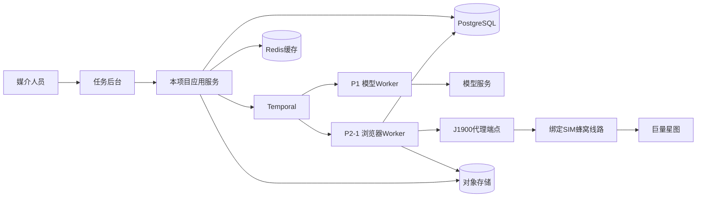
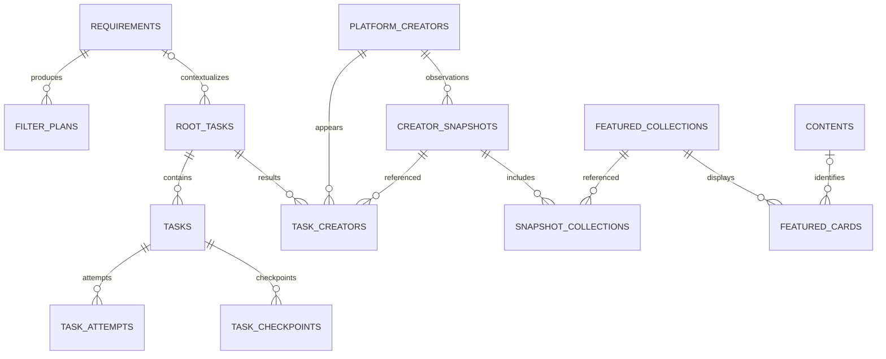

# MCN 达人定向采集系统：V2.0 PRD 与技术实施方案

> 更新日期：2026-09-24  
> 使用对象：产品、开发、测试和运维  
> 首期平台：抖音巨量星图；单家 MCN、单租户、单一媒介角色

## 1. 产品定义与文档约定

### 1.1 目标与一期范围

MCN 的媒介人员根据商单需要填写达人筛选表单，系统将表单转换为平台条件，自动搜索并采集达人资料，按任务保存和展示结果，减少手工找人及整理资料的成本。

主流程：**表单 → 大模型转换及校验 → 任务排队 → 浏览器执行筛选 → 主页资料与精选作品采集 → 持久化 → 按任务查看需求与达人。**

每个采集任务默认 20 位、允许 1—200 位有效达人；已有达人计入结果并重新采集。作品仅来自达人主页的“优秀传播视频”和“优秀种草视频”两个展示模块，不按发布时间筛选，不进入全量作品列表。平台默认榜单的统计周期作为来源口径记录，不成为本项目的时间过滤条件。

一期提供登录、表单提交、采集、任务列表与详情、任务内达人详情、手动刷新、任务恢复、执行单元状态及登录维护。公司内所有媒介共享任务与结果，具有相同产品权限。

一期不提供跨任务达人搜索、导出、导入、评分、定时达人刷新、多角色、商单与联系方式管理。项目独立维护用户、数据及运行资源；不共享其他项目的账号、数据库、浏览器资料或代理资源。后续平台和分析能力只保留接口及数据基础。

### 1.2 阅读结构

| 内容 | 位置 |
|---|---|
| 各功能的目标、输入输出、流程、异常、实现与验收 | 第 2—12 章，F01—F11 |
| 共享架构、管道及平台接口 | 第 13 章 |
| 任务状态、谱系、检查点和恢复 | 第 14 章 |
| 共享数据模型与存储 | 第 15 章 |
| 应用 API | 第 16 章 |
| 安全、部署及运维 | 第 17 章 |
| 系统联调验收 | 第 18 章 |
| 待确认事项及技术空缺 | 第 19 章 |
| 运行配置与错误码 | 附录 A、B |

每个功能模块区分 **PRD**、**技术实现方案**、**验收标准**、**技术空缺**。技术方案中的“待验证”不代表功能可删除；对应项核验通过前不得将该部分标为生产可用。不确定的选择器、接口、硬件协议和供应商配置明确留空，不用推测补齐。

### 1.3 本地开发验证优先（2026-09-27 用户确认）

实施顺序调整：用户已确认设备齐全且有真实星图账号，先以**本电脑 IP + Chrome + 真实账号**组成本地开发验证单元，由用户在唤起的浏览器内人工登录，优先验证检索、候选发现、主页采集与持久化；之后再落地 J1900/OpenWrt/蜂窝模块/SIM 的生产线路。

该阶段明确允许开发单元使用本机网络出口，不要求预先完成第12章蜂窝线路部署。必须使用本项目独立持久 profile，保留账号身份核验、单元并发1、采集/维护互斥、真实平台契约验证和证据脱敏。Chrome实际可执行路径及与Playwright兼容性须实测，不使用日常浏览器profile。

实现须通过显式开发模式区分本机网络与生产绑定线路，不得伪造NetworkProof或关闭平台VERIFIED/live门槛。开发单元不自动转为生产就绪；第12、17、18章的生产线路/DNS/断线隔离、远程维护及恢复要求仍有效。U07/U08不因本机验证通过而关闭；F04/F05的本地真实功能证据与最终生产环境证据分开记录。

本轮仅更新实施依据和任务计划，尚未实现此开发模式或执行登录/真实采集。责任与推进顺序见[UNIT-01](tasks/UNIT-01.md)和[项目进度总览](项目任务进度总览.md)。

### 1.4 自动化优化实施补充（2026-09-28 用户批准）

执行 [AUTO-01](tasks/AUTO-01.md) 与 [DEC-011](decisions/DEC-011-automation-optimization.md)：新任务按独立版本化业务需求清单判断完整主页；采集实现边界必须与平台耗尽分开；区分会话、挑战、权益、额度、网络及契约故障。使用独立 Chrome 正常短信／账号密码登录。登录校验、维护到采集的租约切换和原任务续跑必须在同一浏览器进程／上下文完成；浏览器关闭后**不得假定**平台会话仍然可用，也不得假定其必然失效。本期排除自动收码、官方 API、付费数据服务和全量签名逆向；网页接口仅在逐项实证通过后启用，搜索分页当前只验证并开放到第 2 页。原验收门槛保留，完整实施顺序见[调研报告](research/巨量星图自动化采集技术调研与实施建议.md)。

> **2026-09-29 更正（重要）**：本节原写"实测证明星图业务会话**不能跨 Chrome 重启恢复**"。该结论**证据不足，现予撤回**，改为"**未经证实，不得据以设计**"：
> - 原证据本身（[有界宿主真实运行](evidence/AUTO-01-bounded-host-real-run-2026-09-28.md) 第 3.1 节）已注明**无法区分**"用户新登录"与"既有会话被接受"；后续复核还发现当时的会话探针**只验证元素可见、从未比对账号 ID**，因此"会话失效"可能是测量假象。
> - 反证：用户本人日常 Chrome 首次登录后可 **7-8 天**直接进入后台，说明持久会话在平台侧可行。
> - 但也不能反向断定跨重启一定可用：项目独立 profile 实测在**约 45 分钟内**即失效。两种观测并存，说明**真实存活时长受未识别变量影响**。
> - 因此"会话能否跨重启、能存活多久"作为**独立未验证事项**跟踪（见 [SESSION-01](tasks/SESSION-01.md)）。核验完成前，本方案与各卡片**不得**再以任一方向的结论作为设计前提。
> - 已落地的最小纠正：会话校验通过后单元不再被无条件打回待登录（见 [DEC-012](decisions/DEC-012-session-persistence.md)）。

## 2. F01：用户登录与会话

### 2.1 PRD

**目标与入口**：媒介通过独立账号进入共享任务后台；未登录访问业务页面时进入登录页。

**输入输出**：输入账号和密码，成功进入任务列表；失败提示凭据错误或服务暂不可用，不泄露账号是否存在。支持退出登录。

**流程与规则**：所有媒介可查看和操作全部任务及登录维护功能。初始用户由部署流程创建，不做自助注册和用户管理页面。退出或会话过期不会取消后台任务，重新登录后仍可查看。多位用户操作同一任务时按服务端状态控制，记录操作人。

**异常**：登录失败次数过多时限流；业务会话过期要求重新登录，不重复提交已创建任务。密码重置、用户禁用走运维流程。

### 2.2 技术实现方案

使用本项目 `users`、`sessions`，密码采用成熟的抗暴力破解哈希方案；会话可过期和撤销，业务 API 统一校验。浏览器使用安全 Cookie 并保护跨站写请求。平台登录资料与产品登录会话独立，不能把平台 Cookie 发给前端。

接口：`POST /api/auth/login`、`POST /api/auth/logout`、`GET /api/auth/me`。错误返回统一结构；不把真实密码写入日志或模型输入。

### 2.3 验收标准

合法用户可登录、退出并查询共享任务；无会话无法访问数据和封面。退出后后台任务继续，重新登录可恢复查看；两位媒介具有相同权限且操作人可区分。

### 2.4 技术空缺

会话组件、有效期、域名及 Cookie 部署配置待确定（U01）。生产启用前需完成会话撤销、跨站请求和登录限流测试。

## 3. F02：筛选表单与任务提交

### 3.1 PRD

**目标与入口**：从任务列表创建定向采集任务，用明确表单表达达人条件。

| 输入 | 规则 |
|---|---|
| 关键词 | 可选；明确使用内容关键词搜索，不自动改为昵称搜索 |
| 达人类型 | 选择已验证的平台赛道或类型；选项由能力清单提供 |
| 粉丝量 | 非负范围，最小值不得大于最大值，单位明确 |
| 达人性别 | 达人本人性别，不能混同粉丝性别 |
| 地域 | 达人所在地，不能混同受众地域 |
| 报价 | 合作形式、币种及金额范围必须对应，不能混用报价口径 |
| 平台排序 | 选择已验证排序；未选则用平台默认排序 |
| 目标数量 | 整数，默认 20，范围 1—200 |

至少填写一项业务筛选条件；仅有排序和数量不能发起全站搜索。未核验的平台选项不启用。用户不填写作品时间范围、作品条数或榜单排名条件。

**流程与输出**：前端检查格式 → 提交 → 后端持久化 → 返回根任务 ID → 进入任务详情。模型转换在后台进行。通过校验直接执行，无额外确认页。

**异常**：格式错误定位到字段；网络响应丢失允许安全重试；已接收任务不能因前端超时再次创建。条件无法映射时在任务中展示原因，可带回原值修改，修改后创建新任务，旧需求不可覆盖。

### 3.2 技术实现方案

表单选项来自 `GET /api/platforms/douyin_xingtu/capabilities`。`POST /api/tasks` 接收版本化 `RequirementForm`、目标数、排序及 `Idempotency-Key`，以事务保存原始表单、根任务及工作流启动意图，成功返回 202 和 `root_task_id`。

原始输入与后续归一化计划分开保存；服务端重复进行格式验证。数量是系统停止条件，不作为星图筛选参数。保留提交时间用于追溯，不据此构造作品时间窗口。

### 3.3 验收标准

默认 20 和上限 200 可提交，0、201、非整数及冲突区间不能提交。同一幂等请求重复发送返回相同任务；同键不同内容返回冲突。修改条件提交新任务，旧任务需求保持不变。

### 3.4 技术空缺

首批字段的真实枚举、层级、单多选、报价形式和排序组合待实机核验（U02）；前端框架和组件方案待选定（U01）。不得从截图的未展开菜单臆造字段选项。

## 4. F03：需求转换与平台条件校验（P1）

### 4.1 PRD

**目标**：把所有接受提交的表单准确转换为可执行的星图筛选 JSON，保留原需求和实际条件供媒介核对。

**输入输出**：输入原始表单及平台能力字典；输出通过校验的执行条件，或具体字段错误。明确的数量、范围、类型和用户意图不得被模型调整。

**流程**：模型结构化转换 → 确定性校验 → 保存计划 → 自动排队。无法精确执行的条件要求修改；不能自动忽略、近似替换、扩大召回或留到评分处理。

**异常**：模型请求有限重试；仍不可用时任务失败，可重试转换，不以空条件搜索。平台能力更新导致条件失效时提示重新提交，不静默改用新条件。

### 4.2 技术实现方案

采用版本化 `FilterPlan v1`，记录 `platform`、`capability_version`、`target_count`、`filters`、`sort`、映射来源和校验错误。每个已填筛选字段必须有对应且语义一致的执行条件，校验 Schema、枚举、单位、范围、组合及字段覆盖。

模型只输出声明式数据，不输出页面选择器、Cookie 或工具代码。Adapter 将已注册字段转换为已验证的平台参数。模型调用记录版本、输入输出引用、用量、耗时和错误，不保存隐式推理或凭据。

```json
{
  "schema_version": "filter_plan.v1",
  "platform": "douyin_xingtu",
  "capability_version": "verified-version-id",
  "target_count": 20,
  "filters": [
    {"field": "followers", "operator": "range", "value": {"min": 200000, "max": 500000}, "source_fields": ["followers_min", "followers_max"]}
  ],
  "sort": {"key": "platform_default"},
  "validation_errors": []
}
```

该示例是内部领域契约，不代表星图的真实接口参数。模型超时和修复预算见附录 A；备用模型必须通过相同契约回归后才可使用。

### 4.3 验收标准

所有提交表单有模型处理记录。丢字段、加条件、范围改变、无效枚举和不支持条件均被阻止。合法计划可追溯至原始字段；校验失败不获取浏览器执行资源。

### 4.4 技术空缺

模型供应商、结构化输出 API、Prompt 实际模板和经验证能力映射表待完成（U02、U03）。技术接口可先定义，未完成映射的字段不能进入真实采集。

## 5. F04：平台筛选、搜索与候选发现（P2-1）

### 5.1 PRD

**目标与前置条件**：在条件校验通过且有可用执行单元时，按平台排序寻找目标数量的有效达人。

**流程**：验证账号与线路 → 打开“找达人” → 填写筛选和排序 → 回读已选条件 → 发现候选 → 逐位采集。以目标数量、搜索耗尽或保护预算暂停为边界。

**结果规则**：平台 ID 在任务内唯一；已有达人仍计入且重新采集。候选必须完成最低基础资料采集并落库才计为有效。无效候选记录原因并继续后续候选，返回数量不得超过目标。

**异常**：不足或零结果显示实际数量和原因；重复结果不重复计数。页面条件与计划不一致立即停止。登录失效等待人工；限流按预算退避。扫描预算用尽标为暂停，不谎报“没有更多达人”。

### 5.2 技术实现方案

通过执行单元租约调用版本化 Playwright Adapter。`search` 返回达人 ID、主页、首次发现位置、搜索检查点及已耗尽证据。保存实际已选条件与必要页面证据；不以点击成功等同筛选成功。

搜索结果按平台顺序处理，任务关联保留首次发现位置。根任务下登记搜索及后续采集步骤，共享任务谱系；只有达人的基础资料事务提交后更新有效数量。重复游标或持续无进展视为页面契约异常。

#### 5.2.1 条件执行与结果关联

1. 取得执行单元租约，校验绑定线路、登录身份及能力版本，进入经验证的搜索入口。清理上次操作残留的关键词、筛选和排序；按能力字典执行本次条件，未填项恢复平台默认状态。
2. 按已验证的搜索模式执行内容关键词；不能自动切换为昵称搜索。达人性别、所在地与粉丝画像中的性别、地域使用不同映射；报价必须关联合作形式和币种。
3. 操作前建立响应观察范围，分配内部 `operation_id`，保存操作序号、条件摘要和预期分页位置，再触发页面操作。`operation_id` 仅在本项目内关联，不擅自添加到平台请求。
4. 等待控件状态和业务结果就绪，回读关键词模式、筛选和排序。回读必须与 FilterPlan 一致；中间条件产生的自动搜索响应不作为最终候选。
5. 依据已核验的方法、主机/路径、请求参数、分页标识及响应结构选择结果，检查 HTTP 状态、业务状态及页面会话。不能只匹配 URL 中的 `list`，不能把 HTTP 200 的登录 HTML、错误 JSON 或权限提示解析为空结果。

响应与操作关联采用操作前注册的请求事件、页面引用、请求对象、条件/分页摘要及响应身份共同判断，不依靠时间先后这一项证据。对相同参数的重复请求保留本次触发请求的关联；无法确定归属时读取失败，不使用最近一次响应猜测。响应监听在操作结束后释放，避免旧回调污染下一页或下一位达人。具体观察器规则见 13.4。

#### 5.2.2 增量发现、顺序与停止

搜索契约只启用实测确认的分页方式：页码、游标、“加载更多”或列表容器滚动。每次结果就绪立即提取当批候选，规范化平台身份与真实主页链接，按平台顺序保存；虚拟列表必须在节点被复用或移出 DOM 前提取，不能滚到底后统一遍历。节点缺少已验证身份时不得按昵称去重或拼接主页。

每批候选、首次发现序号、待处理队列和下一搜索检查点在同一事务提交，再进入详情采集。队列属于本项目已发现候选，不意味着这些达人已计入有效人数。同一候选跨页出现只保留首次位置；无效身份留诊断记录，不增加有效数。唯一身份候选按原扫描预算计量，无身份且持续无进展由契约异常和主动时间预算限制，不能无限循环。

搜索页与详情页位于同一独占 BrowserContext，详情使用独立页面，串行打开、采集和关闭；不在采集详情时主动推进搜索页。两个页面不代表两路并发采集，仍遵守单元并发 1。搜索页若后台自动刷新，其响应不写入候选队列，恢复搜索时重新校验页面条件。

每完成一位达人基础资料事务后检查有效数量，达到目标即停止启动后续达人采集；已达目标达人尚未完成的可选模块及两个作品集合仍按任务规则处理。目标数、已发现数、扫描数、有效数和完整数分别记录。

| 现象 | 判定与行为 |
|---|---|
| 经验证的 `has_more=false`、末页控件或其他终点信号 | 与当前条件和页关联后记录耗尽证据；平台实际字段名待核验 |
| 明确零结果页面或经契约确认的首批空结果 | 记录成功搜索和空结果证据，不把网络失败当零结果 |
| 滚动高度不变、当批无新 ID | 先核查加载状态、容器和终点；单独出现不算耗尽 |
| 游标循环、持续无进展、结构不符 | `PLATFORM_PAGE_CHANGED`，停止受影响执行并保留检查点 |
| 扫描或主动采集预算用尽 | `PAUSED_BUDGET`，保留待处理队列，不报告平台已耗尽 |

#### 5.2.3 搜索恢复

恢复首先重建并回读原条件，核对能力/Adapter 版本和条件摘要，优先处理已持久候选队列。经验证仍有效的游标可继续使用；游标已失效时在原条件下从起点重新扫描，用持久化已见身份去重，不重新分配已有候选的首次位置。重新扫描消耗本段主动时间与扫描预算；本段同一身份不重复增加扫描数。新候选按本次实际发现顺序追加，记录搜索代次和重扫原因，不承诺动态排序冻结或精确复现原页面序列。无法精确重建条件时停止，不更改条件继续。

### 5.3 验收标准

有序采集、跨页去重、重复达人更新、候选无效补位、20/200 位停止和不足结果均正确。条件填写失败不产生误筛结果；搜索分页与精选作品展示采集是独立机制。

### 5.4 技术空缺

搜索页真实定位、翻页方式、条件回读方式及访问节奏待验证（U02、U04）。DOM 读取或授权会话响应的具体采集路径留空，不预设未经验证的接口。

开发前按 13.5 交付各筛选的重置/填写/回读样本、搜索模式证据、分页与虚拟列表样本、终点证据及条件改变后的请求对照。上述执行机制已明确，真实路径仍属于待核验配置。

## 6. F05：达人主页资料采集

### 6.1 PRD

**目标**：尽量完整保存当前账号可访问的达人主页业务资料，供媒介在任务内查阅。

**输入输出**：输入有效候选的星图身份和主页；输出该次采集快照、模块和字段状态、数据来源及采集时间。

| 资料模块 | 应覆盖内容 |
|---|---|
| 基础资料 | 星图 ID、昵称、头像链接、介绍、mcn公司、性别、地区、达人类型、内容主题和行业标签等可见字段 |
| 商业与报价 | 合作形式及报价、商业能力和合作汇总等可见指标 |
| 传播与互动汇总 | 页面展示的传播、互动、连接用户等指标及其统计口径 |
| 粉丝画像 | 总量及页面实际展示的性别、年龄、地域等分布 |
| 其他主页模块 | 创作、履约等实际存在且账号可访问的业务信息 |
| 精选作品 | 仅按 F06 采集两个指定模块，不扩大作品范围 |

**流程与规则**：按已核验字段字典访问主页及必要标签页、展开默认内容，保存页面当前默认指标口径；一期不遍历所有统计周期或修改日期选项。不同区块的周期各自记录，不共用一个“作品时间范围”。

**异常**：页面未提供、无权限、明确无数据、采集失败和未执行必须区分；读取失败不能当成空数据。基础资料有效但可选模块失败时保留达人并标明不完整。当前档案保留历史有效值时必须显示其原采集时间，不能当成本次新数据。

### 6.2 技术实现方案

由 `collect_profile` 逐模块返回字段值、原始展示值、单位、周期标签、观测时间、来源及状态。字段使用 `COLLECTED`、`NOT_PROVIDED`、`NO_PERMISSION`、`NO_DATA`、`FAILED`、`NOT_ATTEMPTED`；模块汇总覆盖和失败情况，不计算达人质量分。

`platform + platform_creator_id` 唯一定位达人，昵称不作合并依据。当前字段投影与采集快照分离；失败和无权限的新观测不清空历史有效值。每个模块提交检查点，页面未找到元素时先判断页面契约，不直接写为“平台未提供”。

#### 6.2.1 主页身份与最低有效资料

先验证候选主页位于已核验平台主机及页面范围，再打开详情页；重定向后的页面也需重新验证。以真实响应或页面中的身份字段核对候选星图 ID，不能只凭昵称、头像或 URL 外观认为是同一达人。内部 `creator_id`、星图 `platform_creator_id`、可取得的抖音 UID/其他平台 ID 分开存储；只有已验证映射才保存关联，不从相似名称推断身份。

基础有效门槛为：已核验星图身份、可访问且身份匹配的主页、成功读取的昵称。昵称不用于去重；其他资料的缺失不增加有效性门槛。基础资料、草稿引用、任务关联及有效数量在同一事务幂等提交，后续可选模块失败仍保留这位有效达人。

账号登录或网络故障先按任务级异常处理，不将候选判无效；在授权会话正常且契约成立时确认达人注销、主页不存在或身份错配，记录 `CREATOR_INVALID` 并补位。单达人身份字段读取失败先重新验证 Session，再用新 Page/新观察器最多追加两次重试；仍不可读则记录该候选 `failed/IDENTITY_UNREADABLE` 并继续补位，不伪装成真实无效达人，也不凭单样本禁用整个 Contract。不同达人连续复现时按 `profile_identity` scope 推进 `SUSPECTED`，只有新浏览器租约内的独立样本再次确认才 `DISABLED`。无法达到基础门槛的候选不计有效人数，并保留失败步骤及原因。

#### 6.2.2 模块注册表与执行顺序

`ProfileModuleSpec` 由开发维护并版本化，至少包含模块标识、顺序、基础/可选标记、入口页面、标签页及展开动作、就绪条件、请求契约集合、DOM 契约、字段字典、模块缺失/权限/空态证据、超时和检查点版本。未验证的路径填 `null` 并标记 `UNVERIFIED`（配置验证状态，不是业务字段状态），不得当作可执行配置发布。

执行顺序为基础资料 → 商业与报价 → 传播与互动汇总 → 粉丝画像 → 其他已注册主页业务模块；具体标签页可以复用，字段仍按所属模块保存。精选作品交由 F06 单独处理，避免同一作品被两个采集器重复写入。页面新增未知模块记录契约覆盖缺口，进入字段调研，不由模型自由探索和采集。

逐模块执行：确认身份/租约 → 注册本次响应观察 → 进入标签页并展开经核验内容 → 等待业务就绪 → 读取响应及必要 DOM → 解析校验 → 写入模块观测和检查点。维持平台默认日期和统计口径，不遍历周期；恢复时重进模块后读取当前默认口径，不能沿用其他模块标签。

就绪条件使用稳定的角色/标签/属性定位、加载提示消失和预期业务响应组合，定位限定当前模块；iframe 使用经核验的 frame 定位。固定 sleep 仅用于访问节奏，不能代替就绪判断；页面持续轮询时不以全页 `networkidle` 作为唯一完成条件。响应正文读取完成后才解析，不把响应头到达当作完整数据。

一个模块由多个请求组成时，在注册表声明必需和可选响应及各自负责的字段。关联必须满足本次页面、达人、模块及默认周期语义；请求/响应未携带周期时，需要已验证的页面默认条件映射。相邻区块、预加载其他达人或旧操作的响应丢弃。必需响应超时则对应字段失败，已成功字段保留；不得以“收到一个接口”标记整模块完整。

#### 6.2.3 字段字典与标准化

下表是内部字典模板，不是已核验的平台字段列表；6.1 中要求的各项资料均需在调研覆盖清单登记为已验证来源或待核验缺口。

| 字典项 | 必填内容及约束 |
|---|---|
| 标识与归属 | `field_key`、`module_key`、页面真实名称；平台别名显式映射 |
| 值定义 | 类型、数量/金额/比例单位、币种、合作形式或画像维度；不明单位不推测 |
| 来源契约 | 主来源 `response` 或 `dom`、请求契约和 JSON 路径/定位器、备用来源与触发条件；未知路径为 null |
| 时间口径 | 周期标签来源、原文、观测时间；未展示周期留空并说明来源，不能补写“近30天” |
| 状态判定 | 各字段状态所需的页面/响应证据、空值与合法零值、是否允许截断 |
| 转换规则 | 单位换算、精度、范围/下界处理、格式校验和来源一致性规则 |
| 验证信息 | 契约版本、脱敏正反样本、证据引用、验证日期和账号权限类型 |

数量使用整数或 Decimal 解析；`1.2万` 保存原文、换算值 12000 和近似标记，不声称精确到个位。`1万+` 保存下界语义，`—`、空字符串和占位符不能变为 0。百分数如 `5.2%` 可标准化为比例 0.052，同时保留 `%` 原文和原精度；未经契约确认不能把无单位的 `5.2` 自动除以 100。

报价使用 Decimal，保存单值或上下限、币种及合作形式；“面议”、不可见与零元分别处理，不把不同视频时长或合作方式的金额合成一项。粉丝画像按性别、年龄、地域等真实维度分别保存原分组与比例，不强行凑足 100%、补造未知地区或在维度间混算。标签、MCN、地区等只做字典明确允许的归一化，原文保留。

各字段实际采用的来源随观测保存。主来源缺失或超时，仅在注册表允许、页面身份及模块契约仍成立时读取备用来源；会话、权限或安全挑战不触发回退。备用来源成功时字段可为 `COLLECTED`，但保留回退原因。两来源同时存在时按已验证的显示精度和单位规则对照，不直接比较格式化字符串；无法解释的数值/语义冲突记为 `FAILED`，`failure_reason=SOURCE_CONFLICT`，保留两侧必要证据，不选择一个值覆盖。

#### 6.2.4 字段状态、模块覆盖与恢复

| 字段状态 | 必要依据 |
|---|---|
| COLLECTED | 已解析并校验，真实 0 值属于此类 |
| NOT_PROVIDED | 已验证页面变体或响应契约明确不提供；元素未找到本身不足以判定 |
| NO_PERMISSION | 明确的权限提示或已核验业务状态；不尝试其他来源取得受限值 |
| NO_DATA | 字段/模块明确空态，或契约明确定义该空值为无数据 |
| FAILED | 超时、解析失败、冲突或其他读取失败，附原因与证据 |
| NOT_ATTEMPTED | 尚未执行或因取消/预算/上游异常未执行，附原因 |

模块状态复用既有状态分类：有成功值时可为 `COLLECTED`，但必须同时返回覆盖汇总和 `complete`，不能仅凭该状态视为完整。全部应检查字段已有明确结果且没有 `FAILED`/`NOT_ATTEMPTED` 才为完整；整体空态、无权限或不提供在证据成立时可完成检查。模块整体状态不能隐藏部分字段失败，未知覆盖缺口不得算完成。

恢复复用已经提交且无失败的模块观测，重采受影响的不完整模块并生成新 `module_observation_id`，不覆盖原观测。一次模块重采不把新旧字段合成虚假的同一观测；成功旧模块可以与新模块一起组成快照，但分别展示观测时间及口径。恢复遇到能力变化时沿用兼容契约，无法兼容则停止并记录版本问题。发布和当前投影仍遵从第 14—15 章，字段失败不清空历史有效值。

#### 6.2.5 内部流程伪代码

以下仅说明职责与事务边界；函数中的契约均由已验证配置注入，不是可直接运行的平台爬虫。实际网络和数据库操作位于 Temporal Activity，不放在 Workflow 重放代码中。

```python
async def collect_profile(creator_ref, checkpoint, ctx, registry):
    await ctx.ensure_session_and_line()
    page = await ctx.open_detail_page(creator_ref.verified_homepage)
    try:
        await registry.identity.verify(page, creator_ref)
        for spec in registry.profile_modules_in_order():
            await ctx.check_lease_cancel_and_budget()
            if checkpoint.has_complete_observation(spec.key):
                continue
            observation = await collect_module(page, creator_ref, spec, ctx)
            # 事务同时写草稿观测与检查点；基础门槛满足时幂等更新有效数。
            # 仓储再次核验 attempt、租约代次和任务状态，拒绝迟到写入。
            await ctx.repository.persist_module_and_checkpoint(observation)
        return await ctx.repository.profile_draft_ref(creator_ref)
    finally:
        await page.close()

async def collect_module(page, creator_ref, spec, ctx):
    # observe_before_action 先建立请求关联，再执行动作，退出时移除监听。
    async with ctx.observe_before_action(page, creator_ref, spec) as capture:
        await spec.enter_and_expand(page)
        await spec.wait_business_ready(page)
        sources = await capture.read_declared_sources()
        ctx.raise_global_errors(sources)  # 登录、线路、限流、挑战、契约异常
        fields = await spec.parse_and_validate_with_allowed_dom_fallback(
            page, sources
        )
        return spec.build_observation(fields, capture.evidence_refs)
```

字段级失败由解析器转换为状态后继续本模块；可选模块级读取失败由 Activity 边界保存失败观测后继续下一模块。登录、资源、租约、取消和预算等全局异常向任务中心传播，不吞掉后继续访问。临时故障重试沿用附录 A，不在解析器、HTTP 客户端和 Activity 三层叠加重试；局部故障用 `MODULE_COLLECTION_FAILED`，全局页面契约失效用 `PLATFORM_PAGE_CHANGED`。

### 6.3 验收标准

按真实字段字典逐项对照页面；字段值、单位、周期、来源与缺失原因可核验。不同模块周期不混用；旧值不会被失败或迟到结果覆盖。只通过本任务快照访问该次采集资料。

### 6.4 技术空缺

各标签页完整字段字典、展开方式、指标真实来源及日期默认值待核验（U04）。字段未确认前用缺口记录，不编造字段或成功样本。

U04 的输出须包含身份映射、基础门槛实测、逐模块注册表、字段读取路径及状态证据、默认周期、来源冲突样本和模块恢复用例。本文已确定内部工程机制，不代表平台字段契约已经验证。

## 7. F06：主页精选作品采集与封面存储

### 7.1 PRD

**目标**：保存达人主页默认推荐展示的作品，为媒介提供与平台主页一致的精选内容参考。

**入口与范围**：在达人主页的相应标签页读取以下两个模块；提供的页面样本位于“商业能力”。

| 模块名称 | 内部分组标识 | 采集范围 |
|---|---|---|
| 优秀传播视频 | excellent_reach | 该模块默认提供的完整卡片集合及展示顺序 |
| 优秀种草视频 | excellent_seeding | 该模块默认提供的完整卡片集合及展示顺序 |

两个模块的默认选样口径为平台近30天的前若干作品，实际页面标签待核验。本项目只接受平台默认集合，不按作品发布时间二次筛选、不自行计算 Top X、不改变平台时间条件、不进入历史或全量作品列表。X 不写死，截图中的四张卡片不等于所有达人固定四条。即使发布时间较早或不可取得，仍采集默认展示的卡片。

允许滚动页面、在模块内部横向滑动或触发该模块内部加载，以取得默认集合的全部卡片。“查看更多”只有在确认仍加载同一默认精选集合时才执行；若跳转全量作品列表、切换榜单口径或行为未核验，则不点击。不为补齐数量而搜索或采集模块外作品。

**字段要求**：

| 字段 | 产品规则 |
|---|---|
| 分组与展示位置 | 两个分组分别保存；位置是页面顺序，不宣称算法排名或自行排序 |
| 标题 | 保存平台可取得的真实标题；若只能取得截断文本，保存原文并标记截断 |
| 副标题 | 仅在平台存在独立对应字段时保存；截图不能证明存在，不从封面文字或标题推断 |
| 封面 | 保存图片文件及原始链接，不下载视频 |
| 作品链接 | 保存实际可解析的作品链接；无法取得则标记缺失，不拼接猜测地址 |
| 互动及传播指标 | 保存该卡片展示的指标；样本可见播放量、点赞量、评论量，不据此假设必有分享或收藏 |
| 来源与观测 | 保存达人、页面、所属模块、观测时间、原始展示值及可取得的模块统计标签 |
| 技术辅助字段 | 平台作品 ID 可取得时保存；发布时间可选，仅记录，不参与筛选或完整性判断 |

**同作品跨模块规则**：两个模块出现同一作品时，底层身份可复用，但两个分组关联、展示顺序及各自指标观测都保留；不能只保留第一次出现的位置或把数值相加。同分组重复加载的同一卡片去重。

**异常与完成标准**：两个模块分别判断完成。模块明确为空、无权限或未提供应显示原因；加载失败不能当作空。模块卡片尚未加载完整、标题截断、链接或封面取得失败等要给出字段/覆盖状态，不伪装成完整。两个模块的已验证默认集合均处理完毕且可采集字段无失败，才可标为完整；不可取得的字段保留明确原因。

模块及卡片字段沿用 F05 的状态分类，另保存集合覆盖状态。明确无数据、无权限或平台未提供属于已完成检查且有原因，不等于“采集到作品”；读取失败或尚未执行则保留不完整。任务完成度同时汇总主页资料及两组作品状态，不能仅因达人数量达到目标就标为完整。

### 7.2 技术实现方案

Adapter 提供 `collect_featured_collections(creator_ref, checkpoint)`，分别返回 `excellent_reach` 和 `excellent_seeding` 的集合观测：模块名称、当前页面 URL、模块默认口径原文、观测时间、加载状态、卡片集合及覆盖证据。不得提供 `content_window_days`、发布时间过滤或全量作品分页参数。

每张卡片保存 `collection_observation_id`、稳定的本地 `card_id`、`position`、可空的 `platform_content_id`、真实链接、标题、副标题、封面及各指标观测。平台 ID 优先识别作品，其次使用可验证的规范链接；两者均不可取得时保留局部卡片记录和身份缺失状态，不按标题或封面相似度跨模块合并。

两个模块的卡片指向可复用的作品身份，但各自保存文本和指标快照。模块口径仅保存读取到的原文；“近30天”来自需求描述，不应在页面未提供时伪装为已观测标签。不得读取相邻区块的“近90天”作为本模块口径。

首次读取后持久化卡片集合与模块观测 ID，按卡片和封面保存检查点。若页面提供稳定集合标识，则按经验证契约补采；如果恢复后集合发生变化且无法确认一致，保留旧观测并重新采集整个受影响模块，形成新观测，不把两次默认列表拼成一份虚假的同一时点结果。不存在稳定标识时不得承诺严格跨重试的页面冻结。

封面通过受控下载器和必要的授权会话写入对象存储，保存校验和、类型、大小及状态；需要认证时沿用对应单元和线路。对象成功写入后才引用，失败可补采。限制主机、重定向、类型与大小，禁止任意地址访问；普通用户通过认证入口获取图片。

F06 复用 13.4 的操作/响应关联器及 F05 字段解析器，但集合边界由独立的 `FeaturedCollectionSpec` 控制：必须验证卡片属于当前达人、当前默认模块和本次观测。接口即使包含更多作品、其他榜单或模块外字段，也不扩大采集范围。每次横滑或增量加载后立即保存卡片，处理虚拟节点复用；响应总数只有被证实代表当前默认集合时才能用于覆盖判断。身份不明的重复卡片只用经验证的模块局部键/位置关系识别，不按标题去重；无法证明完整覆盖则使用 `FEATURED_COLLECTION_INCOMPLETE`。

保留必要图片和 CSS 加载，不默认采用参考文章中的禁用图片/CSS 优化。模块内加载终点、链接和封面来源随 U05 核验，接口观察能力不代表全量作品采集权限。

### 7.3 验收标准

- 两个模块默认展示几条就采集几条，完成已验证的模块内加载；不固定四条，不进入全量作品列表。
- 默认卡片即使没有发布时间或时间较早也保留；不存在发布时间筛选参数和作品时间窗口。
- 同作品跨模块同时显示，各自顺序和指标观测可追溯，同模块重复加载不重复增加卡片。
- 区块为空、缺失、无权限和失败可区分；一个模块失败不丢掉另一个的成功数据。
- 标题截断、缺副标题、缺链接和封面失败如实标记；不生成文本、不做封面 OCR 补写、不下载视频。
- 恢复时默认集合发生变化，不混合伪造同一观测；历史任务仍可查看原快照。

### 7.4 页面样本与技术空缺

以下截图是字段和模块的参考证据，不代表当前所有账号均有相同卡片数量、权限和结构：

- [优秀传播视频页面样本](assets/xingtu-featured-reach.png)
- [优秀种草视频页面样本](assets/xingtu-featured-seeding.png)

实际定位器、是否存在横滑或模块内加载、完整集合终止标志、稳定集合标识、作品 ID/链接取得方式、完整标题及副标题字段均待验证（U05）。截图只能确认模块名称、可见卡片、标题及三类指标；不填入未经验证的网络接口或 DOM 路径。

## 8. F07：任务列表、进度与任务操作

### 8.1 PRD

**目标与入口**：登录后的任务列表统一展示所有媒介的采集与刷新任务，可进入任务详情继续工作。

**列表信息**：任务 ID、类型、创建人、提交时间、状态、目标达人数量、有效落库数和完整采集数；按创建时间倒序，支持按状态和时间筛选。没有任务时提供创建入口，查询失败显示重试，不显示为空列表。

**详情信息**：原始表单、执行条件、各阶段进度、数量、等待/失败原因、来源关联和任务结果入口。刷新任务显示指定达人及来源任务，不伪装成新搜索。分别展示发现数、有效落库数、完整数及失败数，不把发现数当采集成功数。

| 操作 | 可用条件 | 行为 |
|---|---|---|
| 取消 | 尚未终止且未完成取消 | 请求安全停止，保留已持久结果 |
| 重试 | FAILED；或 PARTIAL_COMPLETED 且有失败步骤 | 同一业务任务补做失败步骤，新增尝试记录 |
| 继续 | PAUSED_BUDGET | 追加本段预算，继续原需求及检查点 |
| 修改重提 | FAILED_VALIDATION | 带回原表单，创建新任务，不覆盖旧需求 |
| 登录处理 | WAITING_FOR_LOGIN | 进入对应单元维护，验证成功自动恢复 |

已取消或已完成任务不提供“继续”。只有平台结果不足且无失败步骤的任务不做无意义补采；需要重新搜索时创建新任务。

**异常**：关闭页面或退出登录不影响任务。多人同时操作时以服务端状态为准，失败操作说明原因并刷新状态。等待和暂停不是完成；处理中的取消显示“取消中”，不能提前承诺已停止。

### 8.2 技术实现方案

查询 PostgreSQL 中的根任务投影，Redis 可缓存但不可决定任务是否存在。API 返回 `status`、`stage`、计数、异常、状态版本及 `allowed_actions`，前端与服务端均依据状态显示/校验操作。

取消、重试和继续使用幂等写请求与预期版本校验；Temporal 接收对应指令，结果通过数据库投影回显。自动轮询 5 秒，长等待退避至 15 秒，终态停止；重新打开从 API 恢复，不依赖本地进度。

### 8.3 验收标准

相同任务在两个用户端状态一致；非法操作返回明确冲突，重复点击不会重复执行。缓存清空后任务可见，页面关闭后任务正常完成。部分完成、失败、人工等待和预算暂停可区分且操作正确。

### 8.4 技术空缺

前端组件及呈现方式待选定（U01）；任务状态、允许操作和后端持久化责任已定义，不以界面方案未定为由使用内存任务状态。

## 9. F08：任务内达人结果与资料查看

### 9.1 PRD

**目标**：在一次检索诉求下查看搜到的达人及本次资料，支持媒介做人工判断。

**入口与结果列表**：从任务详情进入，按平台发现顺序展示达人昵称、主页链接、关键基础字段、采集时间和完整度。分页查看；任务执行中可查看已持久部分，明确标记“采集中/不完整”。没有独立的跨任务达人搜索入口。

**达人详情**：展示 F05 的模块资料及字段状态；F06 的作品按“优秀传播视频”和“优秀种草视频”分别展示，保留模块内顺序。同作品可出现在两组中，不合并为无分组列表。显示封面、标题、真实副标题、卡片指标及可用的作品链接；缺失或截断要可识别。

**历史与异常**：查看的是该任务关联的快照，不是全库最新值。图片暂不可用使用缺失提示，不能隐藏作品。真实链接可打开原平台；没有链接不能创建不可用按钮或伪造地址。不显示匹配评分或推荐分。

### 9.2 技术实现方案

通过任务关联解析 `creator_snapshot_id`，再读取资料与两个集合观测；禁止直接读取当前达人表代替历史详情。运行草稿与发布快照明确分开，API 返回所查看的快照 ID、草稿/发布状态和观测时间。

`GET .../creators`、`GET .../creators/{creator_id}`、`GET .../creators/{creator_id}/contents` 均限定任务范围。作品接口返回每组独立状态、口径、观测 ID 和有序卡片；若分页，游标绑定快照和分组，不能把两个组混排。封面返回短时授权访问地址。

### 9.3 验收标准

能从原始诉求逐级进入本任务的达人和两个作品分组；同达人在不同任务的旧快照不被覆盖。部分字段或封面失败不阻断其他结果查看，且不会把历史值标为本次新采集。

### 9.4 技术空缺

资料具体字段依赖 U04，精选卡片来源依赖 U05。详情应依据字段覆盖清单呈现，不预先承诺平台没有提供的数据。

## 10. F09：手动刷新达人

### 10.1 PRD

**目标与入口**：从某个任务内达人详情重新获取该达人的当前主页资料和两个默认精选作品模块。

**输入输出**：输入来源任务和达人身份；创建目标为 1 位达人的刷新任务，返回新根任务 ID。原任务保留原快照，新结果通过刷新任务查看。

**规则**：刷新不重新搜索，不重新解释原条件，不改变原搜索任务的人数和顺序。两组作品按刷新时平台默认集合采集，不存在刷新时间窗口参数。日后再次刷新仍创建新任务。

**异常**：重复提交用同一幂等键返回同一任务。主页失效、账号失效或模块失败沿用采集错误处理，原任务仍可查看；刷新未成功不能清空已有有效资料。

### 10.2 技术实现方案

刷新接口校验该达人属于来源任务，事务创建类型为 `REFRESH_CREATOR` 的根任务，保存 `origin_root_task_id`、来源快照及目标身份，直接进入 P2-1 指定达人采集路径。没有新表单，因此不触发 P1。

快照版本与当前投影遵从共享一致性规则。刷新生成新的集合观测及卡片观测，不把新旧默认作品集合合并成历史全量作品列表。

### 10.3 验收标准

刷新只针对指定达人，不发生搜索或模型转换；产生新任务、资料和作品观测。来源任务的需求、排序、快照及原分组保持不变；失败不破坏历史结果。

### 10.4 技术空缺

无新增独立技术选型；依赖 F05/F06 的平台采集路径核验（U04、U05）。

## 11. F10：执行单元状态与平台登录维护

### 11.1 PRD

**目标与入口**：媒介可查看采集资源是否可用，并在任务需要登录时处理平台扫码或验证，随后自动继续。

**可见信息**：单元 ID、平台、脱敏账号/线路、状态、占用任务、最近健康检查及可行动原因；不展示代理密码、Cookie 或可下载的浏览器资料。

**流程**：选择可维护单元 → 取得独占维护权限 → Worker 内的每单元有界 BrowserHost 打开限时 Chrome → 人工登录/验证 → 同一 BrowserContext 检查账号、受保护业务页与线路 → PostgreSQL 带 fencing 的单事务 `maintenance → collect` → 自动恢复原等待任务。交接时只关闭产品维护入口，**不关闭 Chrome 或 BrowserContext**；采集结束或有界超时才执行关闭确认。运行单元需到安全边界释放后才能维护，不能强行与采集同时操作。

**异常**：另一用户维护中显示占用；维护过期可重新打开，不取消业务任务。账号与绑定身份不一致则拒绝就绪。无网络时说明线路异常，不能反复要求用户登录解决网络问题。

### 11.2 技术实现方案

单元与维护会话使用独占租约；短时维护凭证绑定产品会话、单元和有效期。平台登录 profile 与采集由同一 BrowserHost 持有同一受控 Chrome/BrowserContext，对象不跨进程传递，不暴露 CDP 地址；界面仅暴露必要浏览器内容。

提供单元列表、创建维护会话和验证接口；验证真实账号、绑定线路及页面可用性，成功后通过幂等指令通知等待工作流。租约心跳、旧浏览器隔离与节点迁移采用第 14 章及 F11 规则。

使用 Playwright `launch_persistent_context` 为每个执行单元创建本项目独立 `user_data_dir`，不使用日常 Chrome 默认用户目录，不让多个进程同时打开同一目录。浏览器与 Playwright 版本按经测试组合固定；维护与采集复用同一受控 profile 和绑定代理环境，维护期间停止采集观察器及页面操作。

macOS 上以系统 Google Chrome 写入的持久 profile 使用系统 Keychain 加密认证 Cookie；执行单元必须显式忽略 Playwright 默认 `--use-mock-keychain`，且只允许在 macOS + 固定浏览器可执行文件组合中启用，否则 fail-closed。该兼容设置纳入浏览器环境哈希。它只解决父账号认证可读性，不代表 session 型星图子账号业务会话能跨新进程恢复。

登录成功须有三项经验证证据：账号身份与绑定账号一致、受保护业务页面/响应可用、绑定线路及出口正常；不能只判断 URL 跳转或 Cookie 存在。通过后增加内部 `session_version`，销毁旧请求关联范围，重建必要请求上下文并从检查点继续。验证码与设备验证保留人工操作，远程浏览器承载方案仍见 U06。

每次新 Chrome 进程都必须重新形成结构化 `SessionHealth`，数据库中的旧 `READY` 只能授权取得采集租约，不能直接证明当前会话有效。状态分为 `VALID`、`LOGIN_REQUIRED`、`ACCOUNT_MISMATCH`、`SECURITY_CHALLENGE`、`INDETERMINATE`：错误账号进入 `WAITING_FOR_ACCOUNT`，无登录页/挑战/受保护页正证据的冷启动进入 `WAITING_FOR_RESOURCE` 与 `SESSION_UNVERIFIED`，不能误导为重新登录。BrowserHost 释放使用显式 disposition；浏览器正常关闭、Worker 或服务重启本身都不是登录失效证据。

当前真实 A/B 已证明：自然 Chrome 可稳定切换并保持目标子账号，但 Playwright 新进程会按默认子账号重建业务会话；即使目标条目收到可信点击并发出真实选号请求，账号与 `star_sessionid` 也不变化，移除项目网络参数无改善。因此正式 Adapter 不启用自动选号，不做自动化伪装、Cookie 注入或无限重试；目标不是平台默认账号时必须 `ACCOUNT_MISMATCH/WAITING_FOR_ACCOUNT` fail-closed。优先由平台设置默认账号或为目标账号使用独立登录身份。

登录资料仅留在受保护且可加密备份的 profile/凭据存储，不生成参考文章中的明文 `xingtu_cookies.json`，不进入日志、模型或普通 API。`browser_context.request` 可共享该上下文 Cookie，但不执行页面签名 JavaScript，也不代表 localStorage 令牌自动成为请求头；可选直连须按 13.4 单独验证。

### 11.3 验收标准

人工登录成功后原任务从检查点自动续跑；错误账号、维护超时、并发维护和线路故障均有明确状态。同一浏览器不会同时接受人工维护和采集操作，秘密信息不外泄。

### 11.4 技术空缺

远程浏览器承载方式、平台账号识别及登录成功判断的具体实现留空，需验证后确定（U06）。仅打开登录页不算该功能实现。

## 12. F11：蜂窝代理池与 Worker 资源管理

### 12.1 PRD

**目标**：以一组独立蜂窝线路、星图账号和浏览器运行一期采集；后续新增执行单元和 Worker 时业务任务无需改造。

**业务规则**：单元同时只服务一个浏览器任务。资源不足排队，线路故障等待或隔离，不自动直连、不改走其他账号线路。固定绑定的是线路及代理端点，实际公网 IP 的变化须可观察。

**运维输入与输出**：由受控配置注册账号引用、线路/端点、profile 和 Worker 节点；输出资源状态、分配记录及健康信息。一期不要求媒介在网页编辑网络规则或密钥，产品维护入口仅按 F10 提供。

**异常**：Worker 失联不立即把同一 profile 交给另一个进程；先停止或隔离旧浏览器。扩容不等于仅增加进程，还需可用线路、账号和浏览器资源。

### 12.2 技术实现方案

#### 12.2.1 网络范围及一期基线

一期从零搭建一组 J1900/OpenWrt 蜂窝线路资源，独立供本项目使用。SIM 提供的是蜂窝网络出口，不在文档中保证它属于固定家庭宽带地址或具有固定公网 IP。

J1900 负责网络和代理入口；应用、数据库和浏览器 Worker 在独立主机上。最终主机位于内网还是云端尚未确定，不能据此预设代理公网可达。

#### 12.2.2 设备与出口核验

硬件实施清单包含 J1900 的网口、内存、存储、电源、模块接口与兼容性、4G/5G 模块、SIM、天线及必要的独立供电。具体型号与数量须实机确认，不以低功耗标称值代替满负载测试。

OpenWrt 固件、模块驱动和协议按实际设备验证并锁定；蜂窝接口可能使用 QMI、MBIM 等，不统一假设为 DHCP。多卡并发需要实际可同时工作的蜂窝连接；容器或网络命名空间只提供隔离，不会自动生成独立公网出口。

每个代理端点绑定一个线路标识及专用路由策略。代理 DNS 和目标请求均经所绑定线路处理；线路故障或不可用时拒绝请求，禁止自动回落默认 WAN 或直连。不同线路可能被运营商映射到相同公网 IP，必须实测记录，不能仅用出口 IP 判断线路身份。

#### 12.2.3 应用到网关的连接

- 同网主机方案：通过内网代理端点访问；防火墙仅允许授权应用主机和维护通道。
- 云主机方案：先建立双方可认证的私有网络连接，再访问代理端点；蜂窝运营商 NAT 下不能假定可从公网直连。隧道断开必须阻止平台流量，不走备用直连路径。

部署位置在实施前锁定后只采用对应拓扑。代理服务实现和 OpenWrt 网络包须通过端点路由隔离、认证及断线测试后固定版本；不采用未经验证的插件或固件。

#### 12.2.4 执行单元对象

`ExecutionUnit = 平台账号 + 蜂窝线路/代理端点 + 持久化浏览器环境`。

配置包含平台、账号引用、线路 ID、代理端点引用、浏览器环境 ID、运行节点、能力和状态。凭据使用加密引用，不放入普通配置返回。实际出口 IP、最近健康检查、失败原因和会话版本为观测信息。

状态至少包含 `READY`、`LEASED`、`NEEDS_LOGIN`、`OFFLINE`、`QUARANTINED`、`DRAINING`。增加 Worker 前检查可用单元；一个单元并发上限为 1，同一账号和 profile 不允许配置到多个并发单元。

#### 12.2.5 租约、心跳和失联隔离

PostgreSQL 保存持久租约、owner、到期时间和单调递增的租约代次，Redis 仅做加速。获取租约用事务和唯一约束实现；Worker 心跳续租，并在平台步骤及写入前验证租约。

租约到期不等于旧浏览器已经停止。节点监督进程应终止旧浏览器或阻断其代理访问；无法确认隔离时将单元置为 `QUARANTINED`，不立即分配给新 Worker。写入端拒绝旧代次结果，浏览器端通过节点停止或访问隔离避免两个进程同时使用账号。

浏览器 profile 固定在受控节点，禁止多主机同时挂载使用。迁移到新 Worker 节点时先排空和停止旧进程，再受控迁移 profile 或重新登录，验证后恢复调度。

#### 12.2.6 登录维护和线路变化

首次登录或平台验证由媒介进入受认证、限时的远程浏览器会话完成。维护过程独占单元，与采集在操作模式上互斥，但必须由同一有界 BrowserHost 保留同一 BrowserContext 完成原子交接；不暴露任意桌面、Shell、Cookie 下载、CDP 地址或代理密码。

检测到登录成功后在同一上下文验证账号身份、代理线路和受保护业务页，再执行带 owner/generation/session_version 围栏的原子交接并向原等待工作流发送幂等恢复信号。重复确认或信号不创建第二个 owner、浏览器或根任务。维护超时关闭入口与 Chrome，任务仍保持等待；关闭确认后回 `NEEDS_LOGIN`，未确认则进入 `QUARANTINED`。

蜂窝 IP 自然变化时记录事件并在检查点暂停验证线路与登录状态；验证正常后可继续，异常则隔离或进入登录等待。本期不以定时重拨、随机轮换 IP 作为采集策略，不在任务中自动切换账号线路。

### 12.3 验收标准

一组资源可稳定完成单任务；线路和 DNS 隔离实测通过，断线不回落直连。旧浏览器失联时不会双执行。通过模拟及具备条件后的第二单元验证扩容，账号、线路和 profile 不串用。

### 12.4 技术空缺

具体设备、蜂窝模块协议、OpenWrt/代理服务版本、应用主机位置和私有连接方式留空（U07）；需要实机验证。租约隔离的原则已确定，进程监督及代理访问撤销机制待技术验证（U08）。

## 13. 共享架构与管道契约

### 13.1 技术方向

| 组件 | 职责及约束 |
|---|---|
| Python / FastAPI / Pydantic | API、认证、输入输出契约、平台领域模块 |
| Temporal | 持久化工作流、执行队列、超时、重试、Signal 和恢复 |
| PostgreSQL | 业务任务、谱系、快照、检查点、资源配置、租约及操作记录 |
| Redis | 可重建查询缓存和限流，不保存唯一任务事实 |
| Playwright + Chrome/Chromium | 通过受控适配代码执行浏览器流程，持久化独立登录环境 |
| S3 兼容对象存储 | 封面、必要原始摘要及脱敏失败证据 |
| Docker Compose | 应用主机初期部署编排，组件和镜像版本在实施时锁定 |

采用模块化服务和少量独立 Worker，不额外引入 Celery、Kafka 或 RabbitMQ。应用库与 Temporal 持久库使用独立数据库和凭据；浏览器进程与 API 隔离。前端技术选型在开发启动时锁定，不影响本文 API 契约。

### 13.2 系统拓扑



工作流中不执行不可重放的网络或数据库 I/O；通过 Activity 完成外部操作。大结果和分页列表持久化后只在工作流历史中传递引用，避免历史体积随达人和作品增长。

### 13.3 管道与平台适配接口

| 管道 | 输入 | 输出 | 一期状态 |
|---|---|---|---|
| P1 需求转换及校验 | 原始表单、平台能力版本 | 已校验的 FilterPlan 或字段错误 | 实现 |
| P2-1 巨量星图采集 | FilterPlan 或指定达人刷新目标 | 采集快照、任务结果、完整度和检查点 | 实现 |
| P2-2 磁力聚星采集 | 同类领域输入、该平台能力版本 | 同类结果契约 | 仅预留适配边界 |

平台 Adapter 定义 `capabilities`、`validate_plan`、`ensure_session`、`search`、`collect_profile`、`collect_featured_collections`、`classify_error` 等能力。搜索接口返回分页检查点及“已耗尽”证据；精选作品接口返回两组默认展示集合、卡片检查点及覆盖证据，不提供全量作品分页；配置限定平台主机、页面和字段。平台条件、控件和错误页知识均留在 Adapter，任务中心只处理统一状态和结果。

生产使用版本化 Playwright 步骤和页面契约，不允许模型自由点击或执行任意代码。MCP 用于开发调研与验证，可不安装在生产环境。优先选择可验证的页面读取或当前授权会话可获得的数据；具体获取路径经真实账号验证后固定，未验证前不写入具体平台接口。

### 13.4 采集路径与响应观察机制

采用“调研真实交互 → 浏览器触发并观察响应 → 按字典补读 DOM → 验证后可选接口优化”的顺序，保留 Playwright 技术栈。用户提供的市场文章仅作为工程思路参考，其示例 URL、CSS 类、`_signature/as/cp` 等参数未证明存在于当前星图，不作为生产配置。不引入 Selenium/隐身驱动、签名逆向、随机 User-Agent、代理轮换或移动端替代采集路线。

| 路径 | 启用规则 | 失败处理 |
|---|---|---|
| 浏览器交互 + 响应读取（主路径） | 浏览器正常运行平台脚本；读取当前账号、当前页面业务范围内的已验证响应 | 先分类会话/网络/契约，再决定字段级回退；不修改平台响应 |
| DOM 读取（补充路径） | 字段注册主来源为 DOM，或有经验证的备用路径；页面身份、模块和口径已校验 | 缺元素不能直接判 NOT_PROVIDED；定位失效保留失败证据 |
| 授权接口调用（可选优化） | 接口级开关默认关闭；方法、参数、凭据来源、业务状态、周期、线路、身份及等价结果均已实测 | 登录/权限/挑战按全局规则处理；其他失败仅允许显式登记的浏览器回退，不盲重放 |

观察器优先使用 Playwright 请求/响应事件；单请求动作可在动作前设置 `expect_response`，多请求模块使用操作级收集器。收集器将当前页面和请求对象与 `operation_id` 绑定，解析前核对参数摘要、达人/模块/分页身份和响应 Schema。对缺乏关联信息的预加载或重复请求，不以“最后返回”推断归属。进入缓存页面而未产生请求时，使用已验证 DOM 来源或登记的重新进入动作，不发出猜测接口。

只读取登记的 JSON 或明确格式响应，检查大小、内容类型、HTTP 和业务状态。未知业务码或 Schema 变化保存必要摘要并停止相关契约；400/403 不直接认定为签名错误或登录过期。权限拒绝、会话失效、限流及挑战分别按实测证据分类，全局契约失败不能用宽松 DOM 猜测掩盖。

接口优化优先复用 `browser_context.request`，但上线前必须证明其使用本单元代理、DNS 路径和会话更新，不因客户端差异回落直连。额外令牌/CSRF 参数只使用已验证来源及更新流程，不复制静态请求头宣称长期可用；签名无法可靠复现则保留浏览器主路径。接口调用与浏览器操作共用单元访问预算及串行调度，不增加账号内并发。

工具能力依据：[Playwright 网络观察](https://playwright.dev/python/docs/network)、[持久化上下文与目录限制](https://playwright.dev/python/docs/api/class-browsertype)、[APIRequestContext 与 Cookie 共享](https://playwright.dev/python/docs/api/class-apirequestcontext)。这些资料不证明星图具体端点、权限或允许频率。

### 13.5 平台契约调研与启用门槛

使用授权账号手动操作，结合 Network/DevTools 与必要 DOM 证据登记实际请求；一次只改变一个筛选、页码或标签页，对照请求及结果。Copy as cURL/HAR 只在受控本地分析，提交前去除凭据，不向文档粘贴可用 Cookie、令牌或未脱敏个人数据。

| 登记项 | 应交付内容 |
|---|---|
| 身份与入口 | 平台、页面 URL 模式、操作名称、模块、账号权限类型、验证日期 |
| 交互契约 | 定位、重置/填写/回读、标签页/展开、就绪及错误页特征 |
| 请求契约 | 真实主机/路径、方法、参数结构及来源、必要头名称、触发动作；未知项 null |
| 关联与成功 | 达人/筛选/分页/周期关联证据、HTTP 与业务成功/空态/权限/登录判定 |
| 列表范围 | 页码/游标/模块加载、排序、稳定身份、虚拟列表、终点与无进展样本 |
| 字段字典 | JSON 路径/DOM 定位、页面名称、单位、默认口径、归一化和备用来源 |
| 版本与样本 | contract_version、adapter_version、验证状态、脱敏正反样本与回归引用 |

交付物分为搜索契约、主页模块/字段契约、两个精选集合契约和会话契约，均沿用上述模板。配置验证状态使用 `UNVERIFIED`/`VERIFIED`/`DISABLED`，不是业务状态；验证失败停用对应能力，不伪造样本。启用需正常、空态/缺失、权限及适用错误/恢复样本回归通过，并完成真实账号小样本核验；无法获得的变体记录测试缺口。开发可先用明确标为人工构造的模拟样本，未验证能力不能通过生产就绪门槛。

### 13.6 内部数据契约

以下为 Python/Pydantic 领域类型，由 Adapter 映射平台数据；不新增用户 API 路径，不改变原字段状态及根任务状态枚举。

| 类型 | 最小结构与约束 |
|---|---|
| ExecutionContext | root/task/attempt、单元、租约代次、session_version、能力/Adapter/契约版本及预算引用；只传凭据引用 |
| CreatorRef | platform、platform_creator_id、verified_homepage、首次发现位置及来源引用；内部 creator_id 首次落库前可空 |
| SearchPage | 有序 candidates、当前/下一检查点、conditions_digest、search_generation、operation_id、exhausted、exhaustion_evidence_refs；耗尽必须有证据 |
| FieldObservation | field_key、value、raw_value、unit、period_label、observed_at、status、实际 source_kind、source_contract/path_ref、precision/is_approximate、evidence_refs、failure_reason |
| ModuleObservation | module_observation_id、creator_ref、module_key、status、complete、observed_at、source_period_label、fields、覆盖计数/缺口、operation_id、contract_version、evidence_refs |
| ProfileDraftRef | 达人、草稿版本、模块观测引用、基础门槛结果、完整度及失败步骤引用；不携带大正文进入 Workflow |

`search(plan, checkpoint, execution_context) -> SearchPage` 每次返回一批；`collect_profile(creator_ref, checkpoint, execution_context) -> ProfileDraftRef` 按模块持久化；`collect_featured_collections` 仍返回 F06 两组集合引用及覆盖状态。字段 value 由字典约束为标量、范围或分组等类型，不能用任意 JSON 代替单位和口径定义。模块 observed_at 表示本次读取时间，字段及证据可更细；不把平台数据更新时间等同于本项目采集时间。

## 14. 共享任务中心与恢复机制

### 14.1 任务标识和谱系

- `root_task_id`：一次业务请求的全局唯一 UUID；采集与手动刷新分别创建根任务。
- `task_id`：根任务下管道或子任务的全局唯一 UUID。
- `parent_task_id`：子任务的直接上游，同属一个根任务；顶层管道可以为空。
- `attempt_id`：每次执行或人工重试的独立标识；不改变业务任务 ID。
- `workflow_id/run_id`：Temporal 执行标识，映射业务任务，不能代替业务主键。
- `origin_root_task_id`：修改重提或刷新等新业务请求的来源，只作关联，不混成同一次请求。

所有 API、日志、模型记录、证据和数据库写入携带适用的根任务、子任务和尝试标识。下游步骤必须经任务中心注册，不能由各管道自行建立不可追踪的旁路队列。

### 14.2 可靠提交和幂等

创建需求、根任务和启动工作流意图在一个数据库事务中提交。应用内部启动派发器读取待启动意图，以确定性 `workflow_id` 启动 Temporal；成功响应丢失时查询既有工作流，而非重复创建业务任务。

提交写请求必须带 `Idempotency-Key`，在操作范围和调用人维度唯一；同键同请求返回原结果，同键不同请求返回冲突。业务数据库保存记录，不能依赖 Redis 的 7 天缓存避免重复。取消、继续和重试采用状态版本校验，两个媒介同时操作时只有合法状态转换生效。

### 14.3 根任务状态

| 状态 | 含义 | 用户动作 |
|---|---|---|
| RECEIVED | 已持久化，等待启动 | 查看或取消 |
| PARSING | P1 转换及校验 | 查看或取消 |
| QUEUED | 等待平台执行资源 | 查看或取消 |
| SEARCHING | 填写筛选并发现候选 | 查看或取消 |
| COLLECTING | 采集主页资料和两组精选卡片 | 查看或取消 |
| PERSISTING | 提交已取得的结果 | 查看，取消在安全边界处理 |
| RETRY_WAIT | 短暂故障的自动重试等待 | 查看或取消 |
| WAITING_FOR_LOGIN | 等待人工登录或验证 | 打开登录维护；成功后自动续跑 |
| WAITING_FOR_RESOURCE | 绑定线路或执行资源不可用 | 处理资源，健康恢复后调度 |
| PAUSED_BUDGET | 本轮运行或扫描预算用尽 | 查看已有数据，继续或取消 |
| CANCELLING | 已接受取消，等待检查点释放资源 | 等待 |
| CANCELLED | 不再开展后续步骤 | 查看已取得结果 |
| COMPLETED | 达到目标且所有可执行步骤完成 | 查看结果或发起达人刷新 |
| PARTIAL_COMPLETED | 搜索耗尽未达数量，或已结束但有采集失败模块 | 查看原因及结果，可重试失败部分 |
| FAILED_VALIDATION | 条件无法准确执行 | 修改后创建新需求 |
| FAILED | 不可恢复错误或自动重试耗尽 | 查看原因，修复后重试 |

`PAUSED_BUDGET`、人工等待和资源等待均不是终态。单次正常查询返回根任务状态及分阶段明细，不把子步骤成功误认为整个任务完成。

### 14.4 检查点和结果提交

持久化搜索页或游标、已见达人 ID、候选排序位置、每位达人各模块状态、两组精选集合观测 ID、已发现卡片身份、位置、字段/封面状态、能力及 Adapter 版本。每完成一页搜索、一项模块或一批展示卡片提交检查点；封面逐对象标记。作品没有按时间遍历的游标；模块内加载检查点按实机契约实现。

可恢复草稿快照与已发布快照分离：执行期间写入带尝试版本的暂存记录；发布给任务的快照不可修改。任务部分完成时发布部分快照；后续重试成功生成新版本，并保留原快照和更替记录。独立刷新不能更改来源任务的快照引用。

达人当前投影、快照发布、任务关联及进度更新在同一数据库事务中提交。对象存储无法参加该事务，采用先上传并验证对象、再引用、最终清理未引用对象的方式处理。

搜索检查点补充 `conditions_digest`、`search_generation`、当前/下一分页标识、有序待处理候选及已处理位置、终点证据和本段扫描计量。候选队列与翻页进度原子保存，防止崩溃后跳过已发现未处理的达人；大队列留数据库，只向 Temporal 传引用。

主页检查点保存各模块观测 ID、完成标志、字段失败项、默认周期、契约版本及 session_version。请求对象、DOM 句柄和响应监听器均不持久化，恢复后重建。新会话的响应不得追加到旧操作观察器；复用旧模块时保留原观测时间。基础资料的草稿事务使运行中结果可见，最终/部分发布再创建不可变快照；每个 root_task 与达人只增加一次有效计数。

### 14.5 重试、取消与等待

瞬时网络或平台限速采用有上限的退避重试；登录失效、页面改版和验证挑战不能盲目重试。达人身份不可读是例外的候选级有界重试：总计最多三次且每次重建页面，失败后继续后续候选。自动重试失败仍保留检查点，人工重试只补未成功步骤，不重复已确认写入的副作用。只有结果不足、没有失败步骤的部分完成任务不提供补采重试；重新搜索应创建新任务。持续重复游标或翻页无进展视为分页契约异常，不无限循环。

运行中的人工取消先标记请求，在页面或模块边界停止；保存已经完成的结果并释放租约。旧尝试迟到的回执必须通过尝试版本、租约代次及任务状态检查，不能复活已取消任务或覆盖新版本。

预算暂停释放执行资源；继续时增加新的执行预算但沿用原需求和检查点；默认作品集合变化按 F06 创建独立观测处理。运行预算按主动采集时间计量，排队、人工登录及资源等待另行统计，不因等待误判采集超时。默认预算见附录 A，它是保护阀而不是 SLA。

工作流升级须验证历史重放；已开始任务使用固定版本或兼容策略，不能在恢复时静默改变筛选语义。必要时以新尝试采用经验证的新页面适配器，并记录版本变更。

## 15. 共享数据模型与一致性

### 15.1 核心实体

| 实体 | 主键或约束 | 内容 |
|---|---|---|
| users / sessions | 独立用户及会话 ID | 单角色认证、禁用与会话撤销 |
| requirements | requirement_id | 原始表单、版本、提交人、提交时间 |
| filter_plans | plan_id | 模型输出、校验结果、能力版本及实际执行条件 |
| root_tasks | root_task_id | 采集或刷新、整体状态、计数、来源任务 |
| tasks | task_id；root/parent 外键 | P1/P2-1 和子步骤谱系、状态 |
| task_attempts | attempt_id | 执行版本、Temporal 映射、错误和时长 |
| task_checkpoints | task + checkpoint_version | 游标、模块状态、待执行集合引用 |
| task_dispatches | 确定性 workflow_id 唯一 | 已持久化的内部启动意图及投递状态 |
| platform_creators | platform + platform_creator_id 唯一 | 当前字段投影及各字段有效观测来源 |
| creator_snapshots | snapshot_id | 某次采集的不可变资料、字段状态及版本 |
| contents | 内部 content_id；已取得时 platform + platform_content_id 唯一 | 可验证的作品身份和规范链接；身份未知卡片不强行关联 |
| featured_collections | collection_observation_id | 达人采集运行、模块类型、状态、观测时间、默认口径原文和覆盖证据 |
| featured_cards | collection_observation_id + card_id；组内 position 唯一 | 可空 content_id、顺序、标题/副标题、指标、封面引用、字段状态和截断标记 |
| task_creators | root_task_id + platform + platform_creator_id 唯一 | 首次搜索位置、有效性、快照引用及版本记录 |
| snapshot_collections | creator_snapshot_id + collection_type 唯一 | 达人快照引用的每一组默认展示集合；两组可分别有不同观测时间 |
| execution_units / leases | 单元唯一；租约代次 | 账号、线路、profile 引用和运行资源控制 |
| contract_health | contract_version | 兼容期保留的整版本人工覆盖开关 |
| contract_capability_health / failures | contract_version + scope；不同 subject 去重 | `ENABLED/SUSPECTED/DISABLED`、连续失败、跨租约确认与审计恢复 |
| model_runs | model_run_id | 模型版本、输入输出引用、成本和错误 |
| media_objects / raw_evidence | object_id；checksum | 封面、摘要、证据的位置和生命周期 |
| idempotency_records / audit_logs | 操作幂等键；审计 ID | 请求结果和操作追溯 |

数据库不引入评分、导入、导出或多租户表。保留平台字段以支持未来适配，不进行跨平台自然人身份合并。

### 15.2 数据关系



### 15.3 存储与索引

高频查询和唯一性字段使用类型列，平台扩展及字段状态使用受 Schema 约束的 JSONB。任务列表按创建时间和状态索引；任务谱系按 root/parent 索引；卡片按集合观测 ID 与展示位置索引，作品身份按已验证的平台 ID 或规范链接查找；快照按达人与采集时间索引。

数量标准化为数值，比率保留明确单位及统计口径，报价保存币种、金额和合作形式。原始值可用于追溯，但不覆盖标准化值；“万/w”等缩略展示值换算后标记为近似值并保留显示精度，不宣称获取了未展示的精确计数。不同周期数据不混用，缺失值不推断为零。

对象存储按业务封面、原始摘要、失败证据划分生命周期。普通用户只通过应用认证访问快照及短时授权图片，不直接访问存储管理界面。对外 API 返回脱敏引用，不返回内部路径、平台凭据或未脱敏响应。

模块观测及 FieldObservation 存于草稿/快照的版本化 JSONB，`module_observation_id` 在该观测创建时生成并保持稳定；快照复用成功模块时保留其 ID 和来源，不新增独立业务功能或要求新增模块表。搜索队列及模块恢复信息存于 `task_checkpoints` 的版本化载荷。若载荷需分块，用检查点版本和分块引用关联，保证一批候选及下一游标的事务一致性。

字段来源至少包含实际 response/dom/api 类型、契约/路径引用、operation_id、session_version 和脱敏证据引用。历史快照不能依赖临时原始证据才能解释字段值、单位和周期：这些业务元数据随快照长期保存，证据过期后明确不可用。当前投影只接受较新且有效的字段观测，按观测时间及版本确定顺序；迟到旧尝试由租约/尝试校验拒绝，不按数据库最后到达顺序覆盖。

### 15.4 保留策略

历史业务任务、谱系、发布快照及其引用封面默认持续保留；正式删除另行制定数据治理规则，不随缓存 TTL 清除。必要原始摘要默认 90 天，失败证据 30 天，审计至少 1 年，Redis 查询缓存 7 天。

长期业务快照与临时证据必须存储在不同生命周期范围，不能因为一次对象存储清理使历史任务失去封面。缓存重建从 PostgreSQL 读取，不能用“缓存不存在”判断任务不存在。

## 16. 应用 API 契约

所有业务接口需要本项目认证，所有用户使用同一功能权限。写请求记录操作人并执行幂等及合法状态转换检查。集合接口分页，不能一次返回全部作品或原始证据。

| 方法及路径 | 行为 |
|---|---|
| POST /api/auth/login | 登录，签发安全会话 |
| POST /api/auth/logout | 撤销当前会话 |
| GET /api/auth/me | 返回当前用户 |
| GET /api/platforms/douyin_xingtu/capabilities | 返回已启用表单能力和版本 |
| POST /api/tasks | 接受表单并创建根任务，202 返回 root_task_id |
| GET /api/tasks | 按状态、时间等查询共享任务列表 |
| GET /api/tasks/{root_task_id} | 原始表单、执行条件、状态、阶段、计数及异常 |
| GET /api/tasks/{root_task_id}/creators | 分页返回该任务达人、快照引用和完整度 |
| GET /api/tasks/{root_task_id}/creators/{creator_id} | 该任务内达人快照及模块状态 |
| GET /api/tasks/{root_task_id}/creators/{creator_id}/contents | 返回该快照的两组默认精选集合、各组状态及有序卡片；分页时限定组内 |
| POST /api/tasks/{root_task_id}/cancel | 接受取消，在安全边界停止 |
| POST /api/tasks/{root_task_id}/retry | 失败或部分完成任务补采失败步骤，保留历史尝试 |
| POST /api/tasks/{root_task_id}/continue | 从预算暂停恢复，使用原需求和检查点 |
| POST /api/tasks/{root_task_id}/creators/{creator_id}/refresh | 新建单达人刷新根任务，保留来源关联 |
| GET /api/execution-units | 返回单元运行状态及脱敏资源信息 |
| POST /api/execution-units/{unit_id}/login-sessions | 创建独占、限时的登录维护入口 |
| POST /api/execution-units/{unit_id}/login-sessions/{session_id}/verify | 验证账号及会话，成功后自动恢复等待任务 |

API 通过 root_task_id 面向用户；管道 task_id 在阶段明细和诊断中展示，不允许与根任务混淆。任务详情进度分别提供目标数量、发现数、有效落库数、完整采集数及失败数，不能只给一个误导性百分比。

无效表单基本格式返回 422；接受后发现不可映射则查询结果为 `FAILED_VALIDATION` 并给出字段错误。找不到任务返回 404，操作不适用于当前状态或幂等内容冲突返回 409，限流返回 429。后端暂不可用且未持久化时不得返回“已接收”。

客户端默认每 5 秒查询活跃任务，长时间等待可退避至 15 秒；终态停止轮询。重新登录后从持久任务列表恢复显示，不依赖浏览器本地存储。远程登录入口的有效期和连接权限独立校验。

作品查询可用 `collection_type` 指定 `excellent_reach` 或 `excellent_seeding`。每组独立返回 `collection_observation_id`、`observed_at`、`status`、`source_period_label`、覆盖情况和卡片；卡片包含 `card_id`、可空作品身份、`position`、文本、封面、链接、指标及字段状态。缺失分组不能仅以空数组代替原因。API 不接受作品发布时间区间、Top X 或全量作品页码。

`creator_id` 使用本项目内部达人标识，平台身份存于对应记录。任何任务内查询均验证关联存在，不能通过替换 ID 访问与该任务无关的快照。前端分页只分页本项目已采集的数据，不触发平台采集扩张。

## 17. 安全、部署与运维方案

### 17.1 安全边界

- 密码使用成熟的抗暴力破解哈希方案；会话支持过期和撤销，Cookie 采用适合部署域名的安全属性并防护跨站写请求。
- 平台凭据、代理凭据和 profile 加密保存，密钥与业务备份分开管理；日志、模型请求和普通接口不包含 Cookie 或密码。
- 页面与下载地址按平台及已核验 CDN 范围控制；限制图片类型、大小、重定向和超时，防止任意地址访问。
- 只使用授权账号可访问的能力；平台验证码、设备验证或访问限制进入人工处理，不通过技术绕过。
- 单角色不取消审计：任务操作、登录维护、配置发布及数据访问异常均可追溯。

调试默认记录请求契约 ID、方法、脱敏主机/路径、状态、耗时、响应结构摘要和操作关联；请求查询参数、响应正文只允许字典声明的必要内容。Cookie、Authorization、Set-Cookie、CSRF/会话令牌及签名值不进入日志或样本。HAR/Trace 可能包含这些信息和页面内容，不能默认持续录制或直接作为失败附件上传：仅受控诊断临时启用，原件隔离限权，产出经过检查的脱敏摘要后清理原件；无法可靠脱敏则不上传。脱敏失败证据沿用 30 天期限，不改变业务快照保留期。

### 17.2 部署结构与监控

初期采用独立应用主机上的 Docker Compose，部署前端、API、工作流/P1 Worker、浏览器 Worker、PostgreSQL、Redis、Temporal 和对象存储。组件可共机但要资源隔离；数据库、缓存、Temporal 和存储管理端点不直接暴露公网。

浏览器容器设置内存、进程和临时空间限额，profile 使用独立持久目录。应用 API 与浏览器可分别重启。容量不足时优先拆分浏览器或存储，不把大量组件部署到 J1900。

最低观测能力是结构化日志、指标、健康检查及可查询操作记录；关联 root_task_id、task_id、attempt_id、execution_unit_id。记录队列等待、主动采集时间、登录等待、任务完成度、字段失败率、封面成功率、代理出口变化、心跳、模型用量和磁盘占用。

告警覆盖数据库或对象存储不可用、执行单元失联、需登录、页面契约失效和备份失败。具体通知通道在环境调查时落实；产品内始终展示可行动原因，避免只能从日志发现异常。监控工具可选用 OpenTelemetry 及 Prometheus/Grafana 等，按主机资源裁剪，不把完整观测集群作为一期前置功能。

采集专项指标按 Adapter/契约版本及模块汇总：响应关联拒绝数、解析失败率、DOM 回退率、来源冲突数、分页无进展数及契约失效率。达人 ID、URL、operation_id 放在受控关联日志，不作为高基数监控标签。全局契约失效触发既有告警并停止受影响 Adapter；局部字段失败保留结果及诊断，不将两类故障合并为“采集成功”。

### 17.3 备份恢复及发布

数据库与对象存储备份必须保存到应用主机之外，包含业务库、Temporal 持久库、关键配置及受加密保护的浏览器资料；密钥单独保护。恢复时同时核对业务结果、工作流、租约及对象引用，不能只恢复达人表。

上线前完成异机恢复演练，以实测确定 RPO/RTO，不承诺未经验证的恢复时限。恢复或切换后先隔离旧执行节点，验证单元和会话，再放行未完成任务。

发布采用备份确认、向前兼容迁移、工作流版本兼容检查、Worker 发布、API/前端发布及真实账号小样本冒烟。新任务可暂停受理，已有任务按检查点排空；回滚不能让旧代码误读新快照或重放不兼容历史。

### 17.4 故障处置手册

至少交付登录失效、验证码、线路断开、出口变化、Worker 失联、页面改版、任务预算暂停、数据库失败、对象上传失败、磁盘告警、备份恢复和版本回滚手册。每份包含判断、暂停范围、修复、验证、恢复和记录步骤。

### 17.5 实现验证空缺

部署位置和硬件连接见 U07；租约隔离实现见 U08；对象存储、封面下载策略、备份介质、告警渠道及恢复指标见 U09。上述工程能力保留为上线门槛，未完成核验时不得声称已具备。

## 18. 系统联调与上线验收

| 编号 | 场景 | 通过条件 |
|---|---|---|
| T01 | 首批表单字段及组合 | 模型转换完整且数值、单位、语义一致；执行页面回读一致 |
| T02 | 不支持条件、范围冲突、遗漏或模型臆造 | 返回字段错误，不启动搜索、不静默放宽 |
| T03 | 模型超时或无合法输出 | 有限重试后可见失败，不以空条件搜索 |
| T04 | 默认 20、指定 200、越界数量 | 合法任务按目标停止，超过 200 在提交校验阶段拒绝 |
| T05 | 结果不足、零结果、跨页重复 | 实际数量与原因准确，同一达人不重复计数 |
| T06 | 命中已有达人 | 计入目标并重新采集，唯一档案、独立快照、旧值不被乱序覆盖 |
| T07 | 主页模块覆盖 | 对实机字段清单逐项验证，缺失、权限和读取失败可区分 |
| T08 | 两个模块、不同卡片数量、默认模块内加载 | 完整采集默认集合，不写死数量、不进入全量列表、不按发布时间筛选 |
| T09 | 模块为空、缺失、无权限、无副标题及零指标 | 状态有依据，不把失败当空、不生成副标题、不把缺失当零 |
| T10 | 封面成功、过期链接、上传失败 | 文件可认证访问，异常保留文本及状态，恢复后可补采 |
| T11 | 手动刷新 | 新根任务与新默认集合观测，关联来源，旧任务快照不变 |
| T12 | 关闭网页、退出再登录、Redis 清空 | 后台继续运行，持久任务和结果仍可查询 |
| T13 | Worker 崩溃、服务重启、数据库短暂故障 | 检查点可恢复，无重复副作用或丢失已提交结果 |
| T14 | 提交响应丢失、内部启动响应丢失、重复点击 | 幂等返回原业务任务，不重复启动采集 |
| T15 | 取消、迟到回执、两个用户并发操作 | 合法状态转换，结果保留，旧尝试不能复活任务 |
| T16 | 扫描或主动时间预算耗尽 | PAUSED_BUDGET，不假报完成，继续沿用原需求，集合变化不混合 |
| T17 | 登录失效和人工验证 | 独占维护，验证成功自动续跑原任务 |
| T18 | 线路断开、隧道断开、出口变化 | 不直连或改走其他线路，状态明确，验证后恢复 |
| T19 | 租约过期但旧浏览器仍存活 | 先隔离旧执行者，再分配；旧代次不能提交结果 |
| T20 | 第二执行单元加入 | 可调度且账号、线路、profile 隔离，不要求一期正式采购两组 |
| T21 | 历史快照、来源、谱系和版本 | 任一结果可追溯到需求、执行条件、尝试及采集时间 |
| T22 | 异机数据库和对象存储恢复 | 快照引用有效，工作流可接续，无旧节点双执行 |
| T23 | 一期范围审计 | 无评分运行、视频下载、外部项目数据访问、导入或导出依赖 |
| T24 | 同一作品出现在两个模块且指标不同 | 底层身份可复用，两组归属、顺序和各组指标独立保留 |
| T25 | 作品发布时间较早或缺失 | 只要属于模块默认展示集合就采集，不作为失败或排除依据 |
| T26 | 模块加载失败、未知加载终点、跳转全量列表 | 明确未完成/待验证，不越界采集或虚报完整 |
| T27 | 重试后精选集合发生变化 | 保存原观测，重新采集受影响模块，不混成同一时点列表 |
| T28 | 标题截断、作品链接或 ID 不可取得 | 保留原卡片与字段状态，不臆造字段、不按标题错误合并 |
| T29 | 相邻区块显示其他统计周期 | 周期只关联来源模块，不误作为作品筛选条件 |
| T30 | 用户登录和共享任务、身份过期 | 认证生效、相同权限、退出不取消任务、图片访问受保护 |
| T31 | 改变筛选后旧响应迟到、重复请求 | 只接受当前操作及条件关联结果；回读不一致停止，不写入错误候选 |
| T32 | HTTP 200 登录 HTML、业务错误、未知 Schema | 不解析为空结果；按会话/权限/契约分类，无盲目接口重试 |
| T33 | 虚拟列表回收节点、跨页重复、队列提交时崩溃 | 每批保存、有序去重；恢复不跳过待处理候选，有效数不重复增加 |
| T34 | 游标失效、页面高度不变、循环游标 | 有证据才判耗尽；可重扫时条件一致且消耗预算，循环按契约异常处理 |
| T35 | 同昵称不同达人、主页重定向或身份不匹配 | 不按昵称合并；身份核验后才落基础有效资料，网络失败不误判达人无效 |
| T36 | 模块多响应、其他达人预加载、相邻周期 | 仅关联当前达人/模块/口径；缺必需响应标失败，不用迟到数据补齐 |
| T37 | 缺失、真实零、万/w、下界、百分数及报价区间 | 保留单位、精度及原文；不填零、不混合作形式、不强行补足画像比例 |
| T38 | 主来源失败、合法 DOM 回退、两来源冲突 | 按登记路径回退并留来源；不可解释冲突标 FAILED，权限/挑战不触发回退 |
| T39 | 模块中断重采、旧结果迟到 | 成功模块保留原观测，重采生成新观测；不虚构同一采集时点，不覆盖旧发布快照 |
| T40 | 人工登录更新会话、错误账号、请求客户端线路异常 | 验证身份/受保护页面/线路后续跑；旧监听无效，浏览器及可选 API 均不直连 |
| T41 | 响应包含模块外作品、默认集合总数不明 | 不扩大作品范围；无法证明终点则标不完整，不把响应全量作为默认集合 |
| T42 | 调试 HAR/Trace、脱敏样本及证据过期 | 凭据不入日志/对象存储；业务快照的字段来源和口径不因证据过期丢失 |

模型与 Adapter 使用固定标注样本和页面契约样本回归；测试规模依据覆盖项定义，优先覆盖实际表单组合及平台页面变体。单元与集成测试验证幂等、状态、租约及超时边界和乱序；真实账号冒烟验证平台能力；故障注入验证恢复。

一期验收重点是正确性、完整度、恢复和可追溯性。记录 20 位常规任务与 200 位上限任务的耗时、内存、流量、失败率和人工等待；不在未实测时承诺日任务量或固定完成时限。部分完成、暂停和失败必须分别统计，不能全部计为成功率。

## 19. 待确认事项与技术实现空缺

下列清单记录实现阻塞点。开发可先完成领域接口及模拟测试；影响真实采集的空缺验证通过前，相应模块不能按生产完成验收。

| 编号 | 关联功能 | 未确认内容／留空实现 | 补齐方式与通过标准 |
|---|---|---|---|
| U01 | F01、F02、F07、F08 | 前端框架、会话组件、域名及部署会话参数 | 开发确定选型，完成登录、退出、过期、共享查询及跨站写请求验证 |
| U02 | F02—F04 | 首批表单的实际选项、报价形式、单位、层级、排序及组合 | 真实账号逐项验证，形成能力字典与错误案例；已填条件能精确执行 |
| U03 | F03 | 模型供应商、结构化 API、Prompt 和备用模型 | 用真实表单样本验证输出完整性、约束保持、错误与超时；确认配额和数据处理安排 |
| U04 | F04、F05 | 搜索分页、主页各模块字段、读取来源、默认口径、页面定位及访问节奏 | 形成 Adapter 实机样本、字段字典与契约测试，不编造接口 |
| U05 | F06、F08、F09 | 两组卡片加载终点、稳定集合标识、ID/链接、完整标题、副标题及真实读取路径 | 核验默认集合完整覆盖、未跳全量列表、字段可追溯及集合变化恢复；未确认的选择器和端点留空 |
| U06 | F10 | 远程登录浏览器方案、账号识别及会话验证 | 验证独占维护、限时访问、登录成功自动续跑及错误账号拒绝 |
| U07 | F11、部署 | 主机位置、J1900/模块/供电、SIM、OpenWrt、代理和私有连接方案 | 完成实际端口到线路隔离、DNS 路径、断线禁止直连和稳定性测试 |
| U08 | F11、任务恢复 | 旧浏览器停止确认、失联节点隔离及代理访问撤销的具体机制 | 注入租约过期和节点失联，证明无双执行及旧写入 |
| U09 | F06、运维 | 对象存储服务、图片上限/CDN 白名单、备份介质、告警通道及恢复指标 | 完成图片失败恢复、认证访问、异机恢复和告警测试，实测确定指标 |

补齐时将已验证结果写回对应功能的技术方案和字段字典，并移除已解决空缺。不能用模型推测结果、截图之外的假设或伪造占位值作为验证证据。

本次仅补齐工程方案，U02/U04/U05/U06 仍未完成真实平台验证，进一步明确交付如下：

| 空缺 | 开发前核验交付物与通过门槛 |
|---|---|
| U02 | 每项筛选的实际枚举、内容关键词模式、合作形式/单位、重置和回读映射；单项及组合样本能精确重建原条件 |
| U04 | 搜索/身份/主页模块契约、逐字段来源和状态字典、多响应关联、虚拟列表及终点样本；主路径/DOM 对照及 T31—T39 适用用例通过 |
| U05 | 两个默认集合的独立边界、局部稳定键、加载终点、真实字段与封面来源；多余响应数据不扩张范围，集合变化恢复和 T41 通过 |
| U06 | 远程浏览器承载、独立 profile、真实账号识别、业务会话验证、会话版本更新和限时维护；原任务续跑及 T40 通过 |

可选接口优化另按每个请求契约登记等价性、凭据更新、线路及失败恢复证据，未通过保持关闭；它不替代 U04 的浏览器路径核验，也不是一期主路径运行的前置条件。

## 附录 A：运行配置

| 配置 | 默认值 | 边界 |
|---|---|---|
| platform | douyin_xingtu | 一期唯一启用平台 |
| target_count | 20 | 用户可选 1—200 |
| content_scope | homepage_featured_collections | 只采集两个默认精选模块；不按作品发布时间筛选 |
| collection_types | excellent_reach / excellent_seeding | 两组独立观测、各自保留展示顺序 |
| content_count | 平台默认集合实际数量 | 不设固定 Top X，不进入全量作品列表 |
| execution_unit_count | 1 | 增加单元通过资源注册扩展 |
| per_unit_concurrency | 1 | 同一账号与 profile 不并发使用 |
| collection_strategy | browser_response_with_registered_dom | 主路径观察真实交互响应，DOM 来源与回退按字段契约登记 |
| direct_api_enabled | false | 仅通过等价性、会话、线路及错误恢复验证的接口逐项启用 |
| raw_har_trace_enabled | false | 受控诊断临时开启，隔离原件，只保留审核后的脱敏摘要 |
| platform_action_interval / operation_timeout | 待实机核验 | 按契约配置正值，发布前必须确定；不把文章随机 sleep 当允许频率 |
| response_body_max_bytes | 待实机核验 | 按已验证样本设显式上限；超限报读取失败，不截断后假报完整 |
| queue_policy | FIFO | 继续任务按恢复提交时刻重新排队，无加急产品功能 |
| active_budget_per_segment | 120 分钟 | 初始保护阀，非完成时限；实测调整；用尽可继续 |
| candidate_scan_budget_per_segment | max(200, 5 × target_count) | 统计本段检查过的唯一候选，耗尽暂停而非报告平台无结果 |
| model_timeout / retries | 30 秒 / 2 次 | 超过预算失败，不降级空搜索 |
| transient_activity_retries | 最多 3 次自动重试 | 退避并遵从平台限流；登录和页面契约失败不盲重试 |
| heartbeat / lease_ttl | 15 秒 / 120 秒 | 到期后先隔离旧执行者，不能仅凭 TTL 抢占 |
| query_cache_ttl | 7 天 | 业务任务及幂等事实不依赖此期限 |
| login_maintenance_session_ttl | 15 分钟 | 到期可重新打开；不取消等待中的业务任务 |
| raw_summary_retention | 90 天 | 仅必要摘要，排除凭据 |
| failure_evidence_retention | 30 天 | 脱敏证据 |
| audit_retention | 至少 1 年 | 不把业务快照作为短期审计附件删除 |
| business_snapshot_retention | 默认持续保留 | 包含引用封面；删除需另定规则 |

以上为方案默认值，不是平台允许频率或实测性能结论。平台访问节奏须在真实账号调研中确定，出现限流降低速率或等待，不通过增大重试放大访问量。

## 附录 B：错误分类

| 错误码 | 行为 |
|---|---|
| INVALID_FORM | 表单类型、数量或区间不合法，阻止提交或返回校验失败 |
| UNSUPPORTED_FILTER | 指定字段无法准确映射，提示修改 |
| AI_PARSE_FAILED | 模型有限重试后失败，可重试转换 |
| PLATFORM_CONDITION_MISMATCH | 实际已选条件与计划不一致，停止并排查 |
| PLATFORM_PAGE_CHANGED | 按 `search`/`profile_identity`/`profile_module:<key>`/`featured:<key>` 记录能力范围；单样本不禁用整版本，多主体连续失败进入 `SUSPECTED`，新租约独立复现才禁用对应 scope |
| PLATFORM_RATE_LIMITED | 按限流信号退避，超过预算进入可恢复状态 |
| ACCOUNT_LOGIN_REQUIRED | 等待人工登录，成功验证后自动续跑 |
| ACCOUNT_MISMATCH | 会话有效但账号与单元绑定不一致；进入 `WAITING_FOR_ACCOUNT`，要求切换账号或**经审计改绑**（`xingtu rebind-account`，带操作者/原因/证据并重置为 `SESSION_UNVERIFIED`），不自动改绑 |
| SESSION_INDETERMINATE | 当前探针没有足够正反证据；单元为 `SESSION_UNVERIFIED`，等待资源复查，不提示用户重新登录 |
| PLATFORM_SECURITY_CHALLENGE | 等待人工验证，不自动绕过 |
| RESOURCE_UNAVAILABLE | 等待执行单元或绑定线路恢复 |
| LEASE_LOST | 停止旧尝试，隔离或确认浏览器退出后重新调度 |
| CREATOR_INVALID | 不计有效人数，记录原因并处理后续候选 |
| MODULE_COLLECTION_FAILED | 保留成功模块，显示不完整并支持补采 |
| FEATURED_COLLECTION_INCOMPLETE | 模块默认集合覆盖未完成，保留卡片和原因，不标完整 |
| COVER_STORE_FAILED | 保留作品元数据，封面步骤可重试 |
| STORAGE_UNAVAILABLE | 不虚报落库成功，检查点重试 |
| BUDGET_EXHAUSTED | 暂停并允许继续，不宣称采集完整 |
| TASK_CANCELLED | 保留已持久结果，拒绝旧尝试复活任务 |

字段/模块诊断使用结构化 `failure_reason`（如 `SOURCE_CONFLICT`、`RESPONSE_UNCORRELATED`、`RESPONSE_SCHEMA_MISMATCH`、`MODULE_TIMEOUT`）。局部故障归入 MODULE_COLLECTION_FAILED；单达人身份不可读归入候选级失败；跨不同主体确认的页面不变量失效才按相应 scope 进入 PLATFORM_PAGE_CHANGED；合法会话下确认的达人无效或身份错配归入 CREATOR_INVALID。HTTP 状态不能单独决定登录、权限、签名或限流原因，需按已验证契约分类。
