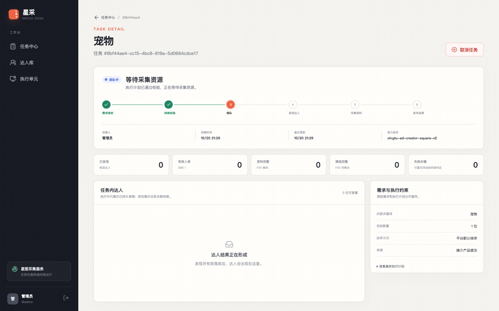

# P1 需求转换阻断修复报告（402 Payment Required）

- 修复日期：2026-10-20（UTC+08）
- 环境：`https://xingtu.yumeng.live`（腾讯云）+ Mac Collection Worker（Tailscale）
- 关联：DSH [冒烟测试报告](deployment-smoke-test-2026-10-20.md)、[QA-01](../tasks/QA-01.md)
- 修复卡：[P1FIX-01](../tasks/P1FIX-01.md)
- 上游缺陷：任务 `1cfaecbc-ec03-4f32-b03b-6548028a3a25`，`AI_AUTH_OR_QUOTA / provider rejected credentials`
- 最终结论：**P1 阻断已解除**（真实模型调用成功，任务进入 QUEUED/等待采集资源）；未执行真实 P2 采集，等待 DSH 独立复测与用户授权。

---

## 1. 缺陷定位报告

### 1.1 确定的根因

**供应商在需求转换调用上返回 HTTP 402 Payment Required（余额/额度不足），不是 API Key 无效。**

直接证据（部署前原 intake-worker 容器日志，2026-10-20T12:36:21Z）：

```text
2026-10-20 12:36:21,207 INFO xingtu.intake_worker dispatched 1 intake task(s)
2026-10-20 12:36:21,766 INFO httpx HTTP Request: POST https://api.deepseek.com/responses "HTTP/1.1 402 Payment Required"
```

对应的 `model_runs` 持久记录：

```json
{
  "provider": "deepseek",
  "requested_model": "deepseek-flash",
  "status": "failed",
  "latency_ms": 475,
  "error_payload": {
    "code": "AI_AUTH_OR_QUOTA",
    "message": "provider rejected credentials",
    "retryable": false
  }
}
```

- 402 是 DeepSeek 的“余额/支付”信号，不是 401/403 的凭据拒绝。
- 代码当时把 `{401, 402, 403}` 合并为 `AI_AUTH_OR_QUOTA`，并固定写
  `provider rejected credentials`，所以数据库里的错误名掩盖了真实原因。
- 原始容器在修复部署时被重建，旧容器 json log 已被 Docker 清理；上述两行是重建前
  `docker logs` 的直接输出。`model_runs` 的失败记录仍在，见 [03 证据](P1-intake-fix-2026-10-20/03-p1-live-verification.txt)。

### 1.2 为什么“此前 DeepSeek 校验 200”与“实际转换失败”同时成立

`DeepSeekAdapter.verify_model()` 的实现是：

```text
GET https://api.deepseek.com/models
```

它只做两件事：验证 Key 可读、验证配置的模型出现在模型列表中；**它不发起推理，也不检查余额**。
因此余额不足时 `/models` 仍可能 200，而真正计费的 `POST /responses` 返回 402。

这也是此前部署检查“200 就认为模型可用”的盲点：**200 只证明“模型列表可读”，不证明“推理可执行”。**
本轮修复在错误分类中区分 401/403 与 402，并把供应商状态/错误摘要写入 `model_runs`，避免再次误判。

### 1.3 配置、代码还是账户额度

| 检查项 | 结果 |
|---|---|
| 配置来源 | `/opt/yumeng-xingtu/shared/config/application.env`，权限 600 root:root；无重复 Key/模型项 |
| Compose 注入 | `env_file` 正确；容器实际环境与文件一致；Key 长度 35、`sk-` 前缀、无空格/引号 |
| 模型名 | `deepseek-flash` 在供应商 `/models` 中真实存在；`/responses` 返回 `model=deepseek-flash` |
| Base URL | `https://api.deepseek.com`，正确 |
| 代码 | 运行镜像 `intake.py` 与本地修复前代码哈希一致；失败映射逻辑本身有缺陷（402 被误分类） |
| 账户额度 | 失败时 402；当前 `/user/balance` 200、`is_available=true`、余额 8.49 CNY |

**结论：主因是账户余额/支付状态；次因是代码把 402 错误地映射成“凭据被拒”，造成根因误判。**
不是 Key 无效、不是模型名错误、不是 Base URL 错误、不是 Compose 注入缺失。

### 1.4 当前余额变化与置信度

- 失败时：供应商返回 402；当时具体余额无法从 API 追溯（余额接口只返回当前值）。
- 修复验证时：`GET /user/balance` → 200，`is_available=true`，CNY 总余额 8.49，
  `granted_balance=0.00`，`topped_up_balance=8.49`。
- 同一套配置、同一模型、同一 Base URL 的真实推理与完整 P1 转换均成功。
- **高置信度**：失败的直接原因是 402 支付/额度状态；配置与代码注入正确。
- **待用户确认**：余额从不足变为可用的具体时间点/是否由充值产生，API 无法证明，需要在
  DeepSeek 控制台核对充值/扣费记录。若未充值，应作为供应商计费异常跟进。

---

## 2. 修复报告

### 2.1 修改文件

| 文件 | 修改原因 |
|---|---|
| `backend/src/xingtu/intake.py` | 402 独立为 `AI_QUOTA_EXHAUSTED`；401/403 为 `AI_AUTH_REJECTED`；4xx/429/5xx 记录 provider status/detail；新增 `_provider_error_detail()`；新错误码加入不可修复/模型错误集合；`model_runs.error_payload` 增加 `provider_status`、`provider_detail` |
| `backend/tests/unit/test_intake.py` | 覆盖 401/402/400 分类与 `model_runs` 持久化 provider 字段 |
| `docs/tasks/P1FIX-01.md`、`FOLLOW-01.md`、`QA-01.md`、`docs/tasks/README.md`、`docs/项目任务进度总览.md`、`docs/任务中心架构.md` | 修复/验证记录、后续项登记、进度同步、错误码文档 |

未修改：数据库 Schema、迁移、API 契约、前端、生产线路/租约规则、Worker 行为、账号/Profile/Cookie。

### 2.2 关键行为变化

- 旧：`{401,402,403}` → `AI_AUTH_OR_QUOTA` + `provider rejected credentials`。
- 新：
  - 401/403 → `AI_AUTH_REJECTED`；
  - 402 → `AI_QUOTA_EXHAUSTED`（message=`provider balance exhausted`）；
  - 429/5xx → `AI_PROVIDER_RETRYABLE`，记录 provider status/detail；
  - 其他 4xx → `AI_PROVIDER_REJECTED`，记录 provider status/detail；
  - `model_runs.error_payload` 可看到例如
    `{"code":"AI_QUOTA_EXHAUSTED","provider_status":402,"provider_detail":"invalid_request_error: Insufficient Balance"}`。
- 新错误码仍为不可修复，不会无意义重试；旧 `AI_AUTH_OR_QUOTA` 保留在兼容集合中，历史任务不受影响。

### 2.3 服务器部署操作

1. 备份服务器 release 的 `backend/src/xingtu/intake.py` 与
   `/opt/yumeng-xingtu/shared/config/production.env`（`.bak.20261020-p1fix`）。
2. 将修复后的 `intake.py` 复制到 release；本地/服务器 SHA-256 均为
   `5dfac62c940574dc3bc41aff005aeb40c1195d414939302b8aedd48a8cb051a5`。
3. 构建新镜像：
   - `xingtu-app:20261020-p1fix-wip`
   - ID `sha256:aff2c94432b9018da514a4a3ed139590edc0d58a039697947017b2d63a3e16d5`
   - 基于 `xingtu-app:20261019-5182c09-wip` + 单文件补丁（32.8kB 层）。
   - **说明**：完整 `deploy/Dockerfile.app` 构建在 `pip install uv==0.13.0` 处等待 PyPI 超过 13 分钟未完成，
     为避免长时间停机和内存压力中止；改用可追溯的派生镜像。后续应在 PyPI 可达时用正式 Dockerfile 重建。
4. 更新 `production.env` 的 `XINGTU_APP_IMAGE`，重建并启动：
   `api`、`intake-worker`、`update-scheduler`。
5. 未重启/未修改：PostgreSQL、Temporal、Temporal PostgreSQL、Redis、MinIO；未执行迁移。

### 2.4 重启与影响

- API 短暂重启（数秒），会话存于 PostgreSQL；重启后登录、任务、执行单元 API 均正常。
- Intake Worker 启动日志：`GET /models 200`；轮询 `xingtu-intake` 正常。
- 无 Schema 迁移，无字段变更，无历史数据修改；历史失败任务 `1cfaecbc...` 未重试、未删除、未改写。
- 本轮新增 1 个隔离测试任务并取消（见第 3 节）；当前 `root_tasks` 共 2 条：
  `1cfaecbc... FAILED`、`8bf44ae4... CANCELLED`。

---

## 3. 实机验证报告

### 3.1 DeepSeek 真实调用

使用**正式运行镜像、正式 `application.env`、正式容器环境**：

- 容器内 `/models` → 200，列表 `['deepseek-flash', 'deepseek-v4-pro']`。
- 容器内 `POST /responses` → 200，`status=completed`，`model=deepseek-flash`。
- 完整 P1 模型调用（同一 `DeepSeekAdapter`、同一 FilterPlan JSON Schema）返回合法 plan。
- 未使用 Mock 替代真实调用；未输出 API Key。

### 3.2 P1 业务转换（隔离测试）

**测试任务：`8bf44ae4-cc15-4bc8-819a-5d0664cdce17`**
输入：`keyword=宠物`，`target_count=1`，其余筛选为空。

| 项目 | 实测 |
|---|---|
| 创建 | `POST /api/tasks` → 202，13:29:53.173Z |
| Intake Workflow | `intake/8bf44ae4...`，`ProcessProductIntakeV1` **COMPLETED**，13:29:54.225→13:29:55.495Z |
| 模型调用 | `deepseek` / `deepseek-flash`，**succeeded**，model_run_id=`2c4e42dc-255f-4ef6-8a24-1bbe490ac100`，16073 input / 88 output tokens，1116ms，`error_payload=NULL` |
| FilterPlan | `source=model`；keyword=`宠物`；target_count=1；capability_version=`xingtu-ad-creator-square-v2`；`validation_errors=[]` |
| 任务状态 | `QUEUED`，version=3，unit=`unit-local-mac-02`，stage=`等待采集资源` |
| P2 任务行 | P2-1=`dafd2d60-3f6d-49ae-ad90-4e08d6c3b3d4`，attempt=`bc3fc308-e090-47eb-bab4-1926981224e7`，search=1，profile=1 |
| 页面 | 任务详情显示“排队中 / 等待采集资源”，进度第 3 步“排队”，无失败提示 |
| task_dispatches | worker 停止时 `sent=false`、`workflow_started_at=NULL`（P1 完成，P2 尚未派发） |



**隔离方式**：在创建任务前临时 `launchctl bootout` Mac Collection Worker，确认进程退出；
因此 P1 成功后没有 collection worker 消费 P2 workflow，不会启动 Chrome 或访问星图。
这是本轮唯一的状态隔离操作；测试后已恢复 worker（PID 14961，poller 新鲜）。

### 3.3 取消与无 Chrome 证据

- 13:30:55Z 调用产品取消命令：任务 `CANCELLED`，version=4，`failure_reason=TASK_CANCELLED`。
- 13:31:30Z 恢复 Mac Worker；13:31:33Z collection worker 启动
  `collect/8bf44ae4...`，`CollectF04F05V1` 于 13:31:34Z **COMPLETED**（0.8 秒）。
- 该 workflow 读取到任务已 CANCELLED，直接返回终态，**未获取浏览器、未启动 Chrome**。
- 恢复后执行单元：
  `state=NEEDS_LOGIN`、`generation=0`、`owner=NULL`、`current_root_task_id=NULL`、
  `browser_stopped=true`、`browser_instance_id=NULL`、`browser_started_at=NULL`。
- 无 `browser_takeover_sessions`；Mac worker 日志只新增轮询行，无浏览器启动记录。

### 3.4 自动化回归

| 检查 | 结果 |
|---|---|
| 后端单元 | **315 passed** |
| 后端契约（设置项目浏览器路径） | **33 passed** |
| 类型检查 | mypy 34 source files，Success |
| 后端 lint/format | ruff check/format 全部通过 |
| 前端测试 | **6 files / 83 tests passed** |
| 前端构建 | exit 0（bundle 未变化） |
| Compose 配置 | `config --quiet` exit 0 |
| API/登录/任务/单元 | 真实 HTTPS 200 |

未执行：`backend/tests/integration`（缺 `XINGTU_TEST_DATABASE_URL`，92 errors/3 skipped，非代码失败）；
真实 P2 采集；真实巨量星图访问。

### 3.5 数据完整性

- 历史任务 `1cfaecbc...` 保持 `FAILED` 及原 `failure_reason`，未被重试或改写。
- 本轮测试任务 `8bf44ae4...` 保持 `CANCELLED`，未删除（遵守“不擅自删除测试数据”）。
- 无 Schema 变更、无迁移、无历史任务删除、无账号/Profile/Cookie 修改。

---

## 4. 部署一致性与安全

### 4.1 本地/服务器版本

- 本地与服务器 release 的以下文件 SHA-256 前缀一致：
  `product_cli.py`、`intake_worker.py`、`worker.py`、`product_api.py`、
  `product_repository.py`、`intake.py`、`product_models.py`。
- 运行镜像：`xingtu-app:20261020-p1fix-wip`，ID `sha256:aff2c944...`。
- `production.env` 已更新 `XINGTU_APP_IMAGE`；`docker compose config --quiet` 通过。
- 服务器 `production.env` 备份为 root 600；release `intake.py` 备份沿用原文件权限（644，501:games）。
- 未执行 Git commit/push/merge；工作区保留 DSH/Codex 既有改动与本轮改动。

### 4.2 SSH

- DSH 直连 `root@119.91.210.100` 使用 `~/.ssh/yumeng_xingtu_tencent_ed25519` 仍被拒绝；
  本轮使用现有 **ControlMaster `/tmp/yumeng-ops01.sock`** 完成只读检查与部署。
- 未修改服务器 SSH、authorized_keys、安全组或 Tailscale 权限。
- 若需要长期自动化，请把公钥 `yumeng-deploy-2026-10-19` 加入服务器授权，或提供受控运维通道。

### 4.3 管理员密码轮换方案（本轮未执行）

密码曾在 DSH 的 Playwright MCP 工具输出中出现明文；未写入仓库、证据或本报告。建议用户在本轮验收后执行：

1. 用交互式 `read -s` 或 Keychain Access 生成/录入新密码，**不要**把密码作为命令行参数或聊天内容。
2. 在 API 容器内交互式重置（`getpass` 不回显）：
   `docker exec -it xingtu-production-api-1 xingtu-product reset-password --username admin --actor security:rotation-2026-10-20`
3. 用 `security add-generic-password -U -s com.yumeng.xingtu.product.admin -a admin -w`
   更新 Keychain（在交互式终端输入，避免明文进入 shell history/日志）；或使用 Keychain Access GUI。
4. 撤销该用户既有 `sessions`（需单独授权；本轮未执行），清理包含旧密码的终端/DSH 日志。
5. 不修改账号/Profile/Cookie，不把新密码写入仓库或报告。

### 4.4 后续任务

已登记 [FOLLOW-01](../tasks/FOLLOW-01.md)：

- HTTP 80 被腾讯云 DNSPod 备案页拦截；
- Let's Encrypt 自动续期/到期告警；
- 失败页内部错误码/英文文案、执行单元展示（P2/P3）；
- 安全响应头；
- 服务端 PyPI 构建缓慢与正式 Dockerfile 重建；
- 管理员密码轮换；
- SSH 公钥授权；
- 部署产物提交与镜像 digest。

---

## 5. 下一步建议

### 已具备重新执行条件（DSH）

- QA-01 的 S01/S02/S03 非采集页面、登录/会话、任务中心/详情、执行单元、安全基线。
- 新建任务后 P1 需求转换、`model_runs` 成功、任务进入 QUEUED/等待采集资源。
- 任务取消与终态反馈（使用隔离/授权任务）。

### 仍需授权

- **真实 P2 采集**：任务在 `NEEDS_LOGIN` 单元上会启动 headful Chrome 并访问星图维护页；
  本轮为隔离验证停止了 Mac Worker。任何非取消任务在 worker 运行时都会触发该路径，必须单独授权。
- P2 实际采集、达人数据展示、真实巨量星图端到端、Worker 断线/恢复故障注入、租约/Profile 锁专项。
- 服务器 SSH 公钥授权、密码轮换、会话撤销、DNS/证书操作。

### 重要操作提醒

历史失败任务 `1cfaecbc...` 仍保留 `allowed_actions=["retry"]`；**不要直接点击“重试失败步骤”**：
在当前运行状态下，P1 成功后任务会派发 P2，Mac Worker 会启动 headful Chrome 并访问星图维护页。
若需复测 P1，使用隔离任务，或在确认无活动任务后先停止 Mac Worker，验证 QUEUED 后取消并恢复。

### 给 DSH 的复测提示

1. 先确认运行镜像仍为 `xingtu-app:20261020-p1fix-wip`，Intake Worker `/models` 200。
2. 创建带完整记录的任务 ID；在 worker 运行状态下不要假定 P1 成功后不会触发 Chrome。
3. 如需只验证 P1，沿用本轮的 worker 隔离法（先确认无活动任务、停止 worker、验证 QUEUED、取消、恢复）。
4. 复测结束后保留任务 ID、model_runs、filter_plans、task_dispatches 与执行单元状态。

---

## 6. 证据索引

| 文件 | 内容 |
|---|---|
| [01-provider-diagnosis.txt](P1-intake-fix-2026-10-20/01-provider-diagnosis.txt) | 402 日志、200 与 402 差异、当前余额/模型 |
| [02-runtime-config.txt](P1-intake-fix-2026-10-20/02-runtime-config.txt) | 配置来源、Key 形状、代码哈希一致性 |
| [03-p1-live-verification.txt](P1-intake-fix-2026-10-20/03-p1-live-verification.txt) | P1 任务、DB/Temporal、取消/无 Chrome |
| [04-deployment.txt](P1-intake-fix-2026-10-20/04-deployment.txt) | 镜像、服务更新、构建限制 |
| [05-regression.txt](P1-intake-fix-2026-10-20/05-regression.txt) | 单元/契约/前端/构建/集成限制 |
| [p1-queued.png](P1-intake-fix-2026-10-20/p1-queued.png) | 任务详情“等待采集资源”截图 |

### 数据安全声明

本报告与证据不含 API Key、管理员密码、Cookie、CSRF Token、数据库/MinIO 凭据；Key 仅以长度/前缀/
指纹是否一致描述；未输出未脱敏的达人账号 ID。未保存 HAR。
