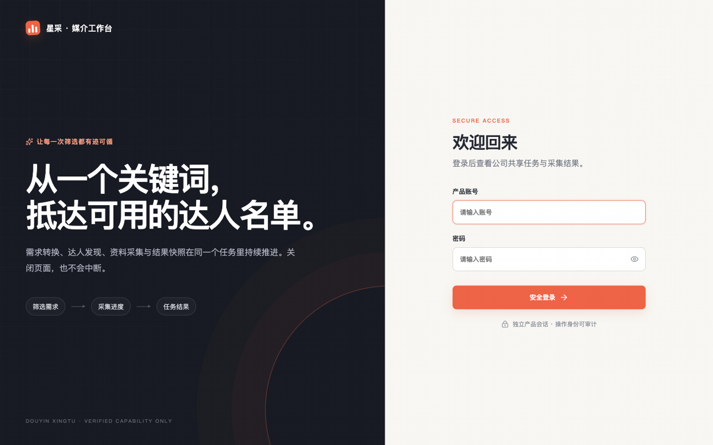
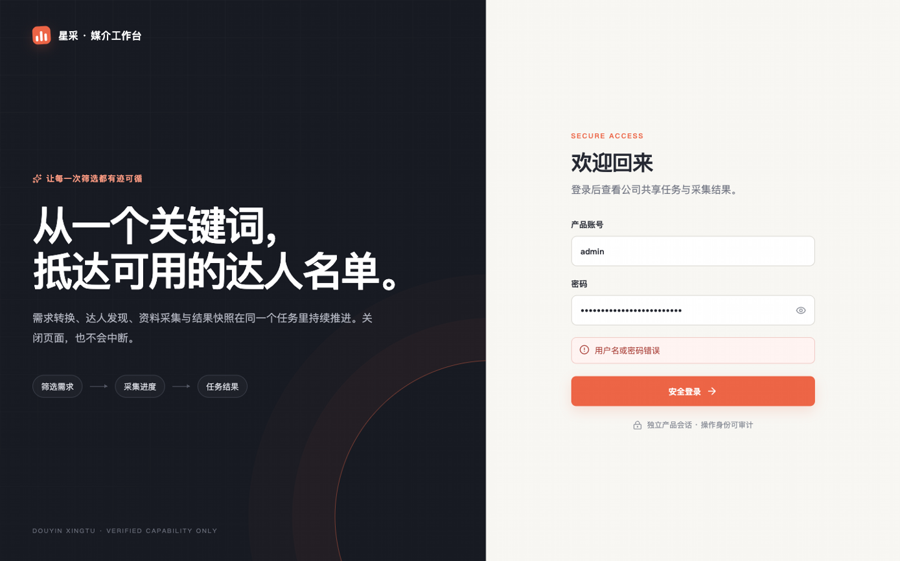
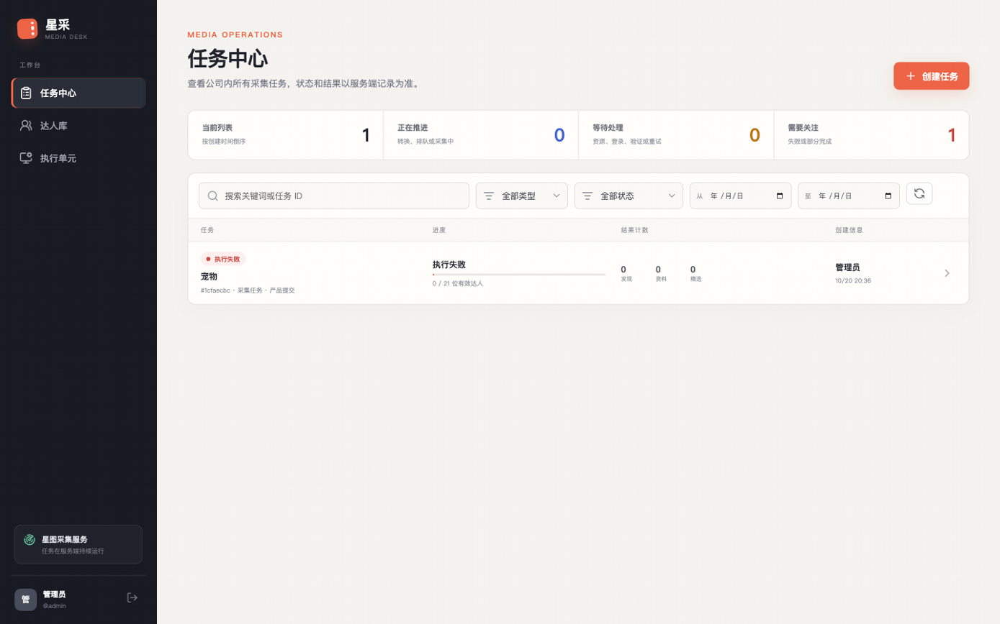
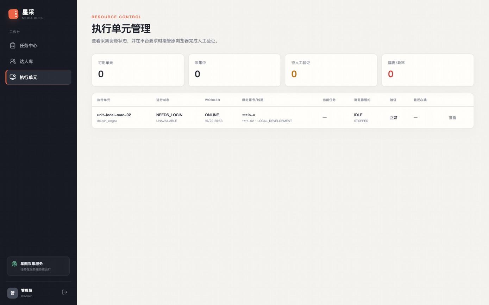
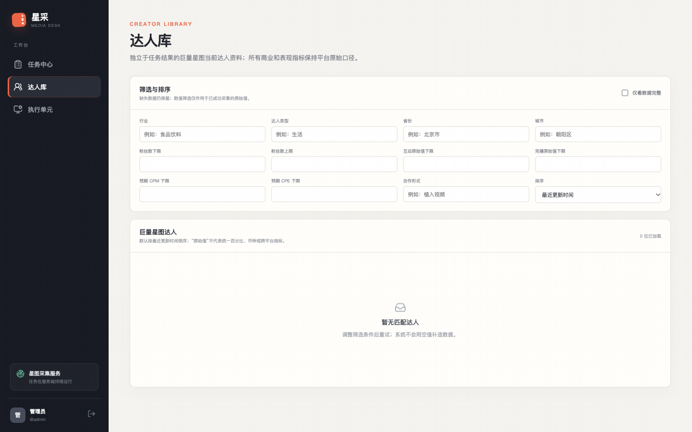
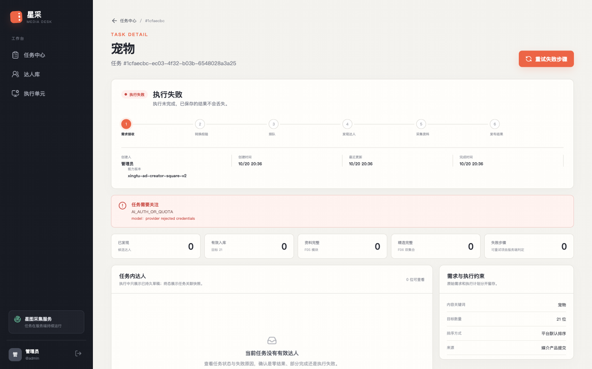
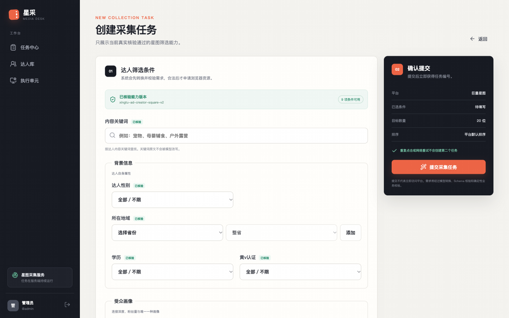
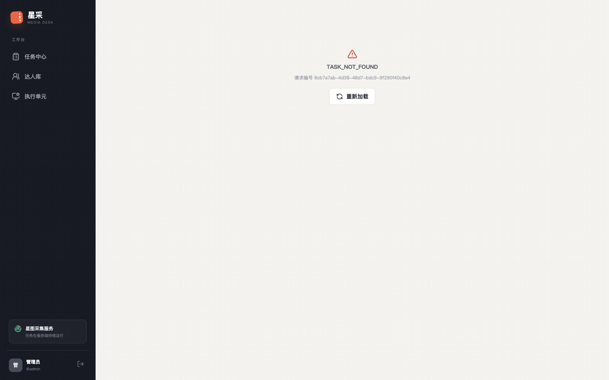
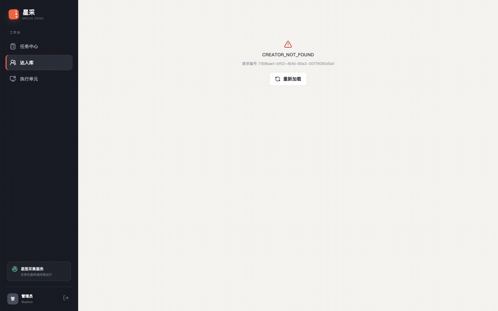

# 巨量星图正式部署后核心业务冒烟测试报告

- 测试日期：2026-10-20（本地时间 UTC+08，测试窗口约 20:43–21:00）
- 测试地址：<https://xingtu.yumeng.live>
- 测试角色：独立 QA 自动化测试工程师 / 全栈工程师 / 系统质量负责人
- 测试性质：正式部署后的核心业务冒烟测试（非全量回归、非压力测试、非真实采集验收）
- 最终结论：**NO-GO**（针对“进入下一阶段真实采集验收”的目标；详见第 7 节）

---

## 1. 结论摘要

本轮以真实系统 Chrome + Playwright MCP 完成了站点、登录会话、核心页面、执行单元、异步服务、安全基线与部署迁移的只读/低风险冒烟测试。

**通过的部分**

- HTTPS 入口、TLS 证书、HTTP/2、SPA 深链与刷新、静态资源均正常。
- 管理员登录、刷新会话保持、Cookie 安全属性、CSRF、Origin 校验、登出与登出后保护均正常。
- 任务中心、任务详情、创建任务页、达人库、执行单元页均能正常渲染；空态与错误态可用。
- 云端执行单元状态与数据库、Mac Worker 真实一致：`worker_status=ONLINE`，但资源严格保持
  `NEEDS_LOGIN / UNAVAILABLE / LOCAL_DEVELOPMENT`，浏览器 `STOPPED`，租约 `IDLE`，没有伪造
  NetworkProof，也没有被包装成“可用”。
- Intake Worker 与 Mac Collection Worker 均有新鲜 Temporal poller；本轮存在的那条任务确实被
  Intake 真实消费，Workflow 正常完成；`task_dispatches=0`，没有触发采集或巨量星图访问。
- 未登录 API 401、CSRF 403、跨域无 CORS 放行、WebSocket 握手拒绝未认证请求。

**阻断的部分**

- **P1：在凭据修复前，所有新任务都会在“需求转换（P1）”阶段立即失败**。现有真实任务
  `1cfaecbc-ec03-4f32-b03b-6548028a3a25` 创建后约 1 秒进入 `FAILED`，根因是服务端 DeepSeek
  凭据被拒：`AI_AUTH_OR_QUOTA / provider rejected credentials`（`model_runs` 可直接对上）。
  Intake Worker、Temporal、任务持久化均正常，故障点在模型供应商鉴权/额度，不在前端或队列。
  这意味着“创建任务 → 需求转换 → 排队 → 等待采集资源”的核心链路当前不可用，下一阶段真实采集
  无法开始。
- **P2：HTTP(80) 入口被腾讯云网络层拦截**（3/3 返回 DNSPod 备案拦截页），未到达项目 Nginx；
  证书为手工 DNS-01 签发的 Let's Encrypt 90 天证书，当前未验证自动续期，存在到期中断风险。
- **P2：部署产物未入库、后端运行版本不可追溯**（HEAD 为 `5182c09`，工作区另有 33 项改动，
  部署目录未提交；前端 bundle 可与本地 dist 对上，但服务器镜像/compose 状态本轮无法独立核验）。
- 其余 P2/P3：核心失败页直接展示内部错误码、执行单元页英文枚举与“验证 正常”语义混淆、
  安全响应头缺失、控制台错误噪声、错误页请求放大等。

**统计**

| 指标 | 数量 |
|---|---|
| 用例总数 | 59 |
| PASS | 45 |
| FAIL | 4 |
| BLOCKED | 6 |
| NOT TESTED | 3 |
| NOT APPLICABLE | 1 |
| 总通过率（PASS/总数） | 76.3% |
| 已执行用例通过率（PASS/(PASS+FAIL)） | 91.8% |

> BLOCKED 不计入 PASS。`FAIL` 的 4 项中，1 项为 P1 业务阻断，其余为部署/展示/加固问题。

---

## 2. 测试环境与工具

### 2.1 部署与入口

| 项目 | 实测值 |
|---|---|
| 正式地址 | `https://xingtu.yumeng.live` |
| 解析地址 | `119.91.210.100`（腾讯云） |
| 入口 | Nginx（`server: nginx`），HTTP/2，Let's Encrypt 证书 |
| 前端 | React/Vite 生产构建，同源相对 `/api`，SPA 回退到 `index.html` |
| 云端服务 | FastAPI、PostgreSQL、Temporal、MinIO、Intake Worker（本轮 API/DB/Temporal/MinIO 证据）；Redis 未独立核验，沿用部署方案 |
| Mac 执行节点 | launchd `com.yumeng.xingtu.collection-worker`，PID 3238，Tailscale `100.67.64.110` |
| 云端 Tailscale | `yumeng-xingtu-cloud` / `100.86.124.51`，本轮为 direct 直连 |

### 2.2 浏览器与工具

| 项目 | 实测值 |
|---|---|
| 浏览器 | 系统 Google Chrome **155.0.8059.85**（`channel=chrome`，headful） |
| 自动化 | **Playwright MCP 0.0.77**（`@playwright/mcp`，serverInfo 报告 `playwright 1.62.0-alpha-2026-06-29`） |
| Node.js | v24.14.0 |
| 操作系统 | macOS 26.5.2 (25F84) |
| 接入方式 | Playwright MCP stdio JSON-RPC + 本机持久桥接；调用 MCP 工具 `browser_navigate / browser_snapshot / browser_click / browser_type / browser_evaluate / browser_take_screenshot / browser_console_messages / browser_network_requests`（详见 [工具与边界](qa-deployment-smoke-2026-10-20/11-tooling-and-access.txt)） |
| 浏览器隔离 | `isolated=true`，Profile 仅在内存；未触碰采集单元 Profile、Cookie 或登录态 |
| 网络方式 | 启动参数 `--no-proxy-server` + `proxy.server=direct://`，绕过 Clash Verge Rev；未修改全局代理/Tailscale/DNS |

### 2.3 Git 与构建状态

| 项目 | 实测值 |
|---|---|
| Git HEAD | `5182c09d0fb212eaad5b01b994d2676792efb395`（2026-10-18） |
| 工作区 | 33 项改动（含 `deploy/Dockerfile.app`、`deploy/production.compose.yaml`、`deploy/nginx/`、`deploy/macos/`、`deploy/ops/`、`deploy/tailscale/` 等未跟踪文件，以及 `frontend/src/pages.tsx`、`backend/src/xingtu/*` 的修改） |
| 前端产物 | 线上 `index-BNJmWNlC.js` 430716 bytes，与本地 `frontend/dist/assets/index-BNJmWNlC.js` 完全一致 |
| 后端版本 | 服务器镜像 tag/digest、`docker compose ps` 本轮无法核验（SSH 被拒，见 2.4） |
| 结论 | 前端可追溯到本地 dist；**后端运行版本无法追溯到某个 Git 提交**，部署可追溯性不足 |

### 2.4 访问方式与未使用的通道

- 所有浏览器访问均走“系统 Chrome + 直连（绕过 Clash 系统代理）”，工作区外有隔离的临时 Profile。
- **Clash Verge Rev 系统代理 `127.0.0.1:7897` 会破坏该域名连接**：直连 200；走代理 HTTP 返回 502、
  HTTPS 返回 `SSL_ERROR_SYSCALL`；同代理访问 baidu/github 均 200。未修改全局代理。
- **SSH 不可用**：使用现有 `~/.ssh/yumeng_xingtu_tencent_ed25519` 连接
  `root@119.91.210.100` 返回 `Permission denied (publickey,...)`。未尝试密码、未修改
  `authorized_keys`。因此服务器容器状态、宿主机资源、容器重启记录本轮无法独立验证。
- **未访问巨量星图**：没有导航、登录、搜索或采集；没有创建会触发采集的任务。

---

## 3. 测试用例与执行结果

- 结果口径：PASS 真实执行并通过；FAIL 真实执行但不符合预期；BLOCKED 前置条件/权限/安全性不允许；
  NOT TESTED 本轮未执行；NOT APPLICABLE 经确认不适用。
- “副作用”列说明该用例是否需要真实采集或改变状态。

### S01 站点与 HTTPS

| ID | 场景与步骤 | 预期 | 副作用 | 风险 | 结果 | 证据 |
|---|---|---|---|---|---|---|
| SMK-01 | 打开 `https://xingtu.yumeng.live/`，等待渲染 | 200，进入登录页，标题/表单正常 | 无 | P1 | **PASS** | [01-login.png](qa-deployment-smoke-2026-10-20/01-login.png)、[网络摘要](qa-deployment-smoke-2026-10-20/10-console-network.txt) |
| SMK-02 | 检查 TLS 证书、协议、HTTP 版本 | 证书有效、TLS1.2+、HTTP/2 | 无 | P1 | **PASS** | [01-https-tls.txt](qa-deployment-smoke-2026-10-20/01-https-tls.txt) |
| SMK-03 | 检查 JS/CSS 加载与混合内容 | 静态资源 200，全部 HTTPS 同源 | 无 | P1 | **PASS** | [01-https-tls.txt](qa-deployment-smoke-2026-10-20/01-https-tls.txt)、[10-console-network.txt](qa-deployment-smoke-2026-10-20/10-console-network.txt) |
| SMK-04 | 直接访问/刷新 `/tasks`、`/tasks/<id>`、`/creators`、`/execution-units` | SPA 回退正常，不 404，不白屏 | 无 | P1 | **PASS** | 截图 03/04/05/06，Network 200 |
| SMK-05 | 访问 `http://xingtu.yumeng.live/`，重复 3 次 | 301/308 跳转 HTTPS | 无 | P2 | **FAIL** | [02-http-webblock.txt](qa-deployment-smoke-2026-10-20/02-http-webblock.txt) |
| SMK-06 | 对比系统代理与直连；用隔离 Chrome 直连访问 | 明确记录访问方式，站点可打开 | 无 | P2 | **PASS**（方式正确，环境有风险） | [03-proxy-diagnostic.txt](qa-deployment-smoke-2026-10-20/03-proxy-diagnostic.txt) |

**S01 备注**：SMK-05 的 FAIL 不在 Nginx 站点配置本身——请求根本没有到达项目 Nginx，而是被外部
网络层 302 到 `dnspod.qcloud.com/static/webblock.html`。显式 HTTPS 不受影响。

### S02 账号登录与会话

| ID | 场景与步骤 | 预期 | 副作用 | 风险 | 结果 | 证据 |
|---|---|---|---|---|---|---|
| SMK-07 | 未登录直接访问 `/tasks` | 客户端跳转 `/login`，受保护 API 401 | 无 | P1 | **PASS** | [10-console-network.txt](qa-deployment-smoke-2026-10-20/10-console-network.txt) |
| SMK-08 | 使用错误密码登录 | 有明确错误提示，停留登录页 | 无 | P1 | **PASS** | [02-login-wrong-password.png](qa-deployment-smoke-2026-10-20/02-login-wrong-password.png) |
| SMK-09 | 使用 Keychain 中的正确凭据登录 | 进入 `/tasks`，显示当前用户 | 无 | P1 | **PASS** | [03-tasks-after-login.png](qa-deployment-smoke-2026-10-20/03-tasks-after-login.png) |
| SMK-10 | 登录后刷新深链、切换任务/达人库/执行单元 | 会话保持，页面正常 | 无 | P1 | **PASS** | 截图 03/04/05/06 |
| SMK-11 | 检查会话 Cookie 与浏览器存储 | `Secure/HttpOnly/SameSite=Lax`，JS 不可读 | 无 | P1 | **PASS** | [04-auth-cookie-flags.txt](qa-deployment-smoke-2026-10-20/04-auth-cookie-flags.txt) |
| SMK-12 | 点击退出登录；再访问受保护页面/API | 回登录页，API 401，Cookie 失效 | 改变测试会话 | P1 | **PASS** | [10-console-network.txt](qa-deployment-smoke-2026-10-20/10-console-network.txt) |
| SMK-13 | 登出后重新登录 | 可再次进入 `/tasks` | 无 | P1 | **PASS** | 截图 03 |

**S02 备注**：错误密码返回 HTTP 422（`INVALID_FORM`）而不是 401；页面提示正确，但与语义不完全一致，
记为 P3。未做暴力测试或频率限制探测。

### S03 核心页面可用性

| ID | 场景与步骤 | 预期 | 副作用 | 风险 | 结果 | 证据 |
|---|---|---|---|---|---|---|
| SMK-14 | 任务中心：统计、列表、搜索 `宠物`、状态筛选、空态 | 数据正确、筛选生效、空态合理 | 无 | P1 | **PASS** | [03-tasks-after-login.png](qa-deployment-smoke-2026-10-20/03-tasks-after-login.png) |
| SMK-15 | 打开失败任务详情：状态、进度、计数、操作入口 | 与服务端一致，能解释失败 | 无 | P1 | **PASS**（存在 P2 文案问题） | [06-task-detail-failed.png](qa-deployment-smoke-2026-10-20/06-task-detail-failed.png) |
| SMK-16 | 打开 `/tasks/new`：能力字段、目标数量、客户端校验 | 9 项能力渲染，空表单被拦截且不发请求 | 无 | P1 | **PASS** | [07-new-task.png](qa-deployment-smoke-2026-10-20/07-new-task.png) |
| SMK-17 | 打开达人库：筛选器、空态 | 页面正常，明确“暂无匹配达人” | 无 | P2 | **PASS** | [05-creators-library.png](qa-deployment-smoke-2026-10-20/05-creators-library.png) |
| SMK-18 | 打开达人详情 | 有真实数据时展示详情 | 无 | P2 | **BLOCKED**（无数据） | 见 S04 |
| SMK-19 | 打开执行单元页：行字段、统计卡 | 字段完整且与后端一致 | 无 | P1 | **PASS**（存在 P3 展示问题） | [04-execution-units.png](qa-deployment-smoke-2026-10-20/04-execution-units.png) |
| SMK-20 | 检查账号菜单/用户相关页面 | 当前用户、用户名、退出可用 | 无 | P3 | **PASS**；无独立用户管理页（本里程碑不适用） | 截图 03 |
| SMK-21 | 访问不存在的任务/达人 | 友好错误态，不白屏 | 无 | P2 | **PASS**（功能）；文案 P3 | [08-task-404.png](qa-deployment-smoke-2026-10-20/08-task-404.png)、[09-creator-404.png](qa-deployment-smoke-2026-10-20/09-creator-404.png) |

**S03 备注**：`/settings` 直接访问只显示“当前里程碑不包含设置页面”，导航未暴露该入口，按 N/A 处理，
不计入通过率。

### S04 达人数据展示

| ID | 场景与步骤 | 预期 | 副作用 | 风险 | 结果 | 证据 |
|---|---|---|---|---|---|---|
| SMK-22 | 达人库查询真实达人数据 | 列表返回并展示 | 无 | P2 | **BLOCKED / NO DATA** | [05-creators-library.png](qa-deployment-smoke-2026-10-20/05-creators-library.png) |
| SMK-23 | 达人详情：基础/商业/创作/履约/连接用户/报价/封面 | 字段正确、封面可访问 | 无 | P2 | **BLOCKED / NO DATA** | [06-db-readonly.txt](qa-deployment-smoke-2026-10-20/06-db-readonly.txt) |
| SMK-24 | 检查空数据与空值处理 | 空态明确，不用空值伪造数据 | 无 | P2 | **PASS** | 截图 05、06 |

**S04 结论**：云端的 `platform_creators / task_creators / contents / media_objects /
creator_snapshots / featured_cards` 均为 0 行，MinIO `xingtu-covers` 为 0 对象。本轮如实标记
BLOCKED / NO DATA，不伪造数据，也不把空态通过当作达人展示验收通过。

### S05 ExecutionUnit 管理与状态同步

| ID | 场景与步骤 | 预期 | 副作用 | 风险 | 结果 | 证据 |
|---|---|---|---|---|---|---|
| SMK-25 | 读取执行单元页与 `/api/execution-units` | ID、Worker、可用性、线路、浏览器、租约、账号齐全 | 无 | P1 | **PASS** | [04-execution-units.png](qa-deployment-smoke-2026-10-20/04-execution-units.png) |
| SMK-26 | 对比 API、数据库、页面显示 | 三者一致 | 无 | P1 | **PASS** | [06-db-readonly.txt](qa-deployment-smoke-2026-10-20/06-db-readonly.txt) |
| SMK-27 | 验证“Worker 在线 ≠ 单元可用” | 在线但不可用，不显示 READY | 无 | P1 | **PASS** | API：`ONLINE / UNAVAILABLE`，页面“可用单元 0” |
| SMK-28 | 检查线路真实性与 NetworkProof | `local_development` 只作测试，不冒充生产线路 | 无 | P1 | **PASS** | UnitConfig `test_only=true`；无验证事件/证明 |
| SMK-29 | Worker 断线→离线→恢复的时效 | 180 秒阈值内收敛 | 需停止 Worker | P1 | **NOT TESTED** | 本轮禁止故障注入 |
| SMK-30 | 接管/验证入口 | 有验证事件时可用 | 触发浏览器 | P2 | **NOT APPLICABLE** | 无验证事件，按钮禁用 |

**S05 当前真实状态**（API 与 DB 一致）：

```
unit-local-mac-02
  worker_status      = ONLINE（Temporal poller 新鲜，age 55s）
  unit_availability  = UNAVAILABLE
  state              = NEEDS_LOGIN
  line_health        = LOCAL_DEVELOPMENT / test_only
  browser_status     = STOPPED
  browser_lease      = IDLE
  generation         = 0, owner = NULL
  current_root_task  = NULL
  verification_state = NULL
```

### S06 任务创建与资源不可用处理

| ID | 场景与步骤 | 预期 | 副作用 | 风险 | 结果 | 证据 |
|---|---|---|---|---|---|---|
| SMK-31 | 提交任务前的副作用评估（代码 + 现网状态） | 明确是否会访问巨量星图 | 无 | P1 | **PASS**（分析） | [worker.py:348](../../backend/src/xingtu/worker.py#L348)、[browser_host.py:219](../../backend/src/xingtu/browser_host.py#L219) |
| SMK-32 | 提交有效最小筛选条件，验证等待资源 | 不越权采集，不回落生产线路 | 真实采集/浏览器启动 | P1 | **BLOCKED** | 见下方说明 |
| SMK-33 | 客户端空表单 + 服务端目标数量越界 | 被拦截，不产生任务 | 无 | P1 | **PASS** | [05-api-security.txt](qa-deployment-smoke-2026-10-20/05-api-security.txt) |
| SMK-34 | 现网真实任务：创建→Intake→模型转换 | 进入排队/等待资源 | 读取已有任务 | P1 | **FAIL（P1）** | [06-db-readonly.txt](qa-deployment-smoke-2026-10-20/06-db-readonly.txt)、[07-temporal-workflow.txt](qa-deployment-smoke-2026-10-20/07-temporal-workflow.txt) |
| SMK-35 | 任务详情对失败的展示 | 用户可理解失败原因 | 无 | P2 | **PASS**（文案 P2） | [06-task-detail-failed.png](qa-deployment-smoke-2026-10-20/06-task-detail-failed.png) |

**为什么 SMK-32 是 BLOCKED（不是没测，而是不能安全测）**

1. `worker.collect` 对 `NEEDS_LOGIN` 单元会进入 maintenance 模式（[worker.py:348](../../backend/src/xingtu/worker.py#L348)），
   `BrowserHost.lease()` 会真实启动 headful Chrome，并执行 `maintenance_page.goto(search.entry_url)`
   访问巨量星图业务页（[browser_host.py:219](../../backend/src/xingtu/browser_host.py#L219)），等待人工登录/清障后才继续。
2. 因此，只要需求转换成功，提交任务就会在 Mac 上拉起浏览器并访问巨量星图；本轮未获得该授权。
3. 另外，即使需求转换不修，服务端模型凭据当前也会让任务在 P1 直接失败；用“模型恰好失败”来规避
   采集副作用不是可接受的安全论据。
4. 本轮**没有创建任何任务**：测试前后任务数均为 1。该唯一任务为 2026-10-20 20:36 由 `管理员`
   创建的历史数据，本轮只读，未删除。

**SMK-34 证据链**：任务创建（audit `product_task.create`）→ Intake dispatch `sent=true` →
Temporal `ProcessProductIntakeV1` **COMPLETED**（628ms）→ 模型调用
`deepseek/deepseek-flash` **failed**，`AI_AUTH_OR_QUOTA / provider rejected credentials`，
`retryable=false`（475ms）→ 任务 `FAILED`（创建后约 1 秒）→ `task_dispatches=0`（从未进入采集）。

### S07 云端与 Mac 异步服务

| ID | 场景与步骤 | 预期 | 副作用 | 风险 | 结果 | 证据 |
|---|---|---|---|---|---|---|
| SMK-36 | Intake poller + 实际 Workflow 结果 | 有新鲜 poller 且真实消费 | 无 | P1 | **PASS** | [07-temporal-workflow.txt](qa-deployment-smoke-2026-10-20/07-temporal-workflow.txt) |
| SMK-37 | Mac Collection poller + launchd | 进程常驻，poller 新鲜 | 无 | P1 | **PASS** | [08-mac-worker.txt](qa-deployment-smoke-2026-10-20/08-mac-worker.txt) |
| SMK-38 | Task Queue 与 ExecutionUnit 绑定 | 队列名与单元一致 | 无 | P1 | **PASS** | `xingtu-unit-local-mac-02` |
| SMK-39 | PostgreSQL / Temporal / MinIO 连通 | 均可用 | 只读 | P1 | **PASS** | [06-db-readonly.txt](qa-deployment-smoke-2026-10-20/06-db-readonly.txt)、[09-minio.txt](qa-deployment-smoke-2026-10-20/09-minio.txt) |
| SMK-40 | 服务端容器状态、重启次数、宿主资源 | 无 CrashLoop/OOM | 只读 | P1 | **BLOCKED** | SSH 被拒，见 2.4 |
| SMK-41 | 积压与重复执行 | 无重复任务/派发 | 只读 | P1 | **PASS** | 1 条 P1、0 条 P2、0 条 task_dispatch |

**S07 备注**：Mac Worker 日志显示 11:53Z / 12:10Z / 12:22Z 出现 Temporal gRPC
`ConnectionReset`、`poll_*` 重试 6–8 次，以及本地时间 18:13/19:04 的
`collection dispatch tick failed: OperationalError`；当前 poller 已恢复新鲜。该链路稳定性
需要后续观察（见风险 R-03），本轮不据此判定通过或失败。

### S08 基础安全与异常处理

| ID | 场景与步骤 | 预期 | 副作用 | 风险 | 结果 | 证据 |
|---|---|---|---|---|---|---|
| SMK-42 | 未登录访问受保护 API | 401，不返回业务数据 | 无 | P1 | **PASS** | [05-api-security.txt](qa-deployment-smoke-2026-10-20/05-api-security.txt) |
| SMK-43 | POST 无 CSRF / 伪造 CSRF / 错误 Origin | 403，不产生数据 | 无 | P1 | **PASS** | [05-api-security.txt](qa-deployment-smoke-2026-10-20/05-api-security.txt) |
| SMK-44 | 跨域请求与预检 | 不放行任意 Origin | 无 | P1 | **PASS** | 同上 |
| SMK-45 | WebSocket 未认证/错误 Origin 握手 | 拒绝 | 无 | P1 | **PASS** | 同上（403） |
| SMK-46 | 页面/接口/仓库扫描敏感凭据 | 无密码、Cookie、Token、DB/MinIO 密钥 | 无 | P1 | **PASS** | [04-auth-cookie-flags.txt](qa-deployment-smoke-2026-10-20/04-auth-cookie-flags.txt)、[11-tooling-and-access.txt](qa-deployment-smoke-2026-10-20/11-tooling-and-access.txt) |
| SMK-47 | 检查 HSTS/CSP/XFO/XCTO/Referrer-Policy | 建议具备 | 无 | P3 | **FAIL（加固项）** | [01-https-tls.txt](qa-deployment-smoke-2026-10-20/01-https-tls.txt) |

**S08 备注**：未做暴力破解、批量扫描、权限提升或高并发攻击。登录接口未验证频率限制（NOT TESTED），
本轮不宣称其具备或缺乏限流。

### S09 部署迁移专项

| ID | 场景与步骤 | 预期 | 副作用 | 风险 | 结果 | 证据 |
|---|---|---|---|---|---|---|
| SMK-48 | 前端 API Base / WebSocket Base | 同源相对路径，无硬编码内网地址 | 无 | P1 | **PASS** | Network 全为 `https://xingtu.yumeng.live/api/...`；bundle 无 localhost |
| SMK-49 | HTTPS 代理头与 Cookie | Secure Cookie 生效 | 无 | P1 | **PASS** | [04-auth-cookie-flags.txt](qa-deployment-smoke-2026-10-20/04-auth-cookie-flags.txt) |
| SMK-50 | React 路由刷新 / 深链 | 不 404 | 无 | P1 | **PASS** | 截图 03–06、08、09 |
| SMK-51 | WebSocket 经 Nginx | Upgrade 可达，认证在应用侧 | 无 | P1 | **PASS**（仅握手路径） | [05-api-security.txt](qa-deployment-smoke-2026-10-20/05-api-security.txt) |
| SMK-52 | Mac Worker 状态反映到云端 | ONLINE 且与 Mac 一致 | 无 | P1 | **PASS** | [07-temporal-workflow.txt](qa-deployment-smoke-2026-10-20/07-temporal-workflow.txt)、[08-mac-worker.txt](qa-deployment-smoke-2026-10-20/08-mac-worker.txt) |
| SMK-53 | 封面/对象存储访问路径 | 桶可访问，缺失对象 404 合理 | 只读 | P2 | **PASS**（有限） | [09-minio.txt](qa-deployment-smoke-2026-10-20/09-minio.txt) |
| SMK-54 | 运行版本可追溯（前端/后端/镜像） | 可关联到提交与镜像 digest | 无 | P2 | **FAIL** | 见 2.3；33 项未提交部署改动 |
| SMK-55 | Docker 容器重启/异常记录 | 无异常重启 | 只读 | P1 | **BLOCKED** | SSH 被拒 |
| SMK-56 | Mac launchd 常驻 | running，未反复重启 | 只读 | P1 | **PASS** | [08-mac-worker.txt](qa-deployment-smoke-2026-10-20/08-mac-worker.txt) |

**S09 备注**：执行单元 `network_mode=local_development`、`test_only=true`、无代理、无
NetworkProof；浏览器测试使用独立内存 Profile，未与采集 Profile 混用。以上两点符合“隔离”要求。

### S10 故障与恢复能力（只读）

| ID | 场景与步骤 | 预期 | 副作用 | 风险 | 结果 | 证据 |
|---|---|---|---|---|---|---|
| SMK-57 | 实际停止/恢复 Worker 观察 180s 收敛 | 离线识别、恢复上线 | 破坏性 | P1 | **NOT TESTED** | 本轮明确禁止故障注入 |
| SMK-58 | 只读检查租约/代次/浏览器状态 | 无活动租约，代次不自增 | 只读 | P1 | **PASS** | generation 0、owner NULL、lease IDLE、browser_stopped=true |
| SMK-59 | 网络故障与 Profile 锁处理 | 可解释、可恢复 | 破坏性 | P1 | **NOT TESTED** | 需后续专项授权 |

**S10 说明**：MAC-01/HYB-01 曾记录“停止 Worker 后 199 秒判定离线、恢复后新 poller 出现”，
但那是上一轮证据，本轮没有复测，因此不计入本轮 PASS。后续专项计划见第 8 节。

---

## 4. 核心页面截图

| 页面 | 截图 |
|---|---|
| 登录页 |  |
| 错误密码提示 |  |
| 任务中心 |  |
| 执行单元 |  |
| 达人库（空态） |  |
| 失败任务详情 |  |
| 创建任务页 |  |
| 任务不存在 |  |
| 达人不存在 |  |

---

## 5. 业务流程验证情况

| 流程环节 | 本轮验证 | 结论 |
|---|---|---|
| 访问站点 | Chrome 真实访问、TLS、静态资源、深链 | 通过（HTTP 入口异常，见 D-02） |
| 登录与会话 | 错误密码、正确登录、刷新、登出、重新登录、Cookie/CSRF | 通过 |
| 创建任务（UI/API） | 页面渲染、客户端校验、服务端校验、CSRF | 通过（未提交有效任务） |
| 需求转换（P1/Intake） | 真实历史任务 + Temporal Workflow + model_runs | **失败**：模型凭据被拒（P1） |
| 任务调度（P2/QUEUED） | `task_dispatches=0`，无 P2 任务 | **未到达**（被 P1 阻断） |
| 资源不可用等待 | 单元 `NEEDS_LOGIN/UNAVAILABLE`，但未提交任务 | **未验证 / BLOCKED** |
| 云端 ↔ Mac 状态 | Worker ONLINE、poller 新鲜、launchd 常驻、DB 一致 | 通过 |
| 数据持久化/达人展示 | 所有达人/内容/快照表 0 行 | **BLOCKED / NO DATA** |
| 真实巨量星图采集 | 未访问 | **未验证**（明确未授权） |

---

## 6. 缺陷清单

> 本轮只报告，不修复。严重程度：P0 核心不可用/重大安全；P1 关键流程阻断；P2 局部异常但有替代路径；
> P3 轻微展示/体验。
>
> 说明：D-04、D-05、D-07、D-08、D-09 是在功能结果判为 PASS 的页面上观察到的质量问题，
> 为不重复计数，未把它们另计为 FAIL；它们仍按严重程度单列，供修复排期。

### D-01（P1）任务在需求转换阶段全部失败：模型凭据被拒

| 项 | 内容 |
|---|---|
| 问题描述 | 现网唯一真实任务创建后约 1 秒 `FAILED`，failure_reason=`AI_AUTH_OR_QUOTA`，字段错误 `model: provider rejected credentials`；在当前部署状态下，任何新任务都会在 P1 停止，无法进入排队/采集。 |
| 复现路径 | 登录 → 创建采集任务（历史任务：`宠物`，目标 21，20:36 创建）→ 任务详情显示失败；或只读查看 `model_runs`。 |
| 实际表现 | `root_tasks.state=FAILED`；`model_runs.provider=deepseek, requested_model=deepseek-flash, status=failed, error_payload={"code":"AI_AUTH_OR_QUOTA","message":"provider rejected credentials","retryable":false}, latency_ms=475`；Intake Workflow `COMPLETED`（说明 Worker 正常）。 |
| 预期表现 | 需求转换成功并进入 `QUEUED`，或在模型不可用时给出可操作提示且不产生不可恢复的失败。 |
| 严重程度 | **P1（关键业务流程阻断）** |
| 影响范围 | 所有新采集任务、手动更新、定时更新任务的 P1 转换；下一阶段真实采集验收完全无法开始。 |
| 根因及置信度 | **高置信度**：服务端注入的 DeepSeek 凭据被供应商拒绝（401/402/403 类），或账户额度/余额不可用。排除项：Intake Worker 在线且完成 Workflow、Temporal poller 新鲜、任务正确落库、错误在 475ms 内返回，均不像网络超时或队列问题。**未确认**具体是 key 错误、额度不足还是供应商侧限制（无法 SSH 查看容器环境）。 |
| 建议修复方式 | 在服务器 `application.env` 中核对 `DEEPSEEK_API_KEY`（换行/引号、key 是否正确、账户余额/额度），从 API 容器内做一次最小 `chat/completions` 验证；修复后由用户授权，使用受控任务重试或新建隔离任务复测。**不要在未授权情况下提交会触发 Chrome/星图访问的任务。** |

### D-02（P2）HTTP 80 被腾讯云网络层拦截，证书续期存在风险

| 项 | 内容 |
|---|---|
| 问题描述 | `http://xingtu.yumeng.live/` 连续 3 次返回 302 到 `dnspod.qcloud.com/static/webblock.html`，未到达项目 Nginx。 |
| 复现路径 | `curl --noproxy '*' http://xingtu.yumeng.live/`（3/3）；页面标题“备案”。 |
| 实际表现 | 302 → DNSPod 备案拦截页；HTTPS 正常。 |
| 预期表现 | 301/308 → `https://xingtu.yumeng.live/`。 |
| 严重程度 | **P2**（显式 HTTPS 不受影响；HTTP 链接体验与证书自动续期受影响） |
| 影响范围 | 从 HTTP 链接进入的用户；Let's Encrypt HTTP-01 验证；证书到期（2027-01-18）后的可用性。 |
| 根因及置信度 | **高置信度**：外部网络层（腾讯云/DNSPod，备案/接入策略）在 80 端口拦截，非本项目 Nginx；OPS-01 已记录过间歇性拦截。证书为手工 DNS-01 签发且当前无自动续期 hook（OPS-01 记录，本轮未 SSH 复核）。 |
| 建议修复方式 | 向腾讯云核查域名接入/备案拦截；确认/配置 DNS-01 自动续期（certbot hook + systemd timer）与到期监控；保留 443 健康检查。不要依赖 HTTP 跳转作为唯一入口。 |

### D-03（P2）部署产物未入库，后端运行版本不可追溯

| 项 | 内容 |
|---|---|
| 问题描述 | HEAD 为 `5182c09`，工作区有 33 项改动，`deploy/Dockerfile.app`、`deploy/production.compose.yaml`、`deploy/nginx/`、`deploy/macos/`、`deploy/ops/`、`deploy/tailscale/` 等均未提交；服务器镜像 digest/compose 状态本轮无法独立核验。 |
| 复现路径 | `git status --short`；对比线上 bundle 与本地 dist。 |
| 实际表现 | 前端 bundle 与本地 dist 一致；后端无法关联到提交；无镜像 digest/部署记录证据。 |
| 预期表现 | 运行版本可由“提交 SHA + 镜像 digest + compose 配置”三者复现。 |
| 严重程度 | **P2** |
| 影响范围 | 回滚、故障定位、审计与后续复测；出现问题时无法证明线上代码等于已审查代码。 |
| 根因及置信度 | **已确认**（工作区状态）；服务器侧细节因 SSH 被拒为“待核实”。 |
| 建议修复方式 | 提交部署产物；镜像 tag 使用提交 SHA，记录 digest；部署证据中保存 `docker compose config` 哈希；可增加只读 `/api/version` 返回构建版本。 |

### D-04（P2）核心失败页直接暴露内部错误码/英文

| 项 | 内容 |
|---|---|
| 问题描述 | 任务详情直接显示 `AI_AUTH_OR_QUOTA` 和 `model：provider rejected credentials`；404 页显示 `TASK_NOT_FOUND` / `CREATOR_NOT_FOUND`；执行单元页显示 `NEEDS_LOGIN`、`UNAVAILABLE`、`LOCAL_DEVELOPMENT`、`IDLE`、`STOPPED`。 |
| 复现路径 | 打开失败任务详情；访问不存在的任务/达人；打开执行单元页。 |
| 实际表现 | 媒介人员看到内部代码和英文供应商错误，无法判断“该找谁、能做什么”。 |
| 预期表现 | 中文可操作提示（如“AI 服务凭据不可用，请联系管理员”），错误码放在详情/请求编号中供支持排查。 |
| 严重程度 | **P2** |
| 影响范围 | 所有失败场景的用户体验与支持成本；不含敏感凭据泄露。 |
| 根因及置信度 | **已确认**：`ErrorState` 直接渲染 `detail.message`，而后端错误处理把 `code` 作为 `message`；错误码未做用户文案映射。 |
| 建议修复方式 | 为错误码建立用户文案表；保留 `request_id`；“供应商细节”只进日志/诊断，不进主提示；执行单元枚举做中文映射。 |

### D-05（P3）执行单元页状态语义混淆

| 项 | 内容 |
|---|---|
| 问题描述 | 单元 `NEEDS_LOGIN` 时“验证”列显示“正常”；“最近心跳”为“—”，但 Worker 显示 `ONLINE`；状态值未翻译。 |
| 复现路径 | 打开 `/execution-units`。 |
| 实际表现 | 用户可能误读为“验证正常/心跳缺失”，与真实登录待维护状态矛盾。 |
| 预期表现 | “接管验证：未接管”；“Worker 心跳”显示 poller 检查时间或明确“由 Worker 在线状态反映”；状态中文化。 |
| 严重程度 | **P3** |
| 影响范围 | 运维/媒介对执行单元状态的理解。 |
| 根因及置信度 | **已确认**：`verification_state` 为空时渲染“正常”；`last_heartbeat_at` 为 NULL 但 Worker 在线来自 Temporal poller。 |
| 建议修复方式 | 调整列名与空值文案；区分“数据库心跳”和“Worker poller 新鲜度”；补中文枚举。 |

### D-06（P3）缺少安全响应头

| 项 | 内容 |
|---|---|
| 问题描述 | 响应无 `Strict-Transport-Security`、`Content-Security-Policy`、`X-Frame-Options`、`X-Content-Type-Options`、`Referrer-Policy`。 |
| 复现路径 | `curl -I https://xingtu.yumeng.live/`。 |
| 实际表现 | 仅 `server/date/content-type/content-length/last-modified/etag/accept-ranges`。 |
| 预期表现 | 至少 HSTS（确认后）、X-Content-Type-Options、Referrer-Policy；CSP 按前端资源评估。 |
| 严重程度 | **P3（加固项）** |
| 影响范围 | 点击劫持、MIME 嗅探、Referrer 泄露等纵深防御。 |
| 根因及置信度 | **已确认**：Nginx 模板未配置安全头。 |
| 建议修复方式 | 在宝塔站点/模板增加响应头；HSTS 需确认所有子域 HTTPS 后再开；CSP 先 report-only。 |

### D-07（P3）控制台错误噪声与错误页请求放大

| 项 | 内容 |
|---|---|
| 问题描述 | 未登录探测、错误密码、CSRF 负向、404 均在 Console 留下红色资源错误；达人 404 页面还会并发发起 5 个依赖查询并各重试一次（共 10 个 404）。 |
| 复现路径 | 打开 `/login`（未登录）、输错密码、访问不存在的达人。 |
| 实际表现 | 无未捕获 JS 异常，但噪声大；错误页产生额外请求。 |
| 预期表现 | 预期内的 401/403 不产生控制台错误或做降级处理；基础详情失败时不发起依赖查询；4xx 不重试。 |
| 严重程度 | **P3** |
| 影响范围 | 可观测性、排障效率、少量无效请求。 |
| 根因及置信度 | **已确认**：`/api/auth/me` 在未登录时必发；React Query `retry: 1` 对 404 也重试；达人详情子查询未以基础查询成功为前提。 |
| 建议修复方式 | 登录页跳过 `me` 或静默 401；4xx 禁用重试；用 `enabled` 串联依赖查询。 |

### D-08（P3）登录失败返回 422 而非 401

| 项 | 内容 |
|---|---|
| 问题描述 | 错误密码返回 `422 INVALID_FORM`（以及控制台 422），而语义上应为 401；未验证限流。 |
| 复现路径 | 错误密码登录。 |
| 实际表现 | 页面提示“用户名或密码错误”，但状态码与错误码体系不一致。 |
| 预期表现 | 401（通用提示）；可选 429 限流。 |
| 严重程度 | **P3** |
| 影响范围 | 监控口径、客户端错误分流、安全审计。 |
| 根因及置信度 | **已确认**：`_status_for_error` 默认回落 422；凭据错误未映射为 401。 |
| 建议修复方式 | 将凭据错误映射为 401；统一错误码；评估登录限流。 |

### D-09（P3）失败任务的进度与“失败步骤”展示不准确

| 项 | 内容 |
|---|---|
| 问题描述 | 失败任务的进度条高亮第 1 步“需求接收”，实际失败在第 2 步“转换校验”；“失败步骤”显示 0。 |
| 复现路径 | 打开 `1cfaecbc...` 任务详情。 |
| 实际表现 | 视觉上像是停在需求接收；失败计数为 0，与“任务需要关注”并存。 |
| 预期表现 | 按失败阶段高亮；失败步骤计数与失败原因一致或明确“非达人级失败”。 |
| 严重程度 | **P3** |
| 影响范围 | 任务诊断效率。 |
| 根因及置信度 | **已确认**（截图 + 代码映射）；具体映射逻辑需实现方确认。 |
| 建议修复方式 | 进度条按状态/阶段映射；区分“任务级失败”和“达人级失败计数”。 |

### D-10（环境，非产品缺陷）Clash Verge Rev 破坏该域名连接

| 项 | 内容 |
|---|---|
| 问题描述 | 系统代理 `127.0.0.1:7897` 下，该域名 HTTP 502、HTTPS `SSL_ERROR_SYSCALL`；直连正常。 |
| 复现路径 | `curl -x http://127.0.0.1:7897 https://xingtu.yumeng.live/`；同代理访问 baidu/github 正常。 |
| 预期表现 | 内网/国内域名应 DIRECT。 |
| 严重程度 | **P2（仅影响本机/同配置用户，非服务端缺陷）** |
| 建议修复方式 | 在 Clash 规则中增加 `DOMAIN-SUFFIX,yumeng.live,DIRECT`；本轮未修改全局配置。 |

---

## 7. 风险评估与最终上线建议

### 7.1 主要风险

| 编号 | 风险 | 等级 | 说明 |
|---|---|---|---|
| R-01 | 需求转换模型凭据不可用导致核心任务全部失败 | **P1** | 当前已实际发生；修复前不能进入真实采集验收 |
| R-02 | HTTP 80 外部拦截 + 证书无自动续期 | P2 | 2027-01-18 到期；HTTP 链接不可用 |
| R-03 | Mac↔云端 Temporal 链路间歇性 ConnectionReset | P2（观察） | 本轮已恢复；需连续监控，可能影响长任务与心跳 |
| R-04 | 部署版本不可追溯 | P2 | 回滚/复测风险 |
| R-05 | 失败态直接暴露内部错误码 | P2 | 影响媒介使用与支持 |
| R-06 | 安全响应头缺失 | P3 | 加固项 |
| R-07 | 提交有效任务会启动 headful Chrome 并访问星图（NEEDS_LOGIN 维护流程） | P1（授权边界） | 下一轮复测前必须明确授权与操作窗口 |

### 7.2 最终结论：**NO-GO**

理由：

1. **P1 阻断**：核心业务链路在“需求转换”阶段失败，当前部署下新任务无法进入排队/采集；
   这不是体验问题，而是本轮冒烟覆盖范围内的关键业务流程不可用。
2. **真实采集相关能力仍未被验证**：执行单元为 `NEEDS_LOGIN/UNAVAILABLE/LOCAL_DEVELOPMENT`，
   无达人数据；且未获授权访问巨量星图。即使修复模型凭据，也仍需要单独的真实采集验收。
3. 入口、登录、页面、状态同步与安全基线通过，但这些不足以抵消 P1 阻断。

### 7.3 进入下一阶段的条件（建议）

1. 修复并验证服务端 DeepSeek 凭据/额度（D-01）；用受控方式证明一次任务可以从 `RECEIVED` 进入
   `QUEUED` 或明确的等待态。
2. 在获得明确授权、并约定“允许 Chrome 启动/允许访问星图维护页”的前提下，复测资源不可用等待
   行为（SMK-29/SMK-32），确认不会错误派发或伪造生产线路。
3. 处理 HTTP 80 拦截与证书自动续期（D-02），并在监控中确认 443 连续可用。
4. 提交部署产物并记录镜像 digest（D-03），使下一轮复测可追溯到确切版本。
5. 修复 P2 文案/展示问题（D-04/D-05），补充安全响应头（D-06）。
6. 重新执行本轮 FAIL/BLOCKED 用例；未复测前不得把本轮结果表述为“真实采集全链路通过”。

### 7.4 测试过程安全提示

- 登录时 Playwright MCP 的自动代码回显曾在一次工具输出中带出管理员密码明文（会话记录可见，未写入
  本报告、证据文件、截图或 Git）。发现后已对后续所有浏览器调用增加输出脱敏，并删除了包含会话
  Cookie 的临时响应头文件。
- 本轮按约束**未修改密码**。建议用户在本轮评审结束后轮换该测试账号密码，并清理相关终端/会话日志。
- 所有证据文件已扫描确认不含密码；账号 ID 已脱敏。

---

## 8. 未验证项与下一轮专项计划（需授权）

| 项目 | 本轮状态 | 下一轮需要的授权/操作 |
|---|---|---|
| 真实任务提交与资源等待 | BLOCKED | 授权提交 1 个带测试标记的隔离任务；明确允许 Mac 启动 Chrome、允许访问星图维护页；任务完成后保留证据 |
| 达人列表/详情真实数据 | BLOCKED（0 数据） | 先完成一次经授权的真实采集；或导入合法脱敏测试数据（需单独批准） |
| Worker 离线/恢复 180s 收敛 | NOT TESTED | 授权在无活动任务时 `launchctl bootout` 并恢复；记录 poller 时间戳与前端状态 |
| 租约/代次/Profile 锁 | 只读通过 | 授权受控的并发/断线场景，验证 fencing 与锁不互踢 |
| 服务端容器/资源/重启 | BLOCKED | 恢复现有 SSH 公钥授权，或提供只读运维通道；不修改认证配置 |
| 接管/验证（F10） | N/A | 需构造验证事件；明确是否允许远程 noVNC 与人工介入 |
| 登录限流/暴力防护 | NOT TESTED | 低速率、非破坏性验证；不在本轮执行 |
| 真实巨量星图采集 | 明确未执行 | 单独的真实采集验收授权与操作窗口 |

---

## 9. 证据索引

| 文件 | 内容 |
|---|---|
| [01-login.png](qa-deployment-smoke-2026-10-20/01-login.png) | 登录页渲染 |
| [02-login-wrong-password.png](qa-deployment-smoke-2026-10-20/02-login-wrong-password.png) | 错误密码提示 |
| [03-tasks-after-login.png](qa-deployment-smoke-2026-10-20/03-tasks-after-login.png) | 登录后任务中心 |
| [04-execution-units.png](qa-deployment-smoke-2026-10-20/04-execution-units.png) | 执行单元状态 |
| [05-creators-library.png](qa-deployment-smoke-2026-10-20/05-creators-library.png) | 达人库空态 |
| [06-task-detail-failed.png](qa-deployment-smoke-2026-10-20/06-task-detail-failed.png) | 失败任务详情 |
| [07-new-task.png](qa-deployment-smoke-2026-10-20/07-new-task.png) | 创建任务页 |
| [08-task-404.png](qa-deployment-smoke-2026-10-20/08-task-404.png) | 任务不存在 |
| [09-creator-404.png](qa-deployment-smoke-2026-10-20/09-creator-404.png) | 达人不存在 |
| [01-https-tls.txt](qa-deployment-smoke-2026-10-20/01-https-tls.txt) | HTTPS/TLS/证书/安全头 |
| [02-http-webblock.txt](qa-deployment-smoke-2026-10-20/02-http-webblock.txt) | HTTP 80 拦截 |
| [03-proxy-diagnostic.txt](qa-deployment-smoke-2026-10-20/03-proxy-diagnostic.txt) | Clash 代理对比与绕过方式 |
| [04-auth-cookie-flags.txt](qa-deployment-smoke-2026-10-20/04-auth-cookie-flags.txt) | Cookie 属性（值脱敏） |
| [05-api-security.txt](qa-deployment-smoke-2026-10-20/05-api-security.txt) | 401/CSRF/Origin/CORS/WS/校验 |
| [06-db-readonly.txt](qa-deployment-smoke-2026-10-20/06-db-readonly.txt) | 云端 DB 只读状态 |
| [07-temporal-workflow.txt](qa-deployment-smoke-2026-10-20/07-temporal-workflow.txt) | Temporal Workflow 与 poller |
| [08-mac-worker.txt](qa-deployment-smoke-2026-10-20/08-mac-worker.txt) | launchd/UnitConfig/日志 |
| [09-minio.txt](qa-deployment-smoke-2026-10-20/09-minio.txt) | MinIO 只读 |
| [10-console-network.txt](qa-deployment-smoke-2026-10-20/10-console-network.txt) | Console/Network 摘要 |
| [11-tooling-and-access.txt](qa-deployment-smoke-2026-10-20/11-tooling-and-access.txt) | 工具版本、访问方式、边界 |

### 数据安全声明

本报告及 `qa-deployment-smoke-2026-10-20/` 下所有证据均不含管理员密码、会话 Cookie、CSRF Token、
数据库/MinIO 凭据或未脱敏的账号 ID；达人账号 ID 已脱敏；未保存 HAR；未删除或修改任何生产业务数据。
