# KJX-01 磁力聚星接入工程交接（交接给 DSH）

交接日期：2026-10-28（Asia/Shanghai）  
交接基线：本地分支 `快手_1026`，HEAD `1cfbb6d3892c29f997ac5c568e5cc3709ecbc3e6`  
项目状态：KJX-01 总体进行中；阶段 B 的“1 位真实、只读、隔离服务端小样本”已验收，完整产品闭环仍为 `PARTIAL`  
安全边界：本文不包含 Cookie、Token、密码、请求头、完整会话快照或达人可识别正文。

## 状态术语

| 标记 | 含义 |
|---|---|
| `VERIFIED` | 有当前代码、测试日志、浏览器证据或只读数据记录直接支持，并注明环境与范围 |
| `IMPLEMENTED_UNVERIFIED` | 代码已存在，但未在要求的真实链路或目标环境验证 |
| `PARTIAL` | 只实现或验证了目标的一部分 |
| `TODO` | 尚未开始 |
| `BLOCKED` | 缺少明确环境、资源或必要条件 |
| `NEEDS_AUTHORIZATION` | 必须先得到用户批准 |
| `OUT_OF_SCOPE` | 不属于当前阶段 |

> 重要：任务卡中的“阶段 B 已验收”特指用户授权的专用 Profile、独立测试库、1 位真实只读样本。它不代表前端创建任务到 Temporal Worker、统一达人库、Windows 或正式业务库已经验收。

## 1. 项目概况与最终业务目标

本项目面向 MCN 媒介人员，用自动化完成达人筛选、商业数据采集、标准化、去重、存储、查询与持续管理。原系统的已验证主平台是抖音“巨量星图”；KJX-01 将快手“磁力聚星”作为第二个平台接入，官方入口为 <https://k.kuaishou.com/official.html?jumpUrl=https%3A%2F%2Fk.kuaishou.com%2F%23%2Fhome#/>。

这不是第二套快手系统。最终链路应是：

```text
选择平台 → 填写该平台条件 → AI 转换并按能力合同校验
→ 创建单平台任务 → 统一任务中心调度 → 共享 ExecutionUnit 串行执行
→ 选择平台专属账号/Profile/Adapter → 搜索和采集
→ 标准化、去重、JSONB/快照持久化 → 任务状态更新
→ 任务结果和统一达人库按平台正确展示
```

产品边界：

- 一个任务只访问一个平台，不在一次任务中同时唤起星图和聚星。
- 巨量星图和磁力聚星共用任务中心、状态机、Temporal、ExecutionUnit 池及达人身份/快照基础设施。
- 两个平台使用独立账号、Chrome Profile 和会话快照；同一逻辑单元同一时刻只执行一个浏览器任务。
- 甲方目标部署环境是 Windows 本地电脑；当前聚星实测环境是 macOS，不能替代 Windows 验收。
- 不自动将跨平台同名、同头像达人合并为同一自然人。
- P0 不包括直播、完整电商/履约深层数据、联系方式、平台写操作、跨平台评分与自然人合并。

事实来源说明：仓库中没有单独落盘、标题为《磁力聚星接入 PRD 与技术方案：精准修订版》的原始文件；该用户确认方案由 [KJX-01 任务卡](../tasks/KJX-01.md)引用，并已收敛进[完整技术方案 §19](../AI达人智能发现与采集系统-完整技术方案.md)。接手时以用户最新确认、技术方案 §19、任务卡、当前代码及最新证据分别判断，不能用早期聊天草案覆盖当前实现。

## 2. 最终 PRD 与架构决策

### 2.1 已确认且不得擅自改变的规则

| 主题 | 最终规则 | 当前实现证据 |
|---|---|---|
| 任务模型 | 一个任务 = 一个指定平台 = 一套条件 = 一次单平台采集 | `domain.py::FilterPlan.platform`、`TaskRecord.platform`；迁移 020 的 `root_tasks.platform` |
| 平台入口 | 聚星用独立 Feature Flag，且必须同时满足 verified live 合同和可执行 Adapter | `product_api.py::ProductSettings`、`/api/platforms`、`create_task()` |
| 执行单元 | 共用资源池；不按平台复制池；单元内 `max_concurrent_activities=1`，不抢占正在执行步骤 | `worker.py::run_worker()` |
| 任务资格 | 继续使用 `allowed_task_kinds`；可配置仅手动、仅定时、手动+定时 | `repository.py::set_unit_task_kinds()`；迁移 018 |
| 优先级 | `collection > manual_update > scheduled_update`；更新任务只在达人安全边界让路 | `repository.py::claim_unassigned_update()`、`Engine.run_update()` |
| 平台资格 | 分配同时检查任务类型与 `(unit_id, platform)` 启用绑定 | `ProductRepository.promote_intake()`、`Repository.unit_supports_platform()` |
| 会话权威 | 数据库只保存最近观察；当前 BrowserHost/Adapter 在受保护页的实时检查才是执行权威 | `BrowserHost.lease()`、`BrowserAdapter.check_session()` |
| 身份 | `(platform, platform_creator_id)` 唯一；聚星以 `userId` 为业务 ID，`starId` 仅用于详情导航 | 迁移 001；阶段 B 证据 |
| 数据 | 公共字段可标准化；平台指标保留来源、单位、窗口、原始值；保留 JSONB 当前投影及不可变快照 | `Repository.persist_creators()`、`platform_creators.projection`、`creator_snapshots.payload` |
| 重试 | 数量未达标时 continue；达标后才 backfill 缺失模块；不为聚星重写第二套重试系统 | `retry_policy.py`、`Repository.command()` |
| 星图保护 | 冻结核心业务行为，不是绝对代码冻结；共享层可做加法调整，但必须有星图回归 | 技术方案 §19、KJX-01 卡片 |

### 2.2 筛选与资料合同

P0 模型可以表达：关键词、内容类型、粉丝数、结构化地域、三档视频报价和目标数。但是当前 **live verified 可执行合同只开放**：

- 关键词（阶段 B 使用“母婴”）；
- 内容类型（当前仅 `maternal_child` / “母婴亲子”）；
- 搜索第一页；
- 详情 `basic`、`spread`、`works`、`audience` 四个模块，其中 basic 内另读取近 30 天涨粉。

粉丝、地域、三档报价虽然阶段 A 有页面操作/摘要回读，尚未进入 `kuaishou_juxing.verified.json` 的 live fields。第二页也明确 fail closed。模型“能表达”不等于生产“已支持”。

资料采集范围与筛选范围分开：阶段 B 已读取基础资料、粉丝/涨粉、三档报价、内容表现、代表作品和画像摘要；但当前统一达人库尚未形成聚星读模型，不能把“已写入 JSONB/快照”描述为“已在产品达人库展示”。

### 2.3 数据更新规则

聚星 P0 只覆盖首次采集。手动更新、字段级补采、失败步骤重试和定时更新属于阶段 D。现有更新服务仍直接依赖 `douyin_xingtu_creator_current`，见 `creator_update.py`，不得宣称聚星更新已支持。现有 continue/backfill 语义要复用，但 [RETRY-01](../tasks/RETRY-01.md) 仍有 F1/F2/F3/F5 历史缺陷；这些不是 KJX-01 可以顺手重构的理由。

## 3. A/B/C/D 阶段总览

| 阶段 | 状态 | 已证实范围 | 尚未满足 |
|---|---|---|---|
| A：能力、账号、架构适配 | `VERIFIED`（限定已登记能力） | 账号可进入找达人/详情；平台模型、绑定、工厂、Feature Flag、条件观察；形成 observed/verified 合同 | 高级筛选、第二页、权限差异、官方数据接口替代性未完整验证 |
| B：P0 最小真实闭环 | `PARTIAL`；其中 1 位服务端隔离小样本 `VERIFIED` | 子账号 60821564 精确校验；Profile/快照冷启动；真实 1 位经 BrowserHost→Adapter→Engine→Repository 完成；隔离持久化与星图投影隔离 | 前端→API→P1→Temporal→Worker 全链路、聚星统一达人库/详情读模型和真实 UI 展示未完成 |
| C：跨平台与真实验收 | `BLOCKED` + `NEEDS_AUTHORIZATION` | 尚无完整通过项 | Windows 实机、Temporal 全链路、母婴/母婴亲子/10 位、最新真实星图回归、正式页面验收；10 位未授权 |
| D：P1 扩展 | `TODO / OUT_OF_SCOPE` | 无 | 高级筛选、分页、聚星更新/补采/定时、深层商业/履约/电商数据、合同监控 |

## 4. 阶段 B 当前真实成果

### 4.1 `VERIFIED` 成果及边界

1. 当前主账号下有两个均可访问找达人及详情的子账号；本单元明确绑定 `60821564`。
2. 聚星专用 Profile 为 `.runtime/profiles/unit-local-mac-02-juxing`；独立快照为 `.runtime/storage-state/unit-local-mac-02.kuaishou_juxing.json`，不会覆盖星图原 `unit_id.json`。
3. 正常关闭后冷启动得到 `VALID / PROTECTED_PAGE_AND_URL_ACCOUNT_VERIFIED`；其他子账号或 URL/DOM 冲突返回 `ACCOUNT_MISMATCH`。
4. 真实只读 1 位样本经 `BrowserHost → KuaishouJuxingAdapter → Engine → Repository` 达到：`COMPLETED`、`target_count=1`、`valid_count=1`、`profile_complete_count=1`、快照 1、星图当前投影 0。
5. 样本使用本机 PostgreSQL 测试库 `xingtu_test_m3` 的随机 `kjx_stage_b_*` Schema；核对后删除，残留 Schema 只读计数为 0。未写正式业务库。
6. 报价单位已核对：平台整数除以 1000 后为人民币元；原整数保留在 `raw_value`。
7. `userId` 是 `(platform, platform_creator_id)` 的 ID；`starId` 仅用于详情 URL。
8. 私有脱敏报告 `.runtime/juxing-stage-b/smoke-report.json` 记录上述计数，不含达人正文。

### 4.2 已记录自动验证

以下是 2026-10-28 卡片/证据中的最后一次结果，不是本次交接重新执行：

| 层级 | 结果 | 能证明什么 | 不能证明什么 |
|---|---:|---|---|
| 后端单元 | 339 passed | 领域、模型、路由和局部兼容逻辑 | 真实平台或外部进程链路 |
| 浏览器合同 | 43 passed | 合成页面上的会话/定位契约 | 聚星当前页面长期稳定性 |
| PostgreSQL 集成 | 110 passed / 1 skipped | 隔离 Schema、迁移和仓储行为 | 正式业务库；证据未记录 skipped 的具体用例，需以后用 `-rs` 复核 |
| 前端 | 沿用 90 passed + build | 平台选择、徽标等组件行为 | 真实聚星数据展示及完整 E2E |
| 静态检查 | Ruff、Mypy、format、`git diff --check` 通过 | 改动范围质量 | 全仓 `make check` |
| 全仓 `make check` | 被 3 个既有 acceptance 脚本的 11 个 `UP031` 阻断 | 已知基线问题 | 不能报告全仓 check 通过 |

本次交接只额外只读执行了 `git diff --check`，结果通过；未重新跑自动测试。

### 4.3 `PARTIAL` / `IMPLEMENTED_UNVERIFIED` 项

- 前端已实现平台单选、动态能力表单、任务平台徽标和执行单元平台标签，但生产 Feature Flag 关闭时聚星入口禁用；未做真实 UI 提交。
- API、Intake、Worker 已有按平台选择 registry/Adapter/Profile 的代码，但尚未用真实 Temporal Worker 跑通。
- 任务内达人结果使用共享 `task_creators + creator_snapshots`，后端查询是平台无关的；前端却仍用星图字段目录和 `snapshotCreatorView()` 解释详情，聚星显示正确性未验证。
- 统一达人库接口仍只接受 `platform="douyin_xingtu"`，查询 `douyin_xingtu_creator_current`；聚星没有 current/query projection，也没有对应列表、详情、报价、作品、历史展示闭环。这是阶段 B 最重要的剩余产品集成项。
- 迁移 020 已写并在隔离集成库验证，但未应用到正式业务库。代码中的执行单元/任务查询会依赖新表和 `root_tasks.platform`；不得在未迁移环境直接部署当前代码。

## 5. 当前代码和 Git 工作区交接

### 5.1 Git 基线

```text
branch: 快手_1026（跟踪 origin/快手_1026）
HEAD:   1cfbb6d3892c29f997ac5c568e5cc3709ecbc3e6
subject: docs(diag-03): note the orphan QA-01 screenshot was removed from the workspace
commit time: 2026-10-26T22:45:38+08:00
staged: 0
unstaged tracked: 30
untracked（创建本文前）: 13
deleted: 0
```

所有 KJX-01 成果均未提交。没有发现可确认与 KJX-01 无关的脏文件；但 Git 无法证明每一行的作者归属，接手者仍须逐项回读 diff。**当前工作区而非 Git 历史是唯一完整实现载体；不得切分支、pull 覆盖、reset、clean 或重新生成这些文件。**

### 5.2 文件级交接：业务与共享层

| 路径 | 状态 | 实现功能 | 阶段/验证 | 后续动作 |
|---|---|---|---|---|
| `backend/src/xingtu/adapter.py` | M | 通用 locator regex、URL 账号证据 | A/B；单元/合同/真实冷启动 | 星图真实回归；避免改变既有选择器语义 |
| `backend/src/xingtu/browser_host.py` | M | 人工校验 URL fallback；平台绑定观察；聚星登录异常不误伤整个共享单元 | A/B；合同和真实账号 | Temporal/等待状态实测 |
| `backend/src/xingtu/contracts.py` | M | `capture_regex`、`account_url_parameter`、账号 URL 绑定/解析 | A/B；合同测试 | 保持 DOM 优先和冲突拒绝 |
| `backend/src/xingtu/creator_update.py` | M | 更新任务写入平台列 | 兼容性改动；自动测试 | 聚星更新仍未支持，阶段 D 前不要扩大 |
| `backend/src/xingtu/domain.py` | M | `PlatformId`、v3 FilterPlan、TaskRecord/CreatorRef 平台字段 | A；自动测试 | 不改变星图默认值和旧 payload 兼容 |
| `backend/src/xingtu/intake.py` | M | 聚星表单到计划的确定性映射 | A/B；单元测试 | live 只允许 registry 已开放字段 |
| `backend/src/xingtu/intake_worker.py` | M | 按任务平台选能力合同 | A；单元测试 | 真实 DeepSeek+Temporal 未验 |
| `backend/src/xingtu/product_api.py` | M | Feature Flag、平台/能力 API、最大 3 位门禁 | A/B；API 单测 | 隔离 E2E；未经授权不抬到 10 |
| `backend/src/xingtu/product_cli.py` | M | Intake Worker 加载平台绑定 registry | A；静态/单元 | 真实多平台进程链路未验 |
| `backend/src/xingtu/product_models.py` | M | v3 Requirement、聚星报价结构、平台 DTO | A；单元 | 与 live 能力目录保持一致 |
| `backend/src/xingtu/product_queries.py` | M | 任务/单元平台展示 | A；自动测试 | **补聚星统一达人库读模型与详情** |
| `backend/src/xingtu/product_repository.py` | M | 根任务平台持久化、平台资格分配 | A；集成测试 | Temporal 全链路实测 |
| `backend/src/xingtu/repository.py` | M | 平台绑定、资格、观察状态、聚星完成判定 | A/B；集成+1 位真实 | 星图真实完成规则回归 |
| `backend/src/xingtu/runtime.py` | M | 多平台配置、Profile/快照隔离、URL 身份恢复 | A/B；单元+真实冷启动 | Windows 实机验证 |
| `backend/src/xingtu/worker.py` | M | 任务后选择平台 binding/registry/Adapter；仍单并发 | A；自动测试，真实 Worker 未验 | 阶段 B/C 核心集成项 |
| `backend/src/xingtu/adapter_factory.py` | ?? | 星图/聚星最小 Adapter 工厂 | A/B；单元 | 保持唯一选择入口 |
| `backend/src/xingtu/juxing_adapter.py` | ?? | 聚星搜索、身份、四模块解析；第二页 fail closed | B；单元+1 位真实 | 分页和更多条件须新证据后再开 |
| `migrations/020_multi_platform_juxing.sql` | ?? | `root_tasks.platform`、`execution_unit_platform_bindings`、星图回填 | A；隔离集成 | 正式库迁移需单独授权和备份/回滚计划 |

### 5.3 文件级交接：前端、合同、测试、文档与工具

| 路径 | 状态 | 用途 | 验证/性质 | 后续动作 |
|---|---|---|---|---|
| `frontend/src/types.ts` | M | 多平台 DTO、v3 表单 | 90 tests/build 基线 | 增加聚星达人详情类型/展示 |
| `frontend/src/api.ts` | M | 平台/能力 API | 前端测试 | 达人库 platform 参数当前仍星图-only |
| `frontend/src/pages.tsx` | M | 平台选择、聚星 P0 表单、任务/单元平台标识 | 组件测试；无真实 UI | 修正聚星详情/达人库展示和星图专属 F06 文案 |
| `frontend/src/styles.css` | M | 平台选择样式 | build | 无独立动作 |
| `frontend/src/App.test.tsx` | M | 平台入口/表单测试 | 前端测试 | 补聚星详情与达人库用例 |
| `contracts/kuaishou_juxing.observed.json` | ?? | 阶段 A 观察合同 | 证据元数据，不可执行 | 保留历史，不作 live registry |
| `contracts/kuaishou_juxing.verified.json` | ?? | 阶段 B live 合同 | 1 位真实；只开放关键词/母婴亲子/第一页/四模块 | 变更必须带新实证和版本升级 |
| `backend/tests/unit/test_adapter_factory.py` | ?? | 工厂分支 | 339 总单元基线 | 保留 |
| `backend/tests/unit/test_juxing_adapter.py` | ?? | 聚星映射、报价、脱敏 | 339 总单元基线 | 补异常/分页证据后用例 |
| `backend/tests/integration/test_juxing_persistence.py` | ?? | 聚星身份、JSONB/快照和星图隔离 | 110+1 skip 基线 | 补读模型/产品查询测试 |
| `backend/tests/contract/test_session_recovery.py` | M | URL/手工校验恢复 | 43 合同基线 | 保留 |
| `backend/tests/integration/test_repository.py` | M | 平台绑定与仓储资格 | 集成基线 | 保留 |
| `backend/tests/unit/test_local_network_mode.py` | M | 多 Profile 配置隔离 | 单元基线 | 增加 Windows 真机证据，不用 mock 替代 |
| `backend/tests/unit/test_product_api.py` | M | Flag/合同/最大 3 位门禁 | 单元基线 | 补真实 E2E 后保留门禁策略 |
| `backend/tests/unit/test_product_models.py` | M | v3 确定性转换 | 单元基线 | 保留 |
| `backend/tests/unit/test_session_snapshot.py` | M | 平台快照隔离与身份 | 单元基线 | 保留 |
| `scripts/juxing_login_maintenance.py` | ?? | 最长 8 小时的人工作业辅助；不连业务库 | 阶段 B 临时运维工具 | 不作为正式产品登录流程；运行前检查 stop 文件 |
| `scripts/juxing_stage_b_smoke.py` | ?? | 仅 `xingtu_test*`、随机 Schema、1 位真实直连冒烟 | 阶段 B 测试工具 | 它绕过前端/P1/Temporal，不能当完整 E2E |
| `docs/tasks/KJX-01.md` | ?? | 权威任务状态卡 | 当前状态来源 | 不得误标总体验收 |
| `docs/evidence/KJX-01-stage-a-implementation-2026-10-27.md` | ?? | 阶段 A 证据 | 历史/直接证据 | 保留 |
| `docs/evidence/KJX-01-stage-b-live-sample-2026-10-27.md` | ?? | 1 位真实证据 | 直接证据 | 保留 |
| `docs/AI达人智能发现与采集系统-完整技术方案.md` | M | 新增 §19 最终契约 | 产品/架构依据 | 后续决策同步 |
| `docs/development.md` | M | 新增聚星环境变量 | 运行说明 | 补 Windows 聚星绑定示例前先实测 |
| `docs/tasks/README.md` | M | KJX 状态索引 | 项目文档 | 与任务卡保持一致 |
| `docs/项目任务进度总览.md` | M | 项目总览 | 项目文档 | 与任务卡保持一致 |

本文 `docs/handover/KJX-01-handover-to-DSH.md` 是本轮唯一新增文件。状态符号：`M` 为未暂存修改，`??` 为未跟踪；当前没有 staged 或 deleted 文件。

### 5.4 不入 Git 但必须保留的本机资源

| 资源 | 作用 | 当前事实/注意 |
|---|---|---|
| `.runtime/units/local-dev-mac-02.juxing-stage-b.json` | macOS 阶段 B 私有单元配置 | `0600`；包含星图基绑定与聚星平台绑定；不要提交 |
| `.runtime/profiles/unit-local-mac-02-juxing/` | 聚星持久 Profile | 不得与星图或日常 Chrome 共用；不要复制到 Git |
| `.runtime/storage-state/unit-local-mac-02.kuaishou_juxing.json` | 聚星会话快照 | `0600`，含敏感凭据；只在本机私有目录保存 |
| `.runtime/juxing-stage-b/smoke-report.json` | 脱敏冒烟计数 | `0600`；可用于核对，不是正式库证据 |
| `.runtime/juxing-maintenance/status.json` | 辅助进程最近状态 | 当前记录 `STOPPED`，状态文件可能陈旧，不是进程真相 |
| `.runtime/juxing-maintenance/stop` | 维护工具停止信号 | 当前存在；工具会以 `PREEXISTING_STOP_FILE` 拒绝启动，未经用户需要不要删除 |

## 6. 关键技术实现与数据流

### 6.1 实际调用关系

```mermaid
flowchart LR
  UI[React 新建任务] --> API[FastAPI /api/tasks]
  API --> RQ[RequirementForm v2/v3]
  RQ --> IW[Intake Temporal Worker]
  IW --> AI[DeepSeek + 确定性校验]
  IW --> PR[ProductRepository.promote_intake]
  PR --> Q[统一 task_dispatches]
  Q --> CW[单元 Temporal Collection Worker]
  CW --> B[UnitConfig.for_platform]
  B --> H[BrowserHost + 独立 Profile]
  H --> F[Adapter Factory]
  F --> X[BrowserAdapter 星图]
  F --> K[KuaishouJuxingAdapter]
  X --> E[共享 Engine]
  K --> E
  E --> DB[platform_creators + snapshots + task 状态]
  DB --> TUI[任务中心/任务结果]
  DB -. 聚星读模型未完成 .-> LIB[统一达人库]
```



当前真实样本只覆盖图中的 `BrowserHost → KuaishouJuxingAdapter → Engine → Repository/DB`，由 `juxing_stage_b_smoke.py` 直接构造计划和根任务；没有覆盖 UI、FastAPI、DeepSeek、两个 Temporal Workflow、正式 Worker 派发和前端查询。

### 6.2 平台选择与调度

1. API 将平台写入 `RequirementForm` 和 `root_tasks.platform`。
2. `IntakeProcessor` 按平台选择 registry；`promote_intake()` 同时检查 `collection` 资格和平台绑定。
3. 每个执行单元仍使用 `xingtu-<unit_id>` 一条队列，Worker `max_concurrent_activities=1`。
4. Activity 取得任务后调用 `UnitConfig.for_platform()`，选对应账号、Profile 和 registry，再由工厂选择 Adapter。
5. 星图任务占用单元时聚星排队，不开第二个 Profile；完成并释放后再切平台。

### 6.3 子账号与 Profile 管理

- 聚星详情页没有可靠账号控件，不能沿用星图“详情页读取账号”规则。
- 搜索页是受保护页，URL 外层查询和 SPA hash 查询同时绑定 `__accountId__=60821564`；可读 DOM 账号证据优先，URL 是合同声明的 fallback。
- 详情页每个模块前回查仍存活的搜索页账号，再用详情页 `ID {userId}` 校验当前达人。
- 任何唯一值不一致、URL 参数冲突或另一个子账号都触发 `ACCOUNT_MISMATCH`；不会自动改绑。
- DB 的 `last_observed_status/at/reason` 只用于展示和诊断；下一任务仍实时检查。
- 星图快照文件名保持原样；新增平台使用带平台后缀的快照文件，避免 Cookie/localStorage 相互覆盖。

### 6.4 持久化和完成判定

- 身份写入 `platform_creators`，唯一约束是 `(platform, platform_creator_id)`。
- 成功字段按 `module.field` 写入 `platform_creators.projection`；每次发布写不可变 `creator_snapshots.payload`，任务关联写 `task_creators.latest_snapshot_id`。
- 只有星图进入 `CreatorLibraryWriter().sync()`，因此聚星目前没有专用 current/snapshot-index/quote/video 查询投影。
- `valid_count` 表示通过基础有效阈值并计数的达人；`profile_complete_count` 表示登记资料模块均完成；任务 `COMPLETED` 还要求达到目标数且每位有效达人 `pipeline_complete`。
- 星图继续要求 F06 两个精选集合；聚星合同没有该模块，因此 `Repository.pipeline_complete()` 对聚星在资料模块完整时成立。条件只按 `PlatformId.KUAISHOU_JUXING` 分支，星图行为不变。
- 第二页未验证时 Adapter 返回 `SEARCH_CAPABILITY_LIMIT`，Engine 以 `PARTIAL_COMPLETED` 收口，不伪报搜索耗尽。

## 7. 已解决问题与重要技术决策

### 7.1 聚星子账号身份校验

最初问题：详情页没有星图式账号 DOM，按原逻辑会把合法登录误判为账号不可读；主账号又有两个可用子账号，不能只证明“已登录”而不证明当前子账号。

最终方案：搜索页验证受保护状态与 `60821564`，详情页验证达人 `userId`；合同新增 `account_url_parameter` 和 locator `capture_regex`。`bind_account_to_url()` 同时写外层与 hash 参数，`account_id_from_url()` 只接受唯一、无冲突值。真实冷启动与错误子账号路径已有证据，详见阶段 B 报告。

### 7.2 不同平台完成判定

星图的 P0 合同包含 F06 两组精选集合；聚星页面和当前合同没有同义模块，强行套用会导致资料已完整仍永远 `PARTIAL_COMPLETED`。当前只对聚星且 `featured_collection_types` 为空时，以 profile modules 完整作为 pipeline 完整；星图仍调用 `featured_complete()`。真实 1 位第一次执行发现该耦合，最小修复后复跑 `COMPLETED`。

### 7.3 平台绑定表的决策

早期方案要求先评估而不是预设新表。实际审计确认旧 `execution_units`/`UnitConfig` 只能表达一个账号、Profile 和 registry，因此迁移 020 新增 `execution_unit_platform_bindings`。它是能力/映射表，不是登录真相表。没有它就无法在分配前判断目标平台资格，也会让聚星登录失效错误阻塞星图。

### 7.4 隔离测试决策

真实小样本只允许专用 Profile、独立 `xingtu_test*` 数据库、1—3 位、只读平台操作。脚本强制检查测试库名、创建随机 Schema，并在 `finally` 删除；脱敏报告只保留身份哈希和计数。正式业务库为 0 条聚星写入；迁移 020 也未应用到正式库。

## 8. 未完成事项及阻塞条件

### KJX-B-01：完成聚星统一达人库与详情读模型

- 状态：`TODO`，阶段 B 原始产品闭环的核心缺口。
- 问题：`Repository.persist_creators()` 已保存通用 JSONB/快照，但 `ProductQueries.list_creator_library()`、详情、报价、作品和历史全部依赖星图专表；API platform 参数也只允许星图。
- 前置：确认 P0 展示字段；使用隔离数据库应用迁移 020；不得先改正式 Schema。
- 路径：`repository.py::persist_creators()`、`product_queries.py:1165+`、`product_api.py:/api/creator-library`、`product_models.py::CreatorLibrary*`、`frontend/src/pages.tsx`。
- 推荐步骤：先以现有 `platform_creators.projection + creator_snapshots` 做最小聚星读分支和平台筛选；只展示合同存在字段，缺失明确为无数据；作品先从快照 `works` 结构读取。若性能/筛选证明必须新增专用 current 表，再提出 Schema 方案并请求授权。
- 输出：聚星列表、详情、报价/内容表现/画像摘要、作品和来源信息；星图查询不变。
- 验收：隔离库插入聚星夹具/真实样本形状后，API 和 UI 可见；同 ID 跨平台不冲突；无星图 F06 时页面不显示“精选缺失”；星图回归通过。
- 风险：不能把聚星 CPM/互动率直接套星图字段名或前端口径；不能复用 `douyin_xingtu_creator_*` 表伪装多平台。
- 授权：继续开发需用户授权；若新增/修改 Schema，必须单独授权。

### KJX-B-02：聚星任务结果详情平台化

- 状态：`IMPLEMENTED_UNVERIFIED / PARTIAL`。
- 问题：后端任务结果查询平台无关，但前端 `snapshotCreatorView()`、字段目录 API 和多个章节文案仍为星图语义；任务中心计数还显示“精选”。
- 前置：KJX-B-01 的展示映射决策；聚星字段目录可从对应 registry 安全导出。
- 路径：`frontend/src/snapshotCreator.ts`、`frontend/src/profile/*`、`frontend/src/pages.tsx`、`product_api.py::profile_field_catalog()`。
- 推荐步骤：按任务/达人 platform 选择字段目录和章节；聚星隐藏不存在的 F06/履约/电商项，显示原始单位/窗口；保留星图现状。
- 输出：任务详情内聚星 1 位样本能正确显示基础、传播、作品、受众和三档报价。
- 验收：组件测试 + 隔离 API/UI；关键字段与快照逐项核对；星图快照视觉/语义基线不变。
- 授权：继续开发需用户授权。

### KJX-B-03：前端→API→AI→Temporal→Worker→DB→前端隔离 E2E

- 状态：`TODO`。
- 问题：当前真实 smoke 绕过了前端、P1 和 Temporal；尚不能证明生产调用链。
- 前置：B-01/B-02；隔离 DB、独立 Temporal namespace/队列前缀或本地测试服务器、测试 Redis、专用 Profile；Feature Flag 只在隔离进程打开。
- 路径：`product_api.py`、`intake_worker.py`、`product_repository.py`、`workflow.py`、`worker.py`、`scripts/m3_up.py`。
- 推荐步骤：先合成 Adapter E2E；再在授权的 1 位范围跑真实 Worker。逐段保存 root task、intake dispatch、P1 plan、task dispatch、Temporal workflow、Worker、快照和 API 响应证据。
- 输出：一个从 UI/API 发起的聚星任务最终在页面可查。
- 验收：任务平台、执行单元平台绑定、状态变化、计数、去重、快照和 UI 全部一致；星图任务在同单元忙时排队，不并发开 Profile。
- 授权：合成/隔离开发需用户继续授权；任何真实平台调用需再次确认范围。

### KJX-C-01：Windows 甲方环境验证

- 状态：`BLOCKED`，缺少目标 Windows 10/11 电脑实际执行条件。
- 前置：甲方电脑、项目位于当前用户 `USERPROFILE` 下、Chrome Stable、Python 3.13、锁定依赖、聚星账号人工登录许可；配置/Profile 不能是 symlink/junction。
- 路径：`docs/F10-local-macos-windows.md`、`platform_runtime.py`、`runtime.py`、`scripts/m3_up.py`。
- 推荐验证顺序：创建 Windows 专用 unit 配置（不要复制 macOS 绝对路径）→ `m3_up.py --check/--status` → `xingtu browser-check` → 人工登录专用聚星 Profile → 正常关闭/冷启动 → 精确匹配 60821564 → Profile 锁冲突/停止证明 → 仅在授权后跑 1 位隔离任务。
- 预期证据：Chrome 路径/版本、Playwright 版本、配置摘要、Profile 路径、会话状态、账号匹配、锁行为、日志和测试计数；不记录凭据。
- 验收：真实 Windows 上所有路径、ACL/reparse-point、`msvcrt` 锁、Chromium `lockfile`、恢复流程通过。静态/monkeypatch 不能记 PASS。
- 授权：需要甲方环境和用户安排；真实平台测试另行授权。

### KJX-C-02：阶段 C 十位达人真实验收

- 状态：`NEEDS_AUTHORIZATION`；不得执行。
- 场景：平台磁力聚星；关键词“母婴”；分类“母婴亲子”；目标 10 位。
- 前置：B-01/B-02/B-03 完成；Windows 或获批隔离验收环境稳定；合同能支持得到 10 位（若需第二页，必须先验证分页）；将阶段 B 最大 3 位门禁提升到 10 的产品授权；测试库与 Profile 独立。
- 检查：页面条件回读、候选唯一 `userId`、有效/资料完整数量、四模块完成、报价单位、作品、窗口/空值、任务终态、平台来源、原始快照追溯和跨平台隔离。
- 完成口径：10 个唯一且有效的快手 ID；`valid_count=10`；所要求模块均完整；`profile_complete_count=10`；任务 `COMPLETED`。若第一页能力边界或平台结果不足，应 `PARTIAL_COMPLETED/SEARCH_CAPABILITY_LIMIT`，不得伪报完成。
- 失败处理：保留检查点和已持久化结果；登录/账号/验证进入等待；模块缺失只补相应模块；结果不足不无限 continue。已知 RETRY-01 F2 需先评估。
- 授权：必须获得“10 位真实只读采集”的明确授权。

### KJX-C-03：巨量星图核心业务真实回归

- 状态：`TODO`。
- 背景：自动回归通过，但共享层修改涉及 Adapter、BrowserHost、Repository、Runtime、Worker、任务/DTO/前端。
- 步骤：用既有星图账号和基线条件走创建、P1、Temporal、采集、完成、快照、任务中心和达人详情；比较输入输出、F06 双集合、continue/backfill、Profile 文件名和状态。
- 验收：星图业务语义、完成判定、快照、达人库、更新调度资格均与基线一致。
- 授权：真实星图访问需按用户授权范围执行；不得用聚星授权代替。

### KJX-D-01：后续高级能力

- 状态：`TODO / OUT_OF_SCOPE`。
- 包含：搜索第二页/分页、粉丝/地域/三档报价 live 筛选、高级筛选、完整履约/电商/直播数据、聚星手动更新、字段补采、失败步骤重试、定时更新、合同健康监控。
- 原则：逐项取得页面操作、回读、单位/窗口/空值和失败证据，再升级合同；不要因 P1 未做就否定已完成的小样本，也不要把这些能力写成已支持。

## 9. DSH 下一步执行计划

1. **恢复上下文**：完整阅读本文、技术方案 §19、KJX-01 卡片及 A/B 证据。完成判据：向用户复述“已验证层级、B 的产品缺口、C 的授权边界”，不改代码。
2. **保护工作区**：核对分支、HEAD、43 个既有脏文件及本文；保存只读清单。完成判据：确认无 staged/deleted，未切分支、未覆盖 `.runtime`。
3. **核对私有运行资源**：只检查文件存在、权限、配置键和 maintenance stop 状态，不输出敏感内容。完成判据：明确 Profile/快照是否可用；如需启动 Chrome，先向用户确认。
4. **复核证据与代码差距**：重点检查统一达人库、任务详情、Temporal 和 Windows。完成判据：将 B-01/B-02/B-03 拆成获得批准的任务卡/验收项；不要重复 Adapter 小样本工作。
5. **获得授权后完成阶段 B 产品集成**：优先 B-01、B-02，再 B-03。完成判据：隔离 UI/API/Temporal 链路可观察，星图自动回归通过。
6. **准备 Windows 与阶段 C 前置**：只做环境清单和测试计划；有甲方机器后执行 C-01。完成判据：Windows 实机证据齐全，不能用 macOS 推断。
7. **请求并获得 10 位授权后执行 C-02**：先确认最大 3 位门禁与分页合同的变更批准。完成判据：10 位数据与页面逐项核对或诚实收口为部分完成。
8. **执行 C-03 星图真实回归**：完成判据：共享层和 UI 的核心业务行为与基线一致。
9. **只在用户另行授权后处理迁移、正式 Feature Flag、Git 提交/推送或阶段 D**。完成判据：每种外部状态变化都有独立批准和回滚/证据。

## 10. 风险、禁止操作及授权边界

- 不重新设计整个多平台系统，不复制第二套任务中心、调度或执行单元池。
- 不重复开发已经真实验证的聚星 Adapter、账号校验、Profile 隔离和 1 位持久化闭环。
- 不主动重构星图 Adapter、状态机、重试系统或数据库。
- 不擅自应用迁移 020 到业务库，不修改 Schema，不启用生产 Feature Flag。
- 不改变 `valid_count/profile_complete_count/pipeline_complete`、星图 F06 或任务状态语义。
- 不把 P0 模型可表达字段误称为 live verified 字段；合同之外必须 fail closed。
- 不在未授权时执行 10 位或任何新真实采集、平台写操作、下单、导出或联系方式读取。
- 不提交、推送、合并、rebase、reset、clean，也不清理当前未提交成果。
- 不复制、打印或提交 `.runtime` 中的 Cookie、Token、会话快照和私有配置全文。
- 不把单元/合同测试、隔离 PostgreSQL、1 位直连 smoke、Temporal E2E、Windows 和正式环境验收混为一谈。
- RETRY-01 的 F1/F2/F3/F5 只记录影响；如需修复，应回到其任务范围，不借 KJX-01 扩大开发。
- 当前 verified registry 使用页面内部请求，但不是官方公开 API；只允许在已授权 Chrome 页面内用当前会话读取，不能转成脱离浏览器的私有接口客户端。

## 11. 关键资料索引

| 资料 | 用途 |
|---|---|
| [完整技术方案 §19](../AI达人智能发现与采集系统-完整技术方案.md) | 最新多平台业务/架构契约 |
| [KJX-01 任务卡](../tasks/KJX-01.md) | 状态、范围、验收和授权边界 |
| [阶段 A 证据](../evidence/KJX-01-stage-a-implementation-2026-10-27.md) | 页面条件观察、共享层实现和早期边界 |
| [阶段 B 证据](../evidence/KJX-01-stage-b-live-sample-2026-10-27.md) | 账号、字段、1 位真实闭环、隔离库与测试计数 |
| [开发运行说明](../development.md) | 环境变量、命令与 live 门禁 |
| [macOS/Windows 本机手册](../F10-local-macos-windows.md) | Windows 路径、锁与实机验收规则 |
| [DATA-01](../tasks/DATA-01.md)及[多平台数据方案](../达人数据JSONB结构化与多平台兼容改造方案.md) | 身份、投影、快照和平台隔离依据 |
| [RETRY-01](../tasks/RETRY-01.md) | continue/backfill 语义及已知缺陷 |
| `contracts/kuaishou_juxing.observed.json` | 非执行的观察证据元数据 |
| `contracts/kuaishou_juxing.verified.json` | 阶段 B 可执行能力/字段合同 |
| `backend/src/xingtu/juxing_adapter.py` | 聚星浏览器读取与映射 |
| `backend/src/xingtu/adapter_factory.py` | 平台 Adapter 选择 |
| `backend/src/xingtu/runtime.py`、`browser_host.py` | Profile、快照、会话和账号检查 |
| `backend/src/xingtu/worker.py`、`workflow.py` | Temporal Activity/Workflow 和单元串行 |
| `backend/src/xingtu/repository.py` | 持久化、资格、检查点和完成判定 |
| `migrations/020_multi_platform_juxing.sql` | 多平台任务与执行单元绑定迁移（尚未进业务库） |
| `scripts/juxing_login_maintenance.py` | 阶段 B 人工登录辅助，不是正式产品入口 |
| `scripts/juxing_stage_b_smoke.py` | 1 位真实隔离 smoke，不是完整 E2E |

关键环境变量名称：`XINGTU_ENABLE_KUAISHOU_JUXING`、`XINGTU_JUXING_OBSERVED_CONTRACT_PATH`、`XINGTU_JUXING_REGISTRY_PATH`、`XINGTU_DATABASE_URL`、`XINGTU_TEST_DATABASE_URL`、`XINGTU_TEMPORAL_ADDRESS`、`XINGTU_TEMPORAL_TEST_BINARY`、`UNIT_CONFIG`、`DEEPSEEK_API_KEY`。不得在文档中记录其秘密值。

## 12. DSH 启动指令

```text
你接手 KJX-01 磁力聚星多平台接入。先完整阅读：
1) docs/handover/KJX-01-handover-to-DSH.md
2) docs/tasks/KJX-01.md
3) docs/AI达人智能发现与采集系统-完整技术方案.md 第 19 节
4) docs/evidence/KJX-01-stage-a-implementation-2026-10-27.md
5) docs/evidence/KJX-01-stage-b-live-sample-2026-10-27.md

随后只读核对当前分支、HEAD、Git 工作区及文档列出的私有运行资源。当前所有 KJX-01
实现均未提交，禁止切分支、reset/clean/pull 覆盖或重复开发已验证的 Adapter/Profile/1 位
真实闭环。先向用户报告你对“已完成层级、阶段 B 剩余产品集成、阶段 C 阻塞与授权边界”
的理解和建议顺序；得到用户明确授权后，才继续业务代码、隔离 E2E、真实平台验收、迁移或
Git 操作。任何 10 位采集、正式库迁移、生产 Feature Flag、Windows 实机或星图真实回归均需
按各自边界确认，不得把模拟、隔离和正式验收混为一谈。
```
