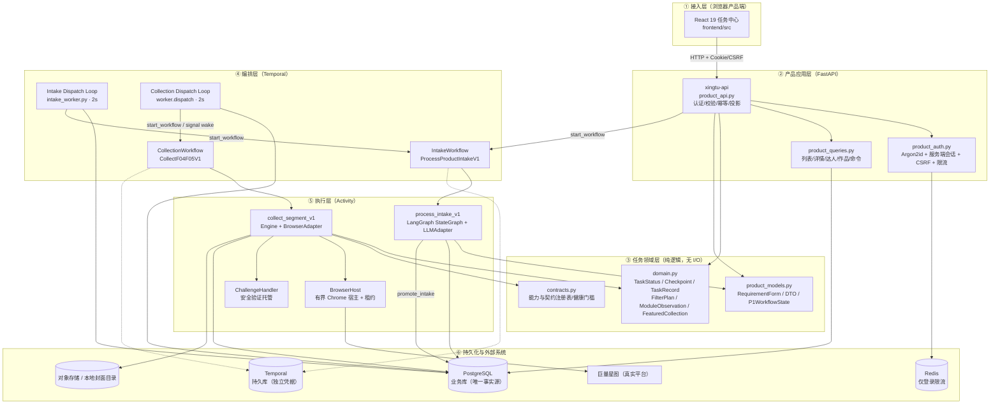
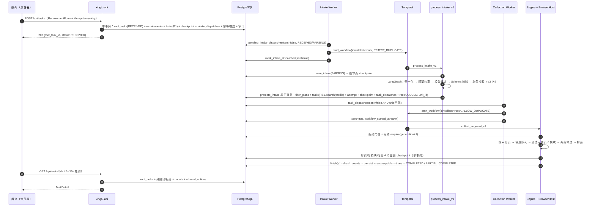
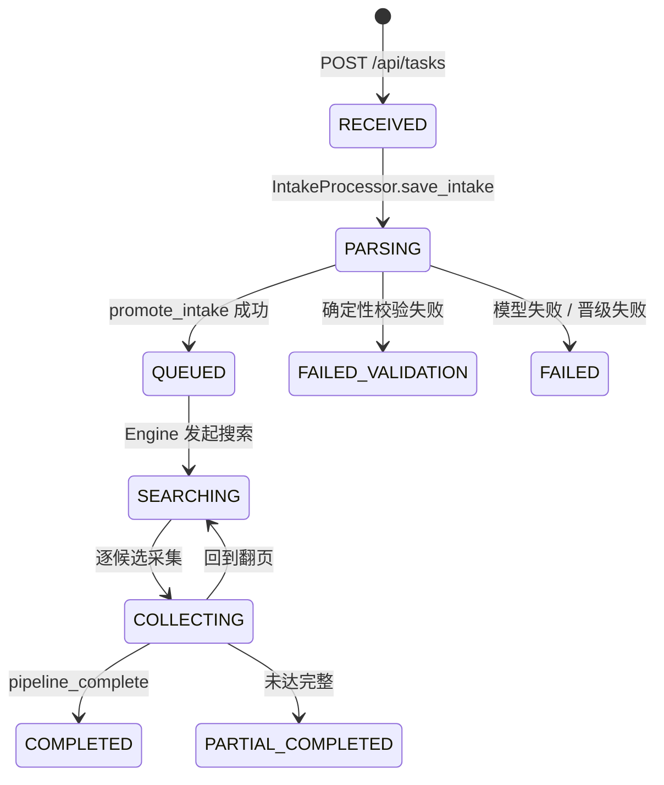
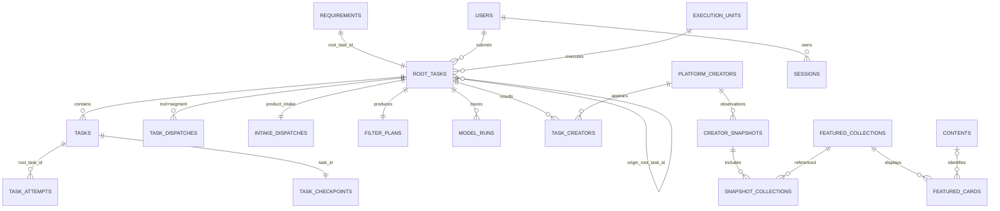
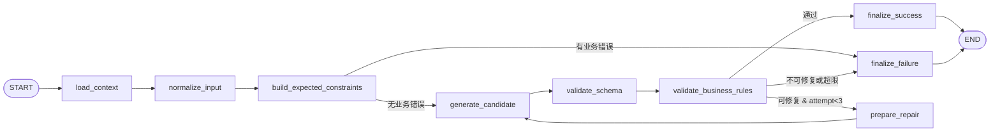

# 任务中心架构文档

> 版本：v1.0（只读梳理稿）
> 编写日期：2026-10-13
> 范围：本项目**当前已落地**的任务中心（受理 → 转换 → 排队 → 采集 → 持久化 → 查询与操作）
> 性质：**仅基于文档与代码的架构梳理，本轮未修改任何代码、迁移、契约或业务流程**
> 依据：技术方案第 8、9、13—16 章；DEC-014/DEC-013/DEC-015；`migrations/001—009`；`backend/src/xingtu/*`；`frontend/src/*`；`docs/evidence/*`；各任务卡与进度总览

---

## 0. 怎么读这份文档

| 你想了解 | 直接看 |
|---|---|
| 任务中心干什么、边界在哪 | 第 1 章 |
| 整体分层、进程与服务拓扑 | 第 2 章 |
| 任务、状态、检查点这些核心概念 | 第 3 章 |
| 数据库表、迁移与不可变约束 | 第 4 章 |
| 每个模块/文件负责什么 | 第 5 章 |
| **一条任务从提交到完成，各步骤到底发生了什么** | 第 6 章（核心） |
| HTTP 接口契约 | 第 7 章 |
| 幂等、并发、崩溃恢复怎么保证 | 第 8 章 |
| 出问题怎么定位 | 第 9 章 |
| 现在到底做了多少、缺什么 | 第 10、11 章 |
| 文件索引、常量、状态—操作矩阵 | 附录 A—E |

---

## 1. 任务中心是什么

### 1.1 业务定位

MCN 媒介人员提交一份「达人筛选需求」，系统把它转换成巨量星图可执行的筛选条件，自动搜索达人、采集主页资料与两组精选作品，并按**任务**保存和展示结果。

主流程（技术方案 §1.1）：

```
表单 → 大模型转换及确定性校验 → 持久任务排队 → 浏览器执行筛选
     → 主页资料与精选作品采集 → 持久化 → 按任务查看需求与达人
```

**任务中心是这条链路的"事实中枢"**：它是唯一保存"用户提了什么、系统答应做什么、做到哪一步、结果是什么、为什么停下"的地方，也是唯一对外提供任务身份（`root_task_id`）的地方。

### 1.2 任务中心的职责

| 职责 | 落点 |
|---|---|
| 接受并可靠持久化原始需求 | `POST /api/tasks` + `requirements` 表 |
| 生成并维护稳定的任务身份与谱系 | `root_tasks` / `tasks` / `task_attempts` |
| 驱动 P1 需求转换（模型 + 确定性校验） | `IntakeWorkflow` + `intake.py` StateGraph |
| 驱动 P2 采集（搜索、主页、精选、封面） | `CollectionWorkflow` + `Engine` |
| 保存执行检查点，支持中断续跑 | `task_checkpoints`（`Checkpoint v1`） |
| 做终态判定与计数（发现/有效/完整/失败） | `Engine.finish()` / `refresh_counts()` |
| 提供状态、阶段、合法操作与结果查询 | `product_queries.py` |
| 执行取消/继续/重试/修改重提 | `product_queries.command()` + 幂等表 |
| 承载等待（登录、账号、验证、资源、预算）与恢复 | 等待态 + 唤醒信号 |
| 管理平台契约健康与失败熔断 | `contract_capability_health` / `_failures` |
| 保留不可变历史快照 | `creator_snapshots`（DB 触发器禁改） |

### 1.3 任务中心的边界（明确不做）

- 不做跨任务达人搜索、评分、导入导出（技术方案 §1.1、CONSOLE-01 范围）。
- **2026-10-17 范围变更**：达人单条手动更新与按粉丝档位的周期性更新已纳入 UPD-01—UPD-05，仍统一使用本任务中心与执行单元池；实施/验收状态以 `docs/tasks/UPD-*.md` 为准。
- 不做多租户、多角色；所有媒介共享任务与结果，权限相同。
- 不保存业务状态于浏览器内存或 Redis：**PostgreSQL 是唯一任务事实源**（DEC-014 第 8 条）。
- 不在 Workflow 里执行不可重放的 I/O；副作用全部下沉到 Activity（技术方案 §13.2）。
- 不实现平台选择器/端点知识：这些留在 Adapter 与 `contracts/`（§13.3）。

### 1.4 术语速查

| 术语 | 含义 |
|---|---|
| 根任务 root task | 一次业务请求（一次采集或一次刷新）的全局身份，用户可见 |
| 管道任务 task | 根任务下的阶段/子任务（P1、P2-1、search、profile） |
| 尝试 attempt | 每次执行或人工重试的标识，换 attempt 不换业务任务 ID |
| segment（执行段） | P2 的一次执行预算单元；重试会 `segment+1` 而不是新建根任务 |
| 检查点 checkpoint | 可续跑的执行状态（游标、候选队列、模块观测、挑战计数…） |
| 草稿 draft | 执行期间可变的暂存结果，仅运行中可见 |
| 发布快照 published snapshot | 终态时写入的不可变结果，任务内查询只读它 |
| 发现 / 有效 / 完整 | 三种截然不同的计数，不可互相替代（§3.5） |
| allowed_actions | 服务端计算的合法操作集合，前端据此显示按钮 |

---

## 2. 总体架构

### 2.1 分层视图



**分层规则（代码中的实际约束）**

1. **接入层**只做认证、输入输出与调用应用服务，不堆积采集逻辑（`docs/agent.md` §2）。
2. **领域层是纯 Pydantic**（`Model` 基类 `extra="forbid"` + `validate_assignment=True`），大量不变量在构造时就拒绝非法数据（§3.8）。
3. **编排层不碰外部 I/O**：Workflow 只传 `root_task_id` 和状态字符串（`workflow.py:22` 注释明确「History carries only IDs/state」）。
4. **执行层所有副作用幂等**，并带租约/attempt/版本栅栏（§8.3）。
5. **持久化层唯一事实源是 PostgreSQL**；Redis 目前只用于登录限流（`product_api.py:125-127`），技术方案里提到的"查询缓存"尚未接入。

### 2.2 运行时进程拓扑

| 进程 | 启动入口 | 队列 | 职责 | 并发 |
|---|---|---|---|---|
| `xingtu-api` | `xingtu-api` / `make api` | — | FastAPI：认证、任务受理、查询、命令、封面读取；lifespan 启 `WorkerHealthMonitor` | uvicorn 默认 |
| Intake Worker | `xingtu-product intake-worker --unit-config` / `make intake-worker` | `xingtu-intake` | 每 2s 扫 `intake_dispatches` 派发 `IntakeWorkflow`；执行 `process_intake_v1` | `max_concurrent_activities=4` |
| Collection Worker | `xingtu worker --config <unit>` / `make collection-worker` | `xingtu-<unit_id>` | 每 2s 扫 `task_dispatches` 派发/唤醒 `CollectionWorkflow`；执行 `collect_segment_v1` | `max_concurrent_activities=1` |
| BrowserHost | **无独立进程** | — | Collection Worker 进程内的 `BrowserContext` 所有者；`self.host_lock` + 进程内串行 | 每单元 1 |
| 前端 | `npm --prefix frontend run dev` | — | Vite dev server（5173），`/api` 代理到 127.0.0.1:8000 | — |

> 关键事实：**浏览器不是独立服务**，也没有独立队列。`BrowserContext` 不序列化、不跨进程传递（`browser_host.py:63-67`），维护与采集共用同一个 Page。

**统一启动方式（当前推荐，`docs/development.md` §2026-10-11）**

```bash
make dev                                # PostgreSQL/Redis/MinIO/Temporal 依赖服务
make m3-check                           # 13 项只读前置自检（含模型可用性）
make m3-up                              # API + Intake Worker，出现"新鲜消费者"后才 READY
make m3-up M3_UP_FLAGS="--with-collection --with-frontend"   # 需真实采集授权时追加
```

> **运维要点（有真实事故背景）**：产品提交的任务只在 **Intake Worker 常驻**时才会离开 `RECEIVED`。缺 P1 Worker 停在 `RECEIVED`，缺 P2 Worker 停在 `QUEUED`（`docs/development.md:230`）。2026-10-11 因此产生过一个停留 7 小时 8 分的真实任务。

### 2.3 端到端时序（一次完整采集）



### 2.4 技术选型（已落地）

| 组件 | 用途 | 代码位置 |
|---|---|---|
| Python 3.13 + Pydantic v2 | 领域类型、契约校验 | `domain.py`、`product_models.py` |
| FastAPI + uvicorn | 产品 API | `product_api.py` |
| psycopg 3（手写 SQL，无 ORM） | 仓储 | `repository.py`、`product_repository.py` |
| Temporal | 持久编排、信号、重试、恢复 | `workflow.py`、`intake_workflow.py` |
| LangGraph `StateGraph` | P1 显式节点与条件边 | `intake.py:345-390` |
| Playwright + 系统 Chrome | 浏览器执行 | `runtime.py`、`adapter.py` |
| Argon2id + 服务端会话 | 产品认证 | `product_auth.py` |
| Redis | 登录限流（账号 HMAC + IP 双桶），不可用时失败关闭 | `product_auth.py` |
| boto3 / 本地目录 | 封面存储（local / s3 双实现） | `covers.py`、`product_covers.py` |
| React 19 + react-router 7 + TanStack Query 5 | 前端 | `frontend/src` |
| Docker Compose | 本地依赖服务编排 | `deploy/compose.yaml` |

---

## 3. 领域模型

### 3.1 标识与谱系

技术方案 §14.1 定义的五类标识在代码中全部落地：

| 标识 | 生成/约束 | 代码 |
|---|---|---|
| `root_task_id` | UUID，一次业务请求一个；采集与刷新分别创建 | `uid()`；`product_repository.py:213` |
| `task_id` | 根任务下的管道/子任务；`tasks` 表 `UNIQUE(root_task_id, kind)` | `product_repository.py:269-272`、`531-536` |
| `parent_task_id` | 子任务的直接上游，同属一个根任务 | 同上 |
| `attempt_id` | 每次执行/重试独立；不改变业务任务 ID | `product_queries.py:560`、`repository.py:915` |
| `workflow_id` / `run_id` | Temporal 执行标识，**不能代替业务主键** | `collect/<root_task_id>`、`intake/<root_task_id>[/<retry_cycle>]` |
| `origin_root_task_id` | 修改重提/刷新的来源，只作关联 | `product_repository.py:182`；请求头 `X-Origin-Root-Task-Id` |

**一个根任务的谱系（P1 阶段）**

```
root_tasks (state=RECEIVED, task_type=product_intake, unit_id=NULL)
 ├── requirements (1:1，root_task_id UNIQUE)
 ├── tasks(kind='P1')  ← parent_task_id = NULL
 │    └── task_checkpoints  (payload = P1WorkflowState)
 └── intake_dispatches (workflow_id = intake/<root>)
```

**晋级后（P2 阶段，同一个 root_task_id）**

```
root_tasks (state=QUEUED, unit_id=<unit>, payload = TaskRecord 摘要)
 ├── filter_plans (source='model')
 ├── tasks(kind='P2-1')          ← parent = P1 task
 │    ├── tasks(kind='search')   ← parent = P2-1
 │    ├── tasks(kind='profile')  ← parent = P2-1
 │    └── task_checkpoints (payload = Checkpoint v1)
 ├── task_attempts (segment=0…)
 └── task_dispatches (root_task_id + segment, workflow_id = collect/<root>)
```

### 3.2 根任务状态机

代码中 `TaskStatus` 共 **18 个状态**（`domain.py:76-94`），其中 2 个是对技术方案 §14.3 表的扩展（`WAITING_FOR_ACCOUNT` 来自 DEC-013，`WAITING_FOR_VERIFICATION` 来自 DEC-015）。

**主链路（正常推进）**



**全部状态**

| 状态 | 含义 | 是否终态 | 代码中由谁写入 |
|---|---|---|---|
| `RECEIVED` | 已持久化，等待启动 | 否 | `create_product_task`；P1 retry 回退 |
| `PARSING` | P1 转换及校验 | 否 | `save_intake` |
| `QUEUED` | 等待平台执行资源 | 否 | `promote_intake`、retry/continue、等待态复位 |
| `SEARCHING` | 填写筛选并发现候选 | 否 | `engine.py:268` |
| `COLLECTING` | 采集主页与精选卡片 | 否 | `engine.py:404` |
| `PERSISTING` | 提交已取得的结果 | 否 | **代码中从未赋值**（见 §11 缺口 G-01） |
| `RETRY_WAIT` | 短暂故障的自动重试等待 | 否 | `record_error`：`PLATFORM_RATE_LIMITED` |
| `WAITING_FOR_LOGIN` | 等待人工平台登录 | 否 | `record_error`：`ACCOUNT_LOGIN_REQUIRED` |
| `WAITING_FOR_ACCOUNT` | 当前账号与绑定账号不一致 | 否 | `record_error`：`ACCOUNT_MISMATCH` |
| `WAITING_FOR_VERIFICATION` | 平台安全验证托管中 | 否 | `record_error` / `ChallengeHandler.register` |
| `WAITING_FOR_RESOURCE` | 线路/租约/会话不可用或契约熔断 | 否 | `record_error`：`RESOURCE_UNAVAILABLE`/`LEASE_LOST`/`SESSION_INDETERMINATE` |
| `PAUSED_BUDGET` | 执行预算用尽 | 否 | `record_error`：`BUDGET_EXHAUSTED` |
| `CANCELLING` | 已接受取消，等待安全边界释放 | 否 | `repository.command` / `product_queries.command` |
| `CANCELLED` | 不再开展后续步骤 | **是** | 取消路径；`record_error` 收敛 |
| `COMPLETED` | 达目标且所有可执行步骤完成 | **是** | `Engine.finish()` |
| `PARTIAL_COMPLETED` | 搜索耗尽未达数量，或已结束但有失败模块 | **是** | `Engine.finish()` / `partial_complete()` |
| `FAILED_VALIDATION` | 条件无法准确执行 | **是** | `IntakeProcessor` |
| `FAILED` | 不可恢复错误或重试耗尽 | **是** | `IntakeProcessor` / `record_error` |

**两套集合（不一致点，值得注意）**

| 集合 | 成员 | 位置 | 用途 |
|---|---|---|---|
| `TERMINAL_STATES`（5） | `CANCELLED` `COMPLETED` `PARTIAL_COMPLETED` `FAILED_VALIDATION` `FAILED` | `product_queries.py:30-36` | 计算 `allowed_actions`、前端停轮询 |
| `RUNNING`（6） | `QUEUED` `SEARCHING` `COLLECTING` `PERSISTING` `RETRY_WAIT` `WAITING_FOR_VERIFICATION` | `repository.py:34-41` | `repo.edit(root, ctx)` 的栅栏：不在其中即 `TASK_CANCELLED("STALE_ATTEMPT_OR_STATE")` |

> `WAITING_FOR_LOGIN/ACCOUNT/RESOURCE`、`PAUSED_BUDGET` **不在 `RUNNING` 中**——这是有意设计：一旦进入这些等待态，带 `ctx` 的写入会被拒绝，采集 Activity 必须返回、由 Workflow 挂起等待唤醒。Activity 重新进入时 `worker.py:199-209` 先把这 5 个状态复位成 `QUEUED` 再构造 `ExecutionContext`。

### 3.3 阶段（stage）映射

`task_stage()`（`product_queries.py:53-73`）把状态翻译成面向用户的中文阶段：

| 状态 | 中文阶段 |
|---|---|
| RECEIVED | 需求已接收 |
| PARSING | 需求转换与校验 |
| QUEUED | 等待采集资源 |
| SEARCHING | 发现达人 |
| COLLECTING | 采集达人资料 |
| PERSISTING | 发布任务快照 |
| RETRY_WAIT | 等待重试 |
| WAITING_FOR_LOGIN | 等待平台登录 |
| WAITING_FOR_ACCOUNT | 等待正确平台账号 |
| WAITING_FOR_VERIFICATION | 等待安全验证 |
| WAITING_FOR_RESOURCE | 等待执行资源 |
| PAUSED_BUDGET | 预算暂停 |
| CANCELLING | 正在取消 |
| CANCELLED / COMPLETED / PARTIAL_COMPLETED / FAILED_VALIDATION / FAILED | 已取消 / 已完成 / 部分完成 / 需求校验失败 / 执行失败 |

前端 `ProgressRail`（`pages.tsx:374-378`）另有一份**6 段进度轨**映射：需求接收 → 转换校验 → 排队 → 发现达人 → 采集资料 → 发布结果。

### 3.4 检查点 Checkpoint v1

`Checkpoint`（`domain.py:751-798`）是续跑能力的全部载体，存在 `task_checkpoints.payload`（JSONB），并以 `revision` 做乐观版本。

| 字段分组 | 代表字段 | 作用 |
|---|---|---|
| 条件与代次 | `conditions_digest`、`search_generation` | 检测筛选条件漂移；游标失效重扫时 +1 |
| 翻页游标 | `cursor`、`visited_cursors`、`processed_operations`、`pending_page`、`exhausted`、`exhaustion_evidence_refs` | 分页终点与"耗尽必须有证据" |
| 停止原因 | `search_stop_reason` | 仅 `SEARCH_CAPABILITY_LIMIT` |
| 候选队列 | `candidates: list[Candidate]`、`scanned_ids`、`diagnostics`、`no_progress_pages` | 崩溃后不跳过"已发现未处理"的达人 |
| 预算与计量 | `active_seconds`、`observed_requests/responses`、`navigation_count`、`duplicate_request_count`、`featured_load_count`、`cover_request_count`、`module_seconds`、`failure_counts` | 运行预算与诊断 |
| F05 注册范围 | `profile_module_keys`、`profile_field_keys`、`profile_checkpoint_versions` | 注册表变更即 `PLATFORM_PAGE_CHANGED` |
| F06 注册范围 | `featured_collection_types`、`featured_card_fields`、`featured_checkpoint_versions` | 同上 |
| 挑战托管 | `challenge_count`、`challenge_recovery_count`、`challenge_recoveries_by_creator`、`challenge_*_at`、`challenge_current_creator`、`challenge_type/state` | 让 Activity 重试与 Workflow 重放**不会重置次数限制** |
| 版本 | `contract_version`、`adapter_version`、`revision` | 写入栅栏与乐观锁 |

每个 `Candidate`（`domain.py:737-748`）自带 `state ∈ {pending, collecting, done, invalid, failed}`、`valid`、当前 `modules`/`collections` 与 `observation_history`/`collection_history`、`retry_count`、`snapshot_ids`。

### 3.5 计数与完整度（三种数不可混同）

`TaskCounts`（`product_models.py:235-241`）对外暴露 6 个数字，来源见 `_summary()`（`product_queries.py:358-404`）与 `refresh_counts()`（`engine.py:659-674`）：

| 字段 | 含义 | 计算 |
|---|---|---|
| `target_count` | 目标数量 | `plan.target_count`（默认 20，1—200） |
| `discovered_count` | 发现数 | `len(checkpoint.candidates)` |
| `valid_count` | 有效落库数 | 首模块（基础资料）事务落库成功才 +1 |
| `profile_complete_count` | F05 资料完整数 | `candidate.valid and repo.profile_complete(...)` |
| `featured_complete_count` | F06 精选完整数 | `candidate.valid and repo.featured_complete(...)` |
| `failed_count` | 失败候选数 | `candidate.state == "failed"` |

**完整度判定链**

```
ModuleObservation.complete  = 无 coverage_gaps ∧ 字段集合完全覆盖 expected_fields ∧ 无 FAILED/NOT_ATTEMPTED
FeaturedCard.complete       = expected_fields == 实际字段 ∧ 无 FAILED/NOT_ATTEMPTED
FeaturedCollection.complete = status ∈ {COMPLETE, EMPTY, NO_PERMISSION, NOT_PROVIDED}
                              （"已登记的终态缺失"算完成检查，不算采到作品）
pipeline_complete           = valid_count ≥ target
                              ∧ 无 valid 候选资料不完整
                              ∧ 所有 valid 候选 pipeline_complete
```

### 3.6 草稿与发布快照

- **草稿**：执行期间通过 `persist_creators(..., publish=False)` 写入，运行中即可见（`view_kind="draft"`）。
- **发布快照**：终态时 `persist_creators(..., publish=True)` 写入 `creator_snapshots`，DB 触发器 `snapshot_immutable` **禁止 UPDATE/DELETE**。
- 任务内查询**只读任务关联的快照**（`task_creators.latest_snapshot_id`），不用达人最新投影替代历史（`docs/agent.md` §5.4）。
- 精选观测同样不可变：`featured_collections` / `featured_cards` 有 `immutable_featured` 触发器，重载产生**新观测**而不改历史。

### 3.7 执行单元与租约模型（任务中心的资源侧）

| 概念 | 实现 |
|---|---|
| 执行单元 | `execution_units` 一行 = 一个账号 + 一条线路 + 一个独立 profile；并发 1 |
| 网络绑定 | `network_mode ∈ {production_line, local_development}`，互斥且 fail-closed（`runtime.py:78-97`） |
| 租约 | `acquire()` 置 `owner=attempt_id`、`lease_until=now+120s`、`generation+1`、`state='LEASED'` |
| 续期 | 采集 Activity 每 15s `repo.heartbeat()`，条件不满足即 `LEASE_LOST` |
| 隔离 | 过期 owner 不抢占，直接 `QUARANTINED/EXPIRED_OWNER`；浏览器未确认停止 → `QUARANTINED` |
| 释放disposition | `VERIFIED_READY / LOGIN_REQUIRED / ACCOUNT_MISMATCH / SECURITY_CHALLENGE / SESSION_UNVERIFIED / BROWSER_UNCONFIRMED` 映射到单元状态与会话状态 |
| 模式切换 | `promote_maintenance_to_collect`（维护→采集，`session_version+1`）/ `transition_collect_to_maintenance`（挑战时反向） |

### 3.8 领域不变量（构造即拒绝）

领域层的强校验是任务中心正确性的第一道防线：

| 类型 | 关键不变量 |
|---|---|
| `FilterPlan` | 字段不重复；`operator` 与 `value` 类型必须匹配；`quote` 必须带 currency + cooperation_form + unit；有 `validation_errors` 即拒绝 |
| `Capabilities.validate_plan` | 契约必须 `VERIFIED` 且版本一致；live 模式要求 `sample_kind=='live'` 且有证据；(字段组合) 必须出现在已核验组合中 |
| `SearchPage` | `exhausted=True` 必须有 `exhaustion_evidence_refs`；非终态页必须有 `next_checkpoint` |
| `FieldObservation` | `COLLECTED` 必须有 value + source_kind + source_contract；非 `COLLECTED` 不得带 value；`FAILED`/`NOT_ATTEMPTED` 必须有失败原因；缺失/无权限/空必须有证据 |
| `CoverRef` | `STORED` 必须有 object_id + checksum + content_type + 正字节数；未验证的封面不得携带 object 引用 |
| `FeaturedCollectionObservation` | 卡片 position 必须从 0 连续；`COMPLETE` 必须有 load_complete、无 gap、有卡片且卡片全 complete |
| `ModuleObservation` | 字段不得重复且必须属于 `expected_fields` |
| `SessionHealth` | `VALID` 必须受保护页已验证 + 观测账号 == 期望账号；`ACCOUNT_MISMATCH` 必须观测到不同的账号 |
| `RequirementForm` | 至少一项业务筛选；列表字段去重且非空；`target_count ∈ [1,200]` 严格整数 |

---

## 4. 数据模型

### 4.1 表清单（按主题）

**① 任务与谱系（迁移 001 / 008 / 009）**

| 表 | 主键/唯一 | 关键列 |
|---|---|---|
| `root_tasks` | `root_task_id` | `state`、`version`、`unit_id`（008 起可空）、`payload` JSONB、`requirement_id`、`created_by`、`origin_root_task_id`、`task_type ∈ {collection, product_intake}`、`created_at`、`updated_at` |
| `filter_plans` | `root_task_id` | `payload`、`source ∈ {internal_acceptance, model}` |
| `tasks` | `task_id`；`UNIQUE(root_task_id, kind)` | `root_task_id`、`parent_task_id`、`kind ∈ {P1, P2-1, search, profile}` |
| `task_attempts` | `attempt_id` | `root_task_id`、`segment`、`created_at` |
| `task_checkpoints` | `task_id` | `revision`、`payload` JSONB |
| `task_dispatches` | `(root_task_id, segment)` | `workflow_id`、`sent`、`workflow_started_at`（009 新增） |
| `intake_dispatches` | `root_task_id` | `p1_task_id`、`workflow_id` UNIQUE、`sent` |

**② 受理与模型追溯（迁移 008）**

| 表 | 主键/唯一 | 关键列 |
|---|---|---|
| `users` | `user_id`；`username` UNIQUE（小写强制） | `display_name`、`password_hash`（Argon2id）、`active` |
| `sessions` | `session_id`；`token_hash` UNIQUE | `user_id`、`csrf_token`、`idle_expires_at`、`absolute_expires_at`、`revoked_at` |
| `requirements` | `requirement_id`；`root_task_id` UNIQUE | `submitted_by`、`origin_root_task_id`、`schema_version='requirement_form.v1'`、`capability_version`、`payload` JSONB |
| `model_runs` | `model_run_id`；`UNIQUE(root_task_id, retry_cycle, attempt_number)` | `provider`、`requested_model`、`response_model`、`prompt_version`、`input_digest`、`status`、`delivery_status`、`output_payload`、`input/output_tokens`、`latency_ms` |

**③ 达人结果与快照（迁移 001 / 003）**

| 表 | 主键/唯一 | 关键列 |
|---|---|---|
| `platform_creators` | `creator_id`；`UNIQUE(platform, platform_creator_id)` | `projection` JSONB（当前字段投影） |
| `task_creators` | `(root_task_id, creator_id)`；`UNIQUE(root_task_id, first_position)` | `valid`、`latest_snapshot_id` |
| `creator_snapshots` | `snapshot_id`；`UNIQUE(root_task_id, creator_id, draft_revision)` | `payload`、`created_at`（**不可变**） |
| `contents` | `content_id`；`UNIQUE(platform, platform_content_id)`、`UNIQUE(platform, canonical_link)` | 作品身份 |
| `featured_collections` | `collection_observation_id` | `collection_type ∈ {excellent_reach, excellent_seeding}`、`status`、`observed_at`、`set_key`、`coverage_gaps`、`payload`（**append-only**） |
| `featured_cards` | `(collection_observation_id, card_id)`；`UNIQUE(collection_observation_id, position)` | `content_id`、`identity_kind`、`platform_content_id`、`canonical_link`、`local_key`、`cover_object_id`、`cover_status`、`payload`（**append-only**） |
| `snapshot_collections` | `(creator_snapshot_id, collection_type)` | 每组独立观测时间与状态 |
| `media_objects` | `object_id` | `checksum`、`kind`、`content_type`、`byte_size`、`source_url` |

**④ 单元、契约与运维（迁移 001 / 002 / 005 / 006 / 007）**

| 表 | 说明 |
|---|---|
| `execution_units` | 账号/线路/profile 绑定、`state`、`session_version`、`generation`、`owner`、`lease_until`、`browser_stopped`、`mode`、`network_mode`、`expected/verified_account_id`、`current_root_task_id`、`maintenance_deadline`、`idle_deadline`、`last_session_*` |
| `contract_health` | 整版本人工覆盖开关（兼容保留） |
| `contract_capability_health` | `(contract_version, scope)`：`ENABLED/SUSPECTED/DISABLED`、连续失败数、去重主体数 |
| `contract_capability_failures` | `(contract_version, scope, subject_id)` 去重失败记录 |
| `unit_account_rebindings` | 账号改绑审计（含 `previous_config_account_id`） |
| `raw_evidence` | 脱敏证据对象与过期时间 |
| `audit_logs` | `root_task_id`、`actor`、`actor_user_id`、`action`、`created_at` |
| `idempotency_records` | `(actor, operation, key)`、`digest`、`root_task_id`、`response_payload` |
| `schema_migrations` | 迁移版本 |

### 4.2 迁移历史

| 版本 | 文件 | 内容 |
|---|---|---|
| 1 | `001_initial.sql` | 全部任务/谱系/快照/幂等/审计/契约基础表 + `immutable_snapshot` 触发器 |
| 2 | `002_unit_network_mode.sql` | `execution_units.network_mode`（默认 `production_line`） |
| 3 | `003_featured_collections.sql` | F06：`contents`/`featured_collections`/`featured_cards`/`snapshot_collections`/`media_objects` + `immutable_featured` 触发器 |
| 4 | `004_local_line_sharing.sql` | 线路唯一约束改为**仅覆盖 production_line** 的部分唯一索引 |
| 5 | `005_bounded_browser_host.sql` | 有界宿主所有权列（`expected/verified_account_id`、`current_root_task_id`、两个 deadline） |
| 6 | `006_session_health_and_scoped_contract.sql` | 结构化会话观测列 + 按 scope 的契约健康两张表 |
| 7 | `007_unit_account_rebinding.sql` | 账号改绑审计表 |
| 8 | `008_m3_product_app.sql` | M3：`users`/`sessions`/`requirements`/`intake_dispatches`/`model_runs`；`root_tasks` 增列；`filter_plans.source` 放宽；**`unit_id` 改可空** |
| 9 | `009_collect_dispatch_start.sql` | `task_dispatches.workflow_started_at`（取消终态判定的关键事实） |

> 迁移全部为**追加式**，无破坏性 down migration（DEC-014）。008 只放宽了两处约束：`root_tasks.unit_id` 可空、`filter_plans.source` 增加 `model`。

### 4.3 不可变性与数据库强制约束

| 机制 | 效果 |
|---|---|
| 触发器 `snapshot_immutable` | `creator_snapshots` 的 UPDATE/DELETE 直接抛异常 |
| 触发器 `immutable_featured` | `featured_collections` / `featured_cards` 追加式，历史观测不可改 |
| `UNIQUE(root_task_id, kind)` on `tasks` | 一个根任务每种 kind 只有一个任务行（重试靠 `segment` 而非新建任务） |
| `UNIQUE(root_task_id, first_position)` on `task_creators` | 首次发现位置唯一，保住"平台发现顺序" |
| `UNIQUE(collection_observation_id, position)` | 组内顺序唯一，且 position 必须从 0 连续（应用层校验） |
| `UNIQUE(root_task_id, retry_cycle, attempt_number)` on `model_runs` | 模型调用次数可审计 |
| `task_dispatches` / `intake_dispatches` 的 `workflow_id` | 确定性 ID 防重复启动 |
| `sessions` CHECK `idle_expires_at <= absolute_expires_at` | 会话双重过期语义 |
| `contract_capability_failures` 复合主键 | 同一 scope 下不同 subject 去重 |

### 4.4 索引（与查询模式的对应）

| 索引 | 服务的查询 |
|---|---|
| `root_tasks_state_created (state, created_at)` | 按状态/时间筛选任务列表 |
| `root_tasks_product_created (created_at DESC, root_task_id DESC) WHERE task_type='product_intake'` | 产品任务游标分页（与 `(created_at, root_task_id) <` 元组比较完全对齐） |
| `featured_collections_creator (creator_id, observed_at)` | 达人历史观测 |
| `featured_cards_content` / `featured_cards_cover` | 作品身份与封面引用反查 |
| `sessions_user_active` / `audit_logs_actor_user_created` / `model_runs_task_created` / `unit_account_rebindings_unit` | 会话、审计、模型追溯、改绑审计 |
| `execution_units_production_line_ref_key`（部分唯一） | 生产线路独占；本地单元共享出口 |

### 4.5 ER 关系



---

## 5. 组件详解

### 5.1 产品接入层

**`product_api.py`（476 行）— FastAPI 应用**

- `ProductSettings.from_environment()`：`XINGTU_DATABASE_URL`、`XINGTU_REDIS_URL`、`XINGTU_LOGIN_HMAC_KEY`、`XINGTU_ALLOWED_ORIGINS`、`XINGTU_SECURE_COOKIE`、`XINGTU_TEMPORAL_ADDRESS`、封面配置。
- `build_services()`：装配 `AuthService` / `ProductRepository` / `ProductQueries` / `PlatformRegistry` / `ProductCoverReader`；启动时 `registry.require_enabled(live=True)`——**未核验的注册表直接拒绝启动**。
- 中间件：为每个请求注入 `X-Request-Id`，响应统一 `Cache-Control: no-store`。
- 异常处理：`CollectorError → _status_for_error()` 映射（见 §7.4）；`RequestValidationError → 422 + field_errors`；409 时**回填当前 `version` 与 `allowed_actions`**，让前端能自我纠正。
- 依赖注入：`current_user`（Cookie 会话）、`current_user_with_csrf`（额外校验 Origin + CSRF Header）。

**`product_auth.py`（224 行）— 认证**

- Argon2id 密码哈希；Cookie 只存高熵原始令牌，DB 只存 SHA-256 摘要。
- 写请求同时校验同源 `Origin` 与会话绑定 CSRF 令牌。
- 登录限流：Redis 账号 HMAC + IP 双桶；**Redis 不可用时失败关闭**，不降级放行。
- 会话支持空闲 + 绝对双重过期与撤销。

### 5.2 受理与查询

**`product_repository.py`（634 行）— 受理侧写路径**

| 方法 | 职责 |
|---|---|
| `create_product_task` | **单事务**写入 root + requirement + P1 task + checkpoint + intake_dispatch + 幂等响应 + 审计 |
| `load_intake` / `save_intake` | 读写 `P1WorkflowState`（含状态与 revision 校验） |
| `begin_model_run` / `finish_model_run` / `existing_model_run` | 模型调用逐次留痕；支持"上次投递不确定"判定 |
| `fail_intake` | 把 P1 失败写成可追溯终态（含字段错误） |
| `promote_intake` | **P1→P2 原子晋级**（详见 §6.3） |
| `pending_intake_dispatches` / `mark_intake_dispatched` / `record_intake_dispatch_failure` | 受理派发意图与失败留痕（60s 节流） |

**`product_queries.py`（864 行）— 查询与命令侧**

- `list_tasks`：状态/时间筛选 + **服务端游标**（base64 `{created_at, root_task_id, scope}`，scope 是筛选条件的哈希，**换筛选条件即游标失效**）。
- `get_task`：详情 = `TaskSummary` + 原始需求 + 执行计划 + 字段错误 + `origin_root_task_id` + `challenge` 摘要 + `intake` 进度。
- `command`：cancel/continue/retry 的**幂等 + 版本 + 状态机**实现（§6.8）。
- `list_creators` / `get_creator`：草稿与发布快照分流；跨任务/跨快照游标拒绝。
- `contents`：两组精选集合**独立分页**，游标绑定快照与分组。
- `_intake_progress`：把"任务为什么还停在 RECEIVED"翻译成三种可诊断情形（§9.2）。
- `_challenge_summary`：把 checkpoint 里的挑战字段翻译成用户可见的等待摘要。

### 5.3 P1 需求转换

**`intake.py`（605 行）**

- `DeepSeekAdapter`：Responses API + JSON Schema；模型 `deepseek-flash`、超时 90s、`temperature=0`、`max_output_tokens=2000`。
- `build_expected_plan()`：**从表单与能力字典确定性推导"期望计划"**，作为模型输出的比对基准（不是让模型自己决定）。
- `IntakeGraph`（`intake.py:345-390`）：LangGraph `StateGraph`，节点与边：



- **有界修复**：`max_attempts=3`，不可修复错误码白名单（`CAPABILITY_VERSION_CHANGED`、`AI_AUTH_OR_QUOTA`、`AI_PROVIDER_REJECTED`）直接失败。
- **双层校验**：`validate_schema`（Pydantic `FilterPlan` 结构）→ `validate_business_rules`（`_first_difference` 逐字段比对期望约束 + `Capabilities.validate_plan` 枚举/组合/单位/币种）。
- **投递不确定性**：`delivery_status='indeterminate'` 时不允许盲目重试，转 `AI_DELIVERY_INDETERMINATE` 业务错误。

**`intake_workflow.py`（19 行）**：`ProcessProductIntakeV1`，单个 activity，`start_to_close_timeout=10min`、`maximum_attempts=1`（模型重试由状态机自管，避免双层重试放大）。

**`intake_worker.py`（185 行）**：`IntakeProcessor.process()` 负责状态流转与终态兜底；`dispatch_intakes()` 逐个启动 workflow 且**单任务失败不中断循环**；`run_intake_worker()` 每 2s tick 一次。

### 5.4 编排层

**`workflow.py`（73 行）— `CollectionWorkflow` / `CollectF04F05V1`**

- 循环：`execute_activity("collect_segment_v1")` → 若返回终态则结束；若为 `PAUSED_BUDGET`/登录/验证等待 → **无限等待 `wake` 信号**；否则 30s 超时等待信号后重新调用 Activity（实现"长任务分段 + 心跳续跑"）。
- Activity 配置：`start_to_close_timeout=125min`、`heartbeat_timeout=45s`、`RetryPolicy(maximum_attempts=4, initial=5s, backoff=2, max=60s)`。
- `workflow.patched("waiting-for-login-explicit-wake-v1" / "waiting-for-verification-explicit-wake-v1")` 保证历史重放兼容。
- `is_continue_as_new_suggested()` → `continue_as_new(root_task_id)` 控制历史体积。

**派发器（两处，行为对称）**

| | Intake | Collection |
|---|---|---|
| 扫描表 | `intake_dispatches WHERE sent=false` + root 状态 ∈ {RECEIVED, PARSING} | `task_dispatches WHERE sent=false` AND root.unit_id 匹配队列 |
| workflow ID | `intake/<root>[/<retry_cycle>]` | `collect/<root>` |
| ID 复用策略 | `REJECT_DUPLICATE` | `ALLOW_DUPLICATE`（已存在则发 `wake`） |
| 写回 | `sent=true` | `sent=true, workflow_started_at=now()` |
| 异常隔离 | 单任务失败记 audit 并保持 `sent=false`，下轮重试 | 同上，且 tick 异常不杀死消费者 |
| 轮询间隔 | 2s | 2s |

**取消的编排处理**：`dispatch()` 额外扫描 `state='CANCELLING'` 的任务——workflow 仍 RUNNING 则发 `wake`，否则当场 `_finalise_cancelled()` 置 `CANCELLED`。

### 5.5 执行层

**`worker.py`（432 行）— `Activities.collect` / `collect_segment_v1`**

单次 Activity 的执行骨架：

1. 终态/取消短路（`CANCELLING → CANCELLED`）。
2. 契约门槛：`registry.require_enabled(live=True)` + `repo.require_contract(contract_version, 所有 scope)` + `ensure_line()`；失败按错误码映射等待态。
3. 判断单元是否处于维护态（`NEEDS_LOGIN` / `ACCOUNT_MISMATCH` / `NEEDS_VERIFICATION`）。
4. `async with self.host_lock:` → `async with BrowserHost.lease(...)`：取租约 + 打开浏览器。
5. 启动心跳协程（15s：`host.heartbeat()` + `activity.heartbeat()` + `engine.guard()`）。
6. 维护态：`host.maintain_and_promote(timeout, challenge_handler=...)`；验证通过后 `challenge_handler.recovered()` + 冷却 60s。
7. 循环：复位等待态 → 构造 `ExecutionContext` → `BrowserAdapter` → `Engine.run()`。
8. `finally`：释放租约并写入 disposition（`stopped=False` 强制 `QUARANTINED`）。

**`engine.py`（803 行）— 采集状态机**（详见 §6.5）

**`browser_host.py`（294 行）**：进程内、有界、单单元的 `BrowserContext` 所有者；持有租约、profile 锁、当前 Page；`maintain_and_promote` 复用同一上下文完成"人工登录 → 采集"交接；`observe_session()` 把 `SessionHealth` 转成 release disposition。

**`runtime.py`（588 行）**：`UnitConfig`（fail-closed 的 `network_mode` 校验）、`BrowserRuntime`（profile 在私有根内 + `flock` 独占 + `launch_persistent_context` + storage-state 快照 + 有界关闭 20s + `confirm_local_browser_stopped` 双重确认）。

### 5.6 仓储与并发

**`repository.py`（1240 行）— 手写 SQL，无 ORM**

| 主题 | 方法 |
|---|---|
| 契约 | `require_contract`、`enable_contract(_scope)`、`record_capability_failure/success`、`capability_has_failure_streak` |
| 单元 | `register_unit`、`rebind_unit_account`、`recover_stopped_unit`、`invalidate_session`、`unit` |
| 租约 | `acquire`、`heartbeat`、`release`、`promote_maintenance_to_collect`、`transition_collect_to_maintenance`、`request_login_maintenance`、`queue_login_resumes` |
| 任务 | `create`、`get`、`edit`（栅栏上下文）、`command`、`persist_creators`、`cover_reference`、`results` |
| 完成度 | `retryable`、`profile_complete`、`featured_complete`、`pipeline_complete`、`profile_coverage` |

**核心抽象：`Repository.edit(root, ctx)`**——带栅栏的事务上下文管理器：

```python
with self.repo.edit(self.root, self.ctx) as (task, conn):
    ...            # 读的是 FOR UPDATE 锁定的 root_tasks + checkpoint
# 退出时 _save()：version+1、checkpoint.revision+1，同一事务提交
```

`ctx` 存在时校验 6 项租约条件 + 5 项任务条件 + 3 项版本条件，任一不符即 `LEASE_LOST` / `TASK_CANCELLED` / `PLATFORM_PAGE_CHANGED`——这是"拒绝旧尝试与取消后迟到提交"的实现位置（技术方案 §5.4）。

**两条补充机制**

| 机制 | 实现 |
|---|---|
| 迁移互斥 | `migrate()` 先取 `pg_advisory_xact_lock(904051)`，再按文件名前缀升序在**同一事务**内执行未应用的 `*.sql`（失败整体回滚） |
| 契约熔断状态机 | `record_capability_failure()`：同一 `(contract_version, scope, subject_id)` 重复上报幂等不推进；**≥3 个不同主体**且租约代次更新 → `SUSPECTED`；已达 `SUSPECTED` 后再有**第 4 个不同主体**且代次更新 → `DISABLED`。`record_capability_success()` 清零失败链，但**永不自愈已 `DISABLED` 的 scope**；`enable_contract_scope()` 是唯一人工恢复入口（需 scope + 非空 reason，写审计）。环境变量 `XINGTU_SCOPED_CONTRACT_HEALTH=0` 可把域级熔断整体降级为不读不写（仅保留全局 `contract_health` 人工覆盖） |
| 模式晋级的三证据 | `promote_maintenance_to_collect()` 要求 owner/generation/state/mode/lease_until/`session_version`/`maintenance_deadline` 全部相符，外加账号匹配与三个显式验证证据；否则按原因返回 `LEASE_LOST` 或 `ACCOUNT_LOGIN_REQUIRED/SESSION_VERIFICATION_INCOMPLETE` |

### 5.7 挑战托管

**`challenge.py`（229 行）**

| 能力 | 实现 |
|---|---|
| `ChallengePolicy` | `stable_seconds=5`、`timeout_seconds=900`、`recovery_cooldown_seconds=60`、`creator_interval_seconds=15`、`max_task_recoveries=2`、`max_creator_recoveries=1`、`poll_seconds=0.25` |
| `register()` | 持久化检测并**原子地**执行次数限制（同达人 ≤1 次、同根任务 ≤2 次），置 `WAITING_FOR_VERIFICATION` |
| `wait_for_stable_session()` | **纯 DOM 只读**：挑战连续不可见 5s、受保护页可见、账号可读且与绑定账号一致 |
| `recovered()` / `failed()` | 记录恢复/终止，状态 `VERIFIED / TIMEOUT / FAILED / LIMIT_EXCEEDED` |
| 跨 Activity 有界 | `waiting_seconds()` / `remaining_timeout()` 基于**持久化的** `challenge_wait_started_at`，Activity 重启不会重置超时 |

到达上限/超时/账号不一致/会话失效 → `engine.partial_complete(SECURITY_CHALLENGE_*)`：**发布已持久结果**后 `PARTIAL_COMPLETED`。系统明确不操作验证控件（DEC-015）。

### 5.8 封面与证据

| 模块 | 职责 |
|---|---|
| `covers.py`（371 行） | `CoverPipeline` + `LocalCoverStore` / `S3CoverStore`：先写对象并 `verify()`，再在 DB 登记 `media_objects` 引用；未引用对象由 `xingtu cover-gc` 清理 |
| `product_covers.py`（57 行） | `ProductCoverReader`：按 object_id 读取并**比对 checksum + 字节数**，不一致即 `COVER_OBJECT_VERIFICATION_FAILED`；local 模式强制目录在私有根内，防路径穿越 |
| `evidence.py`（145 行） | 脱敏证据落盘（摘要 / 失败证据），带 `expires_at` |
| `diagnostics.py`（219 行） | 会话诊断报告（HMAC 化 Cookie 值） |

### 5.9 健康观测

**`worker_health.py`（255 行）**

- `describe_queue()` 调 Temporal `DescribeTaskQueue` 读 poller 列表，按 `DEFAULT_FRESHNESS_SECONDS=180` 判定 `alive`（三态：`True`/`False`/`None`，`None` 表示观测本身失败）。
- 为什么是 180s：实测健康 worker 的长轮询刷新间隔为 58s/58s/**121s**，用 10s 级阈值会把正常 worker 判成不在线（`worker_health.py:44-46`）。
- `WorkerHealthMonitor`：单守护线程，每 5s 刷新，`GET /api/health/workers` 读取快照。

### 5.10 前端

**技术栈**：React 19 + react-router 7 + TanStack Query 5 + Vite 7 + vitest 3；无全局状态库，鉴权用 Context，CSRF token 存模块级变量。

| 路由 | 页面 | 用途 |
|---|---|---|
| `/login` | `LoginPage` | 登录；已登录跳回来路 |
| `/tasks` | `TasksPage` | 任务中心列表：4 个汇总指标 + 状态/日期筛选 + 服务端游标分页 |
| `/tasks/new` | `NewTaskPage` | 能力驱动动态表单；`?origin=<id>` 即"修改重提" |
| `/tasks/:taskId` | `TaskDetailPage` | 任务详情：阶段轨、挑战面板、intake 阻塞面板、6 类计数、达人列表、需求与执行计划 |
| `/tasks/:taskId/creators/:creatorId` | `CreatorDetailPage` | 达人快照：F05 模块字段 + F06 两组精选 Tab + 认证封面 |
| `/settings` | 占位 | "当前里程碑不包含设置页面" |

**关键设计：合法操作完全由服务端决定**——`TaskActions`（`pages.tsx:365-372`）只做 `task.allowed_actions.includes(...)`，不自行判断状态。

**轮询策略（实现与方案有差异，见 §11）**

| 视图 | 间隔 |
|---|---|
| 任务列表 | 固定 15s，**不因全部终态而停止** |
| 任务详情 | 终态 → 停止；等待态 → 15s；否则 → 5s |
| 任务内达人 | 无轮询；任务进入终态时 `invalidateQueries` 刷新一次 |
| 达人详情 / 作品 | 无轮询 |

---

## 6. 任务生命周期逐步详解

### 6.1 提交受理（`POST /api/tasks`）

**前置校验**：Origin（CSRF 依赖）→ 会话 → `RequirementForm` 格式校验（Pydantic，至少一项业务筛选、target 1—200 严格整数）。

**单事务写入（`product_repository.py:196-301`）**

```
1. pg_advisory_xact_lock(user_id:product.create_task:<key>)   ← 串行化同键并发
2. 查 idempotency_records：
     存在且 digest 相同 → 直接返回原响应（同键同内容）
     存在且 digest 不同 → 409 IDEMPOTENCY_CONFLICT（同键异内容）
3. 生成 root_task_id / requirement_id / p1_task_id
4. 校验 X-Origin-Root-Task-Id 指向的任务存在，否则 422 ORIGIN_TASK_NOT_FOUND
   （避免外键异常变成 500）
5. INSERT root_tasks(state='RECEIVED', version=0, unit_id=NULL, task_type='product_intake')
6. INSERT requirements（原始表单 + capability_version）
7. INSERT tasks(kind='P1')
8. INSERT task_checkpoints(payload = P1WorkflowState)
9. INSERT intake_dispatches(workflow_id = 'intake/<root>', sent=false)   ← 启动意图
10. INSERT idempotency_records(含 response_payload)
11. INSERT audit_logs('product_task.create')
```

**幂等摘要** = `sha256(form + capability_version + origin_root_task_id)`。响应 202 + `{root_task_id, status:"RECEIVED"}`。

> 设计要点：**需求、根任务、启动意图同事务**（技术方案 §14.2）。数据库不依赖 Redis 防重。

### 6.2 P1 需求转换

1. Intake Worker 的派发循环每 2s 扫描 `sent=false` 的 `intake_dispatches`，以确定性 ID 启动 `IntakeWorkflow`，随即置 `sent=true`。
2. `IntakeProcessor.process()`：`save_intake(PARSING)`。
3. `IntakeGraph` 按 §5.3 的图执行，逐节点回调 `checkpoint()` 落库（因此中途崩溃可从节点状态续跑）。
4. 每次模型调用先 `begin_model_run`（记录 provider/模型/prompt 版本/输入摘要），结束后 `finish_model_run`（状态、用量、耗时或错误）。**已成功的历史 run 会被复用**，不重复付费。
5. 三种结局：

| outcome | root 状态 | 含义 |
|---|---|---|
| `succeeded` + `final_plan` | → `QUEUED`（走晋级） | 计划通过结构 + 确定性 + 能力三重校验 |
| `failed_validation` | `FAILED_VALIDATION` | 模型输出与用户意图不一致且不可修复（含非白名单 Schema/业务错误） |
| `failed_model` | `FAILED` | 模型不可用、被拒、投递不确定 |

### 6.3 晋级 P1 → P2（`promote_intake`，同一个 `root_task_id`）

**这是任务中心最关键的原子操作**（`product_repository.py:465-569`）：

```
FOR UPDATE 锁定 root_tasks
 ├─ 若已存在 kind='P2-1' 任务 → 幂等返回（只晋级一次）
 ├─ state = CANCELLED → TASK_CANCELLED（取消后的 Intake 不再申请浏览器）
 ├─ state ∉ {PARSING, RECEIVED} → INTAKE_STATE_CONFLICT
 └─ 校验执行单元存在，否则 RESOURCE_UNAVAILABLE
生成 p2_task_id / attempt_id，构造 TaskRecord(state=QUEUED)
 INSERT filter_plans(source='model')
 INSERT tasks(P2-1) + tasks(search) + tasks(profile)
 INSERT task_attempts(segment=0)
 INSERT task_checkpoints(Checkpoint v1，含注册表版本与 profile_requirement)
 INSERT task_dispatches(segment=0, workflow_id='collect/<root>', sent=false)   ← P2 启动意图
 UPDATE root_tasks SET state='QUEUED', version+1, unit_id=<unit>, payload=TaskRecord
 UPDATE task_checkpoints(P1) revision+1
 INSERT audit_logs('product_intake.promote')
```

失败兜底：任何异常都被 `_fail_after_promotion()` 收敛成 `FAILED` + 原因（否则 Temporal `maximum_attempts=1` 会把任务永久留在 `PARSING`）。

### 6.4 派发与编排

- Collection Worker 每 2s 扫 `task_dispatches WHERE sent=false AND root.unit_id = <本队列单元>`。
- 启动 `collect/<root>`；已存在则发 `wake` 信号；随即 `sent=true, workflow_started_at=now()`。
- **`workflow_started_at` 的语义**（迁移 009）：它是"是否真有采集进程可能持有该任务"的唯一持久证据，直接决定取消能否一步终态化。
- Workflow 循环调用 `collect_segment_v1`，等待信号或 30s 超时后重入；`continue_as_new` 控制历史体积。

### 6.5 采集执行（`Engine.run`）

**阶段 A：启动自检**

1. `require_contract(contract_version, {session, search, profile_identity, profile_module:*, featured:*})`。
2. 比对注册表：模块键、精选类型、各 checkpoint 版本与注册表不一致 → `PLATFORM_PAGE_CHANGED`（`MODULE_REGISTRY_CHANGED` 等）。**防止任务中途换注册表导致筛选语义静默变化。**
3. `rebuild_conditions()` 重建并回读平台筛选条件；不兼容先 `rescan("CURSOR_INVALID")` 再试，仍失败即 `CANNOT_REBUILD_CONDITIONS`。

**阶段 B：主循环（`engine.py:228-325`）**

```
guard()（预算 + 租约）
┌─ 有可采候选？
│    优先 valid 且 state ∈ {pending, collecting}（先把已达标的有效达人补完）
│    否则（valid_count < target）取任意 pending/collecting
│    → collect(identity) → 按 creator_interval_seconds(15s) 间隔
├─ valid_count ≥ target → finish()
├─ pending_page 非空 → ingest_pending_page()（按 scanned_ids 去重）
│    整页无新增 ID → BUDGET_EXHAUSTED / CANDIDATE_SCAN
├─ checkpoint.exhausted → finish()
├─ scanned_ids ≥ scan_budget → BUDGET_EXHAUSTED / CANDIDATE_SCAN
└─ 翻页：置 SEARCHING → adapter.search(plan, checkpoint, ctx)
     SEARCH_CAPABILITY_LIMIT → 记 search_stop_reason 后 finish()
     SEARCH_CURSOR_INVALID → rescan + rebuild_conditions 后继续
     exhausted 页：先上传耗尽证据，再写检查点
     单事务提交检查点，提交前做 6 项一致性校验：
       conditions_digest 不符        → PLATFORM_CONDITION_MISMATCH
       search_generation 不符       → STALE_SEARCH_GENERATION
       operation_id 重复            → DUPLICATE_OPERATION
       current_checkpoint ≠ cursor  → CHECKPOINT_MISMATCH
       next ∈ {cursor, visited}     → CURSOR_LOOP
       连续无新身份达上限（默认 2，重扫时 max(2, len(candidates)+1)）
                                    → SEARCH_NO_PROGRESS
```

> 设计要点：**"无进展"绝不等于"耗尽"**——只有平台明确给出 `exhausted` 且带证据才允许声明搜索结束（技术方案 §5.2.2）。

**阶段 C：单达人采集（`collect` → `_collect_once`）**

| 步骤 | 说明 |
|---|---|
| 身份重试 | 最多 3 次，只重试 `PLATFORM_PAGE_CHANGED/IDENTITY_UNREADABLE`；第 1 次失败后重检会话；3 次失败记 `CandidateDiagnostic` 并把候选置 `failed`，**继续后续候选补位** |
| 幂等短路 | 已 `valid` 且 `pipeline_complete` 的候选直接 `done` |
| 模块循环 | 8 个 F05 模块逐个采集；**已 complete 的模块跳过**；首模块（基础资料）是身份与有效性门槛 |
| 可选模块隔离 | 非首模块 `RESPONSE_SCHEMA_MISMATCH` / `MODULE_COLLECTION_FAILED` 被隔离为 `__module_failure__` 观测 + 失败证据 + scope 级熔断，**不摧毁该达人的其余成功模块** |
| 身份一致性 | 模块观测的 `platform_creator_id` / `module_key` / `contract_version` 三项不符即 `MODULE_IDENTITY_OR_VERSION` |
| 有效性判定 | 首模块缺 nickname 或 platform_creator_id → `failed/BASIC_THRESHOLD_FAILED`；平台 ID 与搜索身份不一致 → `invalid/CREATOR_INVALID`；否则 `valid=True, valid_count += 1`（超目标 → `TARGET_OVERRUN`），并**立即 `persist_creators(publish=False)` 让草稿可见** |
| 精选集合 | `collect_featured()`：逐个默认集合采集 → 卡片身份/契约校验 → 封面管道（无源 URL → `NOT_ATTEMPTED + COVER_SOURCE_MISSING`；已 STORED 跳过）→ `apply_cover_outcomes()` 把封面失败折叠进覆盖缺口 → 事务内写入并做去重与"可复用"判定 |
| 重载语义 | `reusable(previous, observation, spec)`：**同稳定 `set_key` + 同指纹**才复用旧观测；集合变化则生成**新观测**（不拼接虚假的同时点列表） |

**阶段 D：收尾（`finish()`）**

```
refresh_counts()
pipeline_complete = valid_count ≥ target
                    ∧ 无 valid 候选资料不完整
                    ∧ 所有 valid 候选 pipeline_complete
persist_creators(publish=True)   ← 发布不可变快照
pipeline_complete ? COMPLETED : PARTIAL_COMPLETED
```

### 6.6 终态判定与失败原因优先级

`PARTIAL_COMPLETED` 的 `failure_reason` 按以下顺序取第一个命中（`engine.py:698-712`）：

| 优先级 | 原因 | 条件 |
|---|---|---|
| 1 | `SEARCH_CAPABILITY_LIMIT` | 平台能力边界停止且未达目标 |
| 2 | `PROFILE_SCOPE_INCOMPLETE` | 资料不完整**且**配置了业务需求清单 `ProfileRequirement` |
| 3 | `MODULE_COLLECTION_FAILED` | 资料不完整，或有候选 `state == "failed"` |
| 4 | `FEATURED_COLLECTION_INCOMPLETE` | 精选步骤尝试过但未全部完成 |
| 5 | `FEATURED_NOT_ATTEMPTED` | 已达目标但精选步骤从未尝试（注册表 `featured=[]`） |
| 6 | `SEARCH_EXHAUSTED` | 搜索确实耗尽但未达目标 |

**同步对外的 `featured_status`**：`COMPLETED` / `PARTIAL_COMPLETED` / `NOT_ATTEMPTED`（全部 valid 达人的集合都完成才算 COMPLETED）。

### 6.7 等待态与恢复路径

| 等待态 | 触发 | 恢复方式 | 是否会轮询 |
|---|---|---|---|
| `WAITING_FOR_LOGIN` | `ACCOUNT_LOGIN_REQUIRED` | **用户显式** `xingtu login` 产生维护意图与唤醒；同一浏览器上下文内完成登录校验后 `promote_maintenance_to_collect` 续跑 | 否（无限等待 wake） |
| `WAITING_FOR_ACCOUNT` | `ACCOUNT_MISMATCH` | 同上（并记录账号不一致证据） | 否 |
| `WAITING_FOR_VERIFICATION` | `PLATFORM_SECURITY_CHALLENGE` / 单元 `NEEDS_VERIFICATION` | `ChallengeHandler` 只读监测稳定性 → 会话复核 → 晋级回采集（最多 2 次/任务、1 次/达人、单次 900s） | 维护活动内 0.25s 轮询 DOM |
| `WAITING_FOR_RESOURCE` | `RESOURCE_UNAVAILABLE` / `LEASE_LOST` / `SESSION_INDETERMINATE` / 契约 `SUSPECTED` | 资源与契约健康恢复后由唤醒/重试重新调度 | 30s 超时轮询重入 |
| `RETRY_WAIT` | `PLATFORM_RATE_LIMITED` | Temporal 退避重试 | 30s 超时轮询重入 |
| `PAUSED_BUDGET` | `BUDGET_EXHAUSTED`（当前仅 `CANDIDATE_SCAN`） | **用户** `POST .../continue`：`segment+1`、新 attempt、追加新 dispatch | 否（无限等待 wake） |

> 关键纪律：`PAUSED_BUDGET`、人工等待、资源等待都**不是终态**（技术方案 §14.3）。而且登录/验证等待**不靠定时轮询**——避免反复唤起可见 Chrome（`workflow.py:59-62` 注释）。

### 6.8 任务操作语义（cancel / continue / retry / 修改重提）

**命令通用机制**（`product_queries.command()`）：

```
pg_advisory_xact_lock(user_id:product.task.<action>:<key>)
 → 幂等记录命中？ digest 相同返回原结果；不同 → 409 IDEMPOTENCY_CONFLICT
 → SELECT root_tasks ... FOR UPDATE
 → version ≠ expected_version → 409 STATE_VERSION_CONFLICT
 → 状态机判定 → 写状态 + version+1 + checkpoint revision+1 + 幂等记录 + 审计
```

**四种操作**

| 操作 | 适用状态 | 行为 |
|---|---|---|
| **取消** | 非终态且非 `CANCELLING` | **P1 阶段**（payload 无 `task_id`，状态 RECEIVED/PARSING）：一步 `CANCELLED` + `TASK_CANCELLED`。**P2 阶段**：按 `task_dispatches.workflow_started_at` 判定——从未启动采集 → 一步 `CANCELLED`（否则在 P2 Worker 不在线时永久卡在 `CANCELLING`，即 FIX-01 P1-B 修复的缺陷）；已启动 → `CANCELLING`，由 P2 派发循环收尾 |
| **继续** | `PAUSED_BUDGET` | `segment+1`、新 attempt、`active_seconds=0`、`scanned_ids=[]`、按任务数量派生重试目标（见下）恢复候选、插入新 `task_dispatches`、`QUEUED` |
| **重试** | `FAILED` 或（`PARTIAL_COMPLETED` 且有可重试候选，且非 `SECURITY_CHALLENGE_*`） | P2 同"继续"；**P1 阶段**（无 `task_id`）走 `retry_cycle+1`、attempt_count 归零、`intake_dispatches.sent=false` 且 `workflow_id` 换成 `intake/<root>/<retry_cycle>`。审计动作记录为 `retry:continue` / `retry:backfill` |
| **修改重提** | `FAILED_VALIDATION` | 不是后端命令：前端带 `?origin=<root>` 打开表单，提交时带 `X-Origin-Root-Task-Id` 创建**新根任务**，旧需求不变 |

**`allowed_actions` 计算**（`product_queries.py:76-93`）

| 动作 | 条件 |
|---|---|
| `cancel` | 非终态且非 `CANCELLING` |
| `continue` | `PAUSED_BUDGET` |
| `retry` | `FAILED`；或 `PARTIAL_COMPLETED` 且失败原因不是 `SECURITY_CHALLENGE_*` 且存在可重试候选 |
| `modify_resubmit` | `FAILED_VALIDATION` |

**重试目标派生**（`retry_policy.decide_retry_scope()`）：有效数 < 目标数 → **继续采集**，只恢复尚未计入有效数的候选；已计入有效数且停留在 `pending`/`collecting` 的候选收敛为 `done`（本次不重访），同一未终态尝试内的 `collecting` 断点仍由引擎在当前 Activity 恢复。有效数 ≥ 目标数 → **补采缺失字段**，只恢复已计入有效数且不完整的候选，未计数候选不重新入队。

**可重试候选判定** `retry_policy.is_retryable()`（`Repository.retryable()` 委托）：候选 `state == "failed"`，或已计入有效数且任一模块/精选集合未完成。`NOT_PROVIDED`/`NO_DATA`/`NO_PERMISSION` 属于已解析缺失，不构成重试项。只有"平台结果不足且无失败步骤"的部分完成任务**不提供**无意义补采（需重新搜索则创建新任务）。

**profile 模块动作超时边界**（DIAG-03）：非 basic 模块的注册动作/就绪超时（Playwright
`TimeoutError`、`PAGE_READY_TIMEOUT`）在 adapter 内转为 `MODULE_COLLECTION_FAILED`
（`MODULE_ACTION_TIMEOUT:<key>` / `MODULE_READY_TIMEOUT:<key>`），记为该达人模块不完整并继续
后续达人与分页；basic、session、challenge、login、lease、identity 与浏览器关闭仍按原规则 fatal。

### 6.9 错误码与状态映射

**错误码全集**（`domain.py:34-64`，附录 B 口径）：`INVALID_FORM`、`UNSUPPORTED_FILTER`、`AI_PARSE_FAILED`、`PLATFORM_CONDITION_MISMATCH`、`PLATFORM_PAGE_CHANGED`、`PLATFORM_RATE_LIMITED`、`PLATFORM_PERMISSION_DENIED`、`PLATFORM_QUOTA_EXHAUSTED`、`SEARCH_CAPABILITY_LIMIT`、`ACCOUNT_LOGIN_REQUIRED`、`ACCOUNT_MISMATCH`、`SESSION_INDETERMINATE`、`PLATFORM_SECURITY_CHALLENGE`、`SECURITY_CHALLENGE_LIMIT/TIMEOUT/SESSION_INVALID/ACCOUNT_MISMATCH/UNKNOWN`、`RESOURCE_UNAVAILABLE`、`LEASE_LOST`、`CREATOR_INVALID`、`MODULE_COLLECTION_FAILED`、`FEATURED_COLLECTION_INCOMPLETE`、`COVER_STORE_FAILED`、`STORAGE_UNAVAILABLE`、`BUDGET_EXHAUSTED`、`TASK_CANCELLED`。

**错误→状态映射**（`engine.py:752-762`）

| 错误码 | 任务状态 |
|---|---|
| `BUDGET_EXHAUSTED` | `PAUSED_BUDGET` |
| `ACCOUNT_LOGIN_REQUIRED` | `WAITING_FOR_LOGIN` |
| `ACCOUNT_MISMATCH` | `WAITING_FOR_ACCOUNT` |
| `SESSION_INDETERMINATE` / `RESOURCE_UNAVAILABLE` / `LEASE_LOST` | `WAITING_FOR_RESOURCE` |
| `PLATFORM_SECURITY_CHALLENGE` | `WAITING_FOR_VERIFICATION` |
| `PLATFORM_RATE_LIMITED` | `RETRY_WAIT` |
| `TASK_CANCELLED` | `CANCELLED` |
| **其他** | `FAILED` |

**契约熔断联动**：`record_capability_failure()` 返回 `SUSPECTED` 时强制转 `WAITING_FOR_RESOURCE`（避免单次失败盲目重试）。

---

## 7. HTTP 接口契约

### 7.1 接口清单（已实现 · 15 个路由）

| 方法 | 路径 | 认证 | 请求 | 响应 | 位置 |
|---|---|---|---|---|---|
| POST | `/api/auth/login` | Origin | `{username, password}` | `UserView` + Set-Cookie | `product_api.py:257` |
| POST | `/api/auth/logout` | Cookie + Origin + CSRF | — | 204 | `:278` |
| GET | `/api/auth/me` | Cookie | — | `UserView` | `:288` |
| GET | `/api/platforms/douyin_xingtu/capabilities` | Cookie | — | `CapabilityDTO`（仅 live VERIFIED 能力） | `:297` |
| POST | `/api/tasks` | Cookie + Origin + CSRF | `RequirementForm` + `Idempotency-Key`〔+`X-Origin-Root-Task-Id`〕 | 202 `{root_task_id, status:"RECEIVED"}` | `:306` |
| GET | `/api/tasks` | Cookie | `status`、`created_from`、`created_to`、`cursor`、`limit≤100` | `TaskPage` | `:323` |
| GET | `/api/tasks/{id}` | Cookie | — | `TaskDetail` | `:341` |
| GET | `/api/health/workers` | Cookie | — | 各队列 `alive/fresh_pollers/freshest_age_seconds/error` | `:348` |
| POST | `/api/tasks/{id}/cancel` | Cookie + Origin + CSRF | `{expected_version}` + `Idempotency-Key` | `TaskDetail` | `:387` |
| POST | `/api/tasks/{id}/continue` | 同上 | 同上 | `TaskDetail` | `:396` |
| POST | `/api/tasks/{id}/retry` | 同上 | 同上 | `TaskDetail` | `:405` |
| GET | `/api/tasks/{id}/creators` | Cookie | `cursor`、`limit≤100` | `CreatorPage` | `:414` |
| GET | `/api/tasks/{id}/creators/{creator_id}` | Cookie | — | `CreatorSummary` | `:424` |
| GET | `/api/tasks/{id}/creators/{creator_id}/contents` | Cookie | `collection_type`（必填）、`cursor`、`limit≤100` | 集合状态 + 有序卡片 | `:433` |
| GET | `/api/tasks/{id}/covers/{object_id}` | Cookie + 任务关联校验 | — | 图片流（checksum + 字节数校验） | `:451` |

### 7.2 关键请求/响应结构

**`RequirementForm`（`requirement_form.v1`）**：`keyword`、`creator_types[]`、`followers{min,max,unit}`、`creator_gender`、`creator_regions[]`、`quote{cooperation_form,currency,min,max,unit}`、`sort_key`、`target_count(1—200)`；至少一项业务筛选。

**`TaskSummary` / `TaskDetail`**：`root_task_id`、`status`、`stage`、`version`、`created_at/updated_at`、`created_by(_name)`、`source ∈ {product, internal_acceptance}`、`keyword`、`counts`（6 个数字）、`allowed_actions`、`failure_reason`；详情追加 `requirement`、`capability_version`、`plan`、`field_errors`、`origin_root_task_id`、`challenge`、`intake`。

**`IntakeProgress`**（只在 `RECEIVED`/`PARSING` 返回）：`sent`、`pending_seconds`、`consumer_alive`（三态）、`consumer_checked_at`、`observed_fresh_pollers`、`dispatch_error`、`blocked_reason`、`blocked_seconds`。

**`ChallengeSummary`**：`state`、`challenge_type`、`first/last_detected_at`、`wait_started_at`、`last_recovered_at`、`detected_count`、`recovery_count`、`current_creator_id`、`completed/remaining_creator_count`、`waiting_seconds`、`account_matches`、`requires_user_action`、`monitoring`、`terminal_reason/message`、`delivered_result`。

**`ProductError`**（统一错误体）：`code`、`message`、`field_errors[]`、`request_id`、`current_version`、`allowed_actions`。

### 7.3 分页游标语义

| 游标 | 内容 | 作用域 |
|---|---|---|
| 任务列表 | base64(`{created_at, root_task_id, scope}`) | `scope = sha256(status + created_from + created_to)[:16]`——**换筛选条件旧游标立即失效** |
| 任务内达人 | 绑定任务 | 跨任务复用被拒绝 |
| 精选作品 | 绑定任务 + 达人 + 快照 + `collection_type` | 两组不能混排、不能跨组复用 |

### 7.4 状态码映射

| 状态码 | 条件 |
|---|---|
| 401 | `ACCOUNT_LOGIN_REQUIRED`（无/失效会话） |
| 403 | `CSRF_CHECK_FAILED`、`ORIGIN_CHECK_FAILED` |
| 404 | `TASK_NOT_FOUND`、`CREATOR_NOT_FOUND`、`COVER_NOT_FOUND`（跨任务读取封面同样返回 404） |
| 409 | `IDEMPOTENCY_CONFLICT`、`STATE_VERSION_CONFLICT`、`ACTION_NOT_ALLOWED`、`NO_RETRYABLE_FAILURE`、`INTAKE_STATE_CONFLICT`（响应体回填 `current_version` + `allowed_actions`） |
| 422 | 表单/游标/参数非法（含 `RequestValidationError` + 字段级错误） |
| 429 | `PLATFORM_RATE_LIMITED`（业务）／登录限流 |
| 503 | `RESOURCE_UNAVAILABLE`、`STORAGE_UNAVAILABLE` |
| 500 | 未预期异常（**不作为业务错误码使用**） |

### 7.5 对照技术方案第 16 章：**尚未实现**的接口

| 技术方案接口 | 状态 | 归属 |
|---|---|---|
| `POST /api/creator-library/{creator_id}/updates` | 实施中 | UPD-03（替代原任务内 refresh 入口） |
| `GET /api/creator-library/{creator_id}/update` | 实施中 | UPD-03 状态/最近成功/下次到期 |
| `GET /api/execution-units` | 未实现 | F10（待办） |
| `POST /api/execution-units/{unit_id}/login-sessions` | 未实现 | F10（待办） |
| `POST /api/execution-units/{unit_id}/login-sessions/{sid}/verify` | 未实现 | F10（待办） |

> 因此当前"登录处理"只能在服务器上用 CLI（`xingtu login`）完成，产品页面没有入口（`pages.tsx:319` 明确写"本里程碑暂不提供远程登录入口"）。

---

## 8. 一致性、并发与恢复设计

### 8.1 三层幂等

| 层 | 机制 | 位置 |
|---|---|---|
| 业务受理/命令 | `idempotency_records(actor, operation, key)` + `digest`；`pg_advisory_xact_lock` 串行化同键 | `product_repository.py:196-212`、`product_queries.py:437-450` |
| 工作流启动 | 确定性 `workflow_id`（`intake/<root>`、`collect/<root>`）+ `REJECT_DUPLICATE`/`ALLOW_DUPLICATE` + `task_dispatches.sent` | `intake_worker.py:136-151`、`worker.py:359-382` |
| 数据写入 | 全部 `INSERT ... ON CONFLICT`；`observation_history`/`collection_history` 按 observation_id 去重；`processed_operations` 防重复页 | `repository.py:938-1070`、`engine.py:296-319, 501-505` |

**同键同内容 → 返回原结果；同键不同内容 → 409 冲突**（技术方案 §14.2）。

### 8.2 并发控制清单

| 场景 | 手段 |
|---|---|
| 同键并发提交 | `pg_advisory_xact_lock` |
| 命令并发（两个媒介同时点取消） | `SELECT root_tasks ... FOR UPDATE` + `expected_version` |
| 采集期读写冲突 | `Repository.edit()` 内 `FOR UPDATE` 锁 root_tasks + checkpoint |
| 单元竞争 | `execution_units` 行锁 + `owner`/`lease_until`/`generation` |
| 晋级竞争 | `promote_intake` 内 `FOR UPDATE` + "P2-1 已存在即返回" |
| 模型调用竞争 | `UNIQUE(root_task_id, retry_cycle, attempt_number)` |

### 8.3 租约与 fencing（拒绝迟到写入）

`Repository.edit(root, ctx)` 在写入前校验：

**租约侧（6 项）**：单元存在、`generation == ctx.lease_generation`、`owner == ctx.attempt_id`、`state == 'LEASED'`、`lease_until > now()`、`mode == 'collect'`、`session_version == ctx.session_version` → 任一不符 `LEASE_LOST`。

**任务侧（5 项）**：`task.attempt_id == ctx.attempt_id`、`state ∈ RUNNING`、`execution_unit_id` 一致、`root_task_id` 一致、`task_id` 一致 → 不符 `TASK_CANCELLED("STALE_ATTEMPT_OR_STATE")`。

**版本侧（3 项）**：`plan.capability_version`、`checkpoint.adapter_version`、`checkpoint.contract_version` 一致 → 不符 `PLATFORM_PAGE_CHANGED("VERSION_MISMATCH")`。

**取消收敛**：`record_error` 若发现任务已 `CANCELLING`，直接把错误路径收敛为 `CANCELLED`；已是终态则**直接返回不覆盖**。

### 8.4 崩溃恢复矩阵

| 崩溃点 | 恢复行为 |
|---|---|
| API 写事务前 | 无副作用，用户重试即可（幂等键保护） |
| API 写事务后响应丢失 | 客户端同键重发 → 返回原 `root_task_id`，**不会重复建任务** |
| intake dispatch 前 | `sent=false`，下一 tick 自动重派 |
| Intake Activity 中途 | `task_checkpoints(P1)` 的节点状态可续；已成功 `model_run` 复用不重复调用模型 |
| promote 前 | 状态仍在 PARSING，重试可再次晋级 |
| promote 后、采集前 | `task_dispatches(sent=false)` 仍在，P2 Worker 上线后自动派发 |
| 采集 Activity 中途（进程被杀） | Temporal 重试；Engine 从 checkpoint 续跑（已完成候选/模块跳过、`pending_page` 续消费、游标保留）；**租约过期 → `QUARANTINED`，不抢浏览器** |
| Workflow 历史过大 | `continue_as_new(root_task_id)`，身份不变 |
| 取消后迟到写入 | 被 attempt/lease/state 栅栏拒绝 |
| 浏览器状态未知 | `release(stopped=False)` → `QUARANTINED`；需人工/命令回收 |

### 8.5 一致性的三个刻意取舍

1. **快照不可变**：发布后不允许修改，历史任务永远看到当时的观测（触发器强制）。
2. **对象存储不进事务**：封面采用"先上传并验证 → 再在 DB 引用 → 未引用对象被动 GC"（技术方案 §14.4）。
3. **时间语义分离**：采集时间（`observed_at`）与平台数据更新时间分开；缩略值（"万"）保留原文 + `bound=approximate/lower` 标记，不伪装精确值。

---

## 9. 可观测性与运维

### 9.1 三层观测

| 层 | 观测物 | 位置 |
|---|---|---|
| 任务级 | `GET /api/tasks/{id}` 的 `status`/`stage`/`counts`/`failure_reason`/`challenge`/`intake` | `product_queries.py` |
| 队列级 | `GET /api/health/workers` | `worker_health.py` |
| 证据级 | `docs/evidence/` 脱敏证据 + `raw_evidence` 表（摘要 90 天 / 失败证据 30 天 / 审计 ≥1 年） | `evidence.py` |

### 9.2 "任务不动了"怎么定位

**停在 `RECEIVED` / `PARSING`** → 看 `TaskDetail.intake.blocked_reason`：

| 情形 | 判据 | `blocked_reason` |
|---|---|---|
| 正常派发窗口 | `sent=false` 且等待 < 120s | 无 |
| 没有消费者 | `sent=false` 且等待 ≥ 120s 且无派发失败记录 | `INTAKE_WORKER_UNAVAILABLE` |
| 派发持续失败 | `audit_logs` 有 `product_intake.dispatch_failed:*` | `INTAKE_DISPATCH_FAILING` |

> 判定**不依赖** poller 计数：正常派发循环约 2s 内置 `sent=true`，因此"等数分钟未派发且无失败记录"本身即结论。`consumer_alive` 仅作诊断元数据（`worker_health.DEFAULT_FRESHNESS_SECONDS=180`）。

**停在 `QUEUED`** → Collection Worker 未运行或队列名不匹配（`xingtu-<unit_id>`）。

**停在 `CANCELLING`** → 该任务的 `workflow_started_at` 非空且 P2 Worker 不在线（这是已知的依赖关系，见 FIX-01 P1-B 的设计取舍）。

**停在等待态** → 按 §6.7 表格定位是登录、账号、验证、资源还是预算。

### 9.3 诊断命令

| 命令 | 用途 |
|---|---|
| `make m3-check` | 13 项只读前置自检（环境文件、DB、迁移、Temporal、注册表、单元、模型凭据与可用性） |
| `make m3-up` | 启动 API + Intake Worker，出现新鲜消费者才 READY |
| `xingtu status` / `xingtu results` | 内部 CLI 读任务与结果 |
| `xingtu session-diagnostics --config ...` | 冷启动真实 Chrome 做会话只读核验（写 0600 报告，Cookie 只存 HMAC） |
| `xingtu recover-unit` | 回收过期 `LEASED`/`QUARANTINED` 单元（flock + Chromium SingletonLock PID 双确认） |
| `xingtu cover-gc` | 清理未引用封面对象 |
| `make smoke-local` | 本地验证载体：跑**真实** `Activities.collect` + `CollectionWorkflow` 至终态 |

日志：`.runtime/logs/{api,intake-worker,collection-worker,frontend}.log`。

---

## 10. 现状盘点

### 10.1 分层实现度

| 层 | 状态 | 说明 |
|---|---|---|
| 产品认证与会话 | ✅ 已实现并通过真实环境联调 | 生产 HTTPS/Secure Cookie/精确 Origin 待验收（APP-01） |
| 受理与幂等 | ✅ 已实现 | 同键同内容/异内容、事务回滚、并发提交均有测试 |
| P1 需求转换 | ✅ 已实现，真实 DeepSeek 已验收 | 仅声明当前 live `keyword:eq` 能力；其余筛选字段未登记（U02） |
| P1→P2 晋级 | ✅ 已实现 | 同根任务原子晋级，只晋级一次 |
| Temporal 编排 | ✅ 已实现 | 两个 Workflow、两个派发循环、信号唤醒、continue-as-new |
| 采集执行 F04/F05/F06 | ✅ 已实现 | F05 8 模块/81 字段已验收；F04 分页限第 2 页（Page 3 待验收）；F06 已验收 |
| 任务查询与操作 | ✅ 已实现并验收（CONSOLE-01） | 列表/详情/达人/双集合/认证封面/取消/继续/重试 |
| 安全验证托管 | ✅ 已实现（合成回归） | 真实自然挑战恢复证据待补（CHALLENGE-01） |
| 前端产品页面 | ✅ 已实现 | 5 个真实路由；缺登录处理、执行单元、刷新达人 |
| 执行单元与远程维护 | ❌ 未实现 | F10 待办；CLI 本地维护可用 |
| 手动/定时更新达人 | 实施中 | UPD-01—UPD-05；F09 入口改为达人库，新增 F12 周期更新 |
| 生产线路与跨节点调度 | ❌ 未实现 | UNIT-01 生产阶段 / OPS-01 |

### 10.2 F 功能对照

| 功能 | 主责卡 | 任务中心相关实现 |
|---|---|---|
| F01 登录与会话 | APP-01 | ✅ `product_auth.py` + `/api/auth/*` |
| F02 表单与提交 | INTAKE-01 | ✅ `RequirementForm` + 能力 DTO + 可靠提交 |
| F03 需求转换 P1 | INTAKE-01 | ✅ StateGraph + `model_runs` + 确定性校验 |
| F04 搜索发现 | F04 | ✅ 搜索/候选队列/耗尽证据；分页开放到第 2 页 |
| F05 主页资料 | F05 | ✅ 8 模块/81 字段、不可变快照、缺失语义 |
| F06 精选作品与封面 | F06 | ✅ 两组集合、卡片顺序、受控封面 |
| F07 任务列表/进度/操作 | CONSOLE-01 | ✅ 列表/详情/阶段/计数/`allowed_actions`/取消/继续/重试 |
| F08 任务内结果 | CONSOLE-01 | ✅ 草稿/快照分流、双集合、认证封面 |
| F09 手动更新达人 | F09/UPD-03 | 实施中：`manual_update` 根任务 + 达人库入口 |
| F12 周期更新达人 | UPD-04 | 实施中：`scheduled_update` 批次任务 + 调度状态 |
| F10 执行单元与登录维护 | F10 | ❌ 无产品入口（仅 CLI） |
| F11 线路与 Worker 资源 | UNIT-01/OPS-01 | ⚠️ 固定单元队列 + 租约已实现；跨节点调度未实现 |

### 10.3 测试与验证覆盖（自动化程度）

| 能力 | 自动化覆盖 | 证据位置 |
|---|---|---|
| 认证 / 会话 / CSRF / Origin / 限流 | ✅ 单元 + 集成（含并发限流） | `tests/unit/test_product_api.py`、`test_product_auth.py`、`tests/integration/test_login_concurrency.py` |
| 表单边界与能力 DTO | ✅ 单元 | `tests/unit/test_product_models.py` |
| 受理幂等（同键同内容 / 异内容 / 事务回滚） | ✅ 单元 + 集成 | `test_product_api.py`、`tests/integration/test_product_m3.py` |
| P1 链路（模型留痕、3 次上限、失败无 P2、取消不调模型） | ✅ 集成 | `test_product_m3.py` |
| P1→P2 单次晋级 + 采集派发行 | ✅ 集成 | `test_product_m3.py` |
| 命令状态机（取消两路径、版本冲突回填、审计身份） | ✅ 集成 | `test_product_m3.py` |
| `IntakeProgress` 三态诊断 | ✅ 集成 + API 序列化 | `test_product_m3.py` |
| 租约 / 栅栏 / 快照不可变 / 账号改绑 / 契约熔断 | ✅ 集成 | `tests/integration/test_repository.py` |
| 引擎全链路（分页、去重、预算、重扫、模块隔离、终态原因） | ✅ 集成（约 30 个场景） | `tests/integration/test_engine.py` |
| 忠实（草稿/发布/跨任务/双集合游标） | ✅ 集成 | `test_product_m3.py`、`test_featured.py` |
| 队列健康纯函数 | ✅ 单元 | `tests/unit/test_worker_health.py` |
| 派发循环抗故障 | ✅ 单元 | `tests/unit/test_intake_worker_dispatch.py`、`test_collection_worker_dispatch.py` |
| 挑战托管在详情页的呈现 | ✅ 单元 | `tests/unit/test_challenge_product.py` |
| 前端组件与合成 API 浏览器 E2E | ✅ vitest 3 例 + Playwright E2E | `frontend/src/App.test.tsx`、`tests/e2e/test_product_frontend.py` |
| **任务列表分页/筛选 `list_tasks`** | ⚠️ 无后端测试（仅前端 E2E mock 覆盖） | 缺口 |
| **`GET /api/health/workers`** | ⚠️ 数据源有单测，端点本身无自动化测试 | 缺口 |
| **封面 HTTP 端点端到端（200/401/404）** | ⚠️ 仅人工证据；`ProductCoverReader` 与 `cover_reference` 有测试 | 缺口 |
| **`continue`（PAUSED_BUDGET）与 P2 阶段 `retry` 的 HTTP 层** | ⚠️ 无直接用例 | 缺口 |
| **管理 CLI（create-user / reset-password 等）参数层** | ⚠️ 仓储被间接覆盖，CLI 层无测试 | 缺口 |

### 10.4 与文档的差异（需注意）

| # | 差异 | 证据 |
|---|---|---|
| 1 | `docs/agent.md:20` 仍写"未实现：产品 API 与前端（F01/F02/F07/F08）、P1 需求转换（F03）"，与实际代码不符（均已实现） | `product_api.py`、`frontend/src`、`intake.py` |
| 2 | 技术方案 §13.1 提到 Redis 做查询缓存；实现中 Redis **只用于登录限流** | `product_api.py:125-127` |
| 3 | 技术方案 §16 说客户端默认 5s 轮询、长等待退避到 15s；实现中**任务列表固定 15s 且不停止**，仅详情页是 5s/15s 两档 | `pages.tsx:93, 199-202` |
| 4 | `PERSISTING` 状态在枚举与阶段映射中存在，但**代码中从未赋值** | 全仓 grep 仅命中枚举与映射 |

---

## 11. 架构评价：优点、风险与建议

### 11.1 设计上做得好的地方

1. **唯一事实源清晰**：PostgreSQL 承载全部任务事实，Redis 只在认证限流这一侧路。缓存不可用时任务依然可查（避免"缓存不存在 = 任务不存在"）。
2. **两个"意图表"解耦了业务与编排**：`requirements` → `intake_dispatches` → `task_dispatches`。写事务只落意图，派发器负责启动；响应丢失不会重复建任务。
3. **P1→P2 使用同一个 `root_task_id`**：用户看到的任务身份唯一，幂等语义完整（DEC-014 明确否决了"两个根任务"方案）。
4. **领域层不变量极强**：`extra="forbid"` + `validate_assignment` + 大量 `model_validator`，非法状态在构造时就被拒绝；证据与缺失语义被强制表达（缺证据的"缺失"写不进去）。
5. **续跑能力在设计上完整**：检查点覆盖游标、候选队列、模块观测、挑战计数、预算计量；Activity 可重启、Workflow 可重放、Workflow 历史可 `continue_as_new` 压缩。
6. **拦截迟到写入的栅栏是"三重"的**：attempt + lease generation + 版本，并且"租约过期不等于浏览器停止"被显式建模为 `QUARANTINED` 而非直接抢占。
7. **"无进展 ≠ 耗尽"**：分页契约异常有独立错误码（`CURSOR_LOOP`、`SEARCH_NO_PROGRESS`、`CHECKPOINT_MISMATCH`），耗尽必须有证据。
8. **诊断面是后来补上的、且有针对性的**：`IntakeProgress` 三态判定、`workflow_started_at`（迁移 009）、`RequestDiagnostic`/`response_keys`（FIX-01 P0-A）都直接对应真实事故。

### 11.2 风险与缺口（按严重度）

**G-01 状态机存在"声明但不可达"的状态（低危、但影响可读性）**
`PERSISTING` 在枚举、阶段映射、`RUNNING` 集合中都存在，但没有任何代码路径赋值。用户永远不会看到"发布任务快照"阶段。

**G-02 `RUNNING` 与等待态的边界依赖"隐式复位"（中危）**
`WAITING_FOR_LOGIN/ACCOUNT/RESOURCE`、`PAUSED_BUDGET` 不在 `RUNNING`，因此带 `ctx` 的写入会抛 `TASK_CANCELLED`。当前靠 `worker.py:199-209` 在 Activity 入口把 5 个等待态复位成 `QUEUED` 来兜住。这是一处**隐式约定**：新增等待态时若忘记加进复位列表，会出现"状态自愈不了"的静默问题。

**G-03 契约 scope 命名不一致导致部分熔断失效（中危）**
`Engine.contract_scope()` 返回 `featured:registry` / `profile_module:registry`（`engine.py:722-725`），而校验侧 `require_contract` 用的是 `featured:{key}` / `profile_module:{key}`（`worker.py:63-65`、`engine.py:205-208`）。注册表级 scope 的失败记录会被写入，但**不会被门槛校验**。

**G-04 取消的终态化仍依赖 P2 Worker（低危，已被显式设计）**
`workflow_started_at` 非空的取消会保持 `CANCELLING` 直到 P2 派发循环收尾。P2 Worker 长期不在线时，用户会看到"取消中"停留。这是"只有唯一能证明 workflow 是否运行的层才能终结"的自觉取舍，但缺一条运维告警。

**G-05 前端复刻了服务端语义（中危）**
`terminalStatuses`、`waitingStatuses`、`RETRYABLE_REASONS`、`taskMessage`、`ProgressRail` 的状态→阶段映射，都是后端 `TERMINAL_STATES` / `task_stage` / `retryable` 的**并行副本**，且未做响应校验。后端新增状态时前端不会自动跟上（`statusLabel` 是 `Record<TaskStatus,string>` 全量映射，新增键会渲染空标签）。

**G-06 前端展示层缺陷（低危）**
- `ProgressRail` 对 `CANCELLING`/`CANCELLED`/`FAILED` 的 `findIndex` 返回 -1，被 `Math.max(0, …)` 归零 → 这些任务的进度轨把"需求接收"显示为当前步。
- 任务列表搜索是**当前页前端过滤**（`pages.tsx:94`），且汇总指标只统计当前页（指标小字写"当前列表"）。
- `NewTaskPage` 的幂等键在挂载时生成一次并终身复用（`pages.tsx:150`）；提交失败后修改条件再提交会命中 `IDEMPOTENCY_CONFLICT`（内部码经 `friendlyError` 原样暴露）。
- `quote` 条件无 UI（`CapabilityInput` 对未知字段返回 `null`），因此报价筛选在产品页面上不可用。
- 修改重提表单回填不完整（`creator_types`/`creator_regions` 单选且不回显，`followers` 非受控）。

**G-07 列表轮询不符合技术方案约定（低危）**
`/tasks` 固定 15s 轮询且不因全终态停止，方案要求 5s 起步、长等待退避 15s、终态停止。

**G-08 死代码与未接线（低危）**
`Repository.queue_login_resumes()`（与 `request_login_maintenance` 逻辑重复）与 `ProductRepository.expire_sessions()` **全仓无调用方**；后者缺席意味着 `sessions` 表只增不减，过期依赖每次请求的懒判定。此外 `ChallengeHandler.maintenance_ttl`、`Candidate.snapshot_ids`、`worker_health.collection_queue()` 也是写了不用的部分。

**G-09 队列与调度仍是单节点模型（结构性，属 OPS-01 范围）**
队列名绑定 `unit_id`，租约与浏览器宿主都在单机进程内。跨节点调度、失联节点隔离、旧节点访问撤销属 OPS-01。

**G-10 文档滞后（低危但影响协作）**
`docs/agent.md` 的"未实现"清单未同步 M3 已落地的 API/前端/P1。这是本任务中心架构梳理中发现的**最容易被误读**的一处不一致。

**G-11 运维面上的"无失败面"历史教训尚未完全工程化**
2026-10-11 的根因是"缺消费者时系统没有任何失败面"。现在已有 `IntakeProgress.blocked_reason` + `/api/health/workers`，但 `QUEUED` 无 P2 消费者、`CANCELLING` 无 P2 消费者这两类情况**还没有等价的用户可见诊断**。

**G-12 作品接口缺一个技术方案明确要求的字段（低危）**
`contents` 的 published 分支 SQL 已取到 `featured_collections.collection_observation_id`，但返回体只包含 `snapshot_id`，**未返回 `collection_observation_id`**；技术方案 §16 要求每组独立返回该观测 ID。前端目前不依赖它，所以外部无感，但契约不完整。

**G-13 保留期只有写入没有清理（中危）**
`raw_evidence.expires_at` 按失败证据 30 天 / 摘要 90 天写入，但**没有任何过期清理实现**（该表仅 INSERT）。封面孤儿清理也只有显式 CLI `xingtu cover-gc`，无定时任务。这意味着"保留策略"目前是记账而非执行。

**G-14 释放租约不校验结果（中危）**
`Repository.release()` 不检查 `rowcount`：owner/generation 已过期时静默无操作，既不报错也不写审计（对比 `heartbeat()` 会显式抛 `LEASE_LOST`）。在"租约被别的路径回收"的极端时序下，当前进程会误以为已正常释放。

**G-15 隐式不变量依赖 `assert` 与不可重跑迁移（低危）**
`repository.py` 多处用裸 `assert` 表达不变量（`-O` 下会被剥离）；迁移 008 的 `ADD COLUMN`/`ADD CONSTRAINT` 未加 `IF NOT EXISTS`，重复执行会失败（009 已修正）。两者都已在 `docs/testing/follow-ups-2026-10-12.md` 登记。

### 11.3 建议（仅建议，本轮未实施）

| 优先级 | 建议 | 对应缺口 |
|---|---|---|
| 高 | 让 `QUEUED`/`CANCELLING` 也具备与 `IntakeProgress` 等价的阻塞诊断（`blocked_reason` + 已等待时长），把"缺 P2 消费者"变成用户可见结论 | G-11、G-04 |
| 高 | 统一契约 scope 命名（或在 `require_contract` 中同时接纳注册表级 scope），并补一条回归测试 | G-03 |
| 中 | 把前端的 `terminalStatuses`/`waitingStatuses`/状态文案改为从服务端响应派生（例如由 API 返回 `is_terminal`/`is_waiting`，或在契约测试中断言前端枚举与后端一致） | G-05 |
| 中 | 修正 `ProgressRail` 对终态/取消态的阶段落点；任务列表搜索改为服务端关键词查询 | G-06 |
| 中 | 明确 `PERSISTING` 的去留：要么在发布前真实置位，要么从枚举与阶段映射中移除并记录决策 | G-01 |
| 低 | 在 Activity 入口把"等待态复位"改为数据驱动（由枚举分组统一生成），消除隐式约定 | G-02 |
| 低 | 清理死代码；补前端 `status.ts`/`api.ts` 单测与作品/命令路径测试 | G-08、G-05 |
| 低 | 同步 `docs/agent.md` 的实现状态清单 | G-10 |
| 中 | 为 `raw_evidence` 与未引用封面补一个受控的过期清理路径（或明确记录"仅记账不执行"的决策） | G-13 |
| 中 | `release()` 校验 `rowcount`，失败时记审计（避免"以为释放了"的假象） | G-14 |
| 低 | `contents` 补返回 `collection_observation_id`，与技术方案 §16 对齐 | G-12 |
| 低 | 迁移 008 加 `IF NOT EXISTS`（或明确其不可重跑并写入运维手册） | G-15 |

---

## 附录 A：关键文件索引

| 主题 | 文件 |
|---|---|
| 领域类型与状态机 | `backend/src/xingtu/domain.py` |
| 契约注册表与门槛 | `backend/src/xingtu/contracts.py`、`contracts/douyin_xingtu.verified.json` |
| 产品 DTO | `backend/src/xingtu/product_models.py` |
| 产品 API | `backend/src/xingtu/product_api.py`、`product_cli.py` |
| 认证 | `backend/src/xingtu/product_auth.py` |
| 受理写路径 | `backend/src/xingtu/product_repository.py` |
| 查询与命令 | `backend/src/xingtu/product_queries.py` |
| P1 转换 | `backend/src/xingtu/intake.py`、`intake_workflow.py`、`intake_worker.py` |
| 编排 | `backend/src/xingtu/workflow.py` |
| 执行 | `backend/src/xingtu/worker.py`、`engine.py` |
| 仓储 | `backend/src/xingtu/repository.py` |
| 浏览器宿主与运行时 | `backend/src/xingtu/browser_host.py`、`runtime.py` |
| 挑战托管 | `backend/src/xingtu/challenge.py` |
| 封面与证据 | `backend/src/xingtu/covers.py`、`product_covers.py`、`evidence.py` |
| 健康观测 | `backend/src/xingtu/worker_health.py` |
| 内部 CLI | `backend/src/xingtu/cli.py`、`diagnostics.py`、`research.py` |
| 迁移 | `migrations/001—009*.sql` |
| 前端 | `frontend/src/{App,pages,api,types,status,AuthContext,ui}.tsx` |
| 启动编排 | `scripts/m3_up.py`、`Makefile` |
| 测试 | `backend/tests/{unit,integration,contract}`、`tests/e2e/` |

## 附录 B：关键常量

| 常量 | 值 | 位置 |
|---|---|---|
| 目标数量 | 默认 20，1—200（严格整数） | `domain.py:208`、`product_models.py:60` |
| 执行段预算 | `active_seconds=7200`、候选扫描 `max(200, 5 × target)` | `domain.py:712-720` |
| 采集 Activity | `start_to_close=125min`、`heartbeat=45s` | `workflow.py:28-29` |
| 采集重试 | 4 次、初始 5s、退避 ×2、上限 60s | `workflow.py:30-35` |
| P1 Activity | `start_to_close=10min`、`maximum_attempts=1` | `intake_workflow.py:15-16` |
| P1 模型预算 | 最多 3 次调用 | `product_models.py:181` |
| Workflow 等待 | 普通态 30s 超时；等待态无限等待 wake | `workflow.py:54-71` |
| Activity 心跳 | 15s | `worker.py:103` |
| 租约 | 120s，续期 +120s | `repository.py:454, 474` |
| 维护 TTL / 空闲 TTL | 15min / 5min | `repository.py:416-417` |
| 队列名 | `xingtu-intake`、`xingtu-<unit_id>` | `intake_worker.py:160`、`worker.py:417` |
| 并发度 | intake 4、collection 1 | `intake_worker.py:170`、`worker.py:425` |
| 派发轮询 | 2s | `intake_worker.py:179`、`worker.py:432` |
| 挑战策略 | 稳定 5s / 超时 900s / 冷却 60s / 达人间隔 15s / 任务 ≤2 次 / 达人 ≤1 次 / 轮询 0.25s | `challenge.py:30-36` |
| 阻塞判定阈值 | `INTAKE_BLOCK_AFTER_SECONDS=120` | `product_queries.py:42` |
| 队列新鲜度 | 180s（刷新 5s、超时 3s） | `worker_health.py:46-48` |
| 达人身份重试 | 最多 3 次 | `engine.py:329` |
| 分页无进展上限 | 默认 2；重扫时 `max(2, len(candidates)+1)` | `engine.py:312` |
| 模型适配器 | `deepseek-flash`、90s 超时、`temperature=0`、`max_output_tokens=2000` | `intake.py:83-85, 152-154` |
| 浏览器关闭上限 | 20s | `runtime.py:474` |
| 会话快照去抖 | 4s | `runtime.py:214` |
| 产品会话 | 空闲 8h、绝对 7d；Cookie `xingtu_product_session`，`HttpOnly` + `SameSite=Lax` + `Secure`（本地可关） | `product_auth.py:156-157`、`product_api.py:262-270` |
| 登录限流 | 5 次失败 / 900s，账号 HMAC + IP 双桶；Redis 不可用则失败关闭 | `product_auth.py:58-103` |
| 密码哈希 | Argon2id；入库最短 12 字符 | `product_auth.py:34-47` |
| 契约熔断阈值 | `≥3` 个不同主体 → `SUSPECTED`；`SUSPECTED` 后第 `4` 个不同主体且代次更新 → `DISABLED` | `repository.py:173-190` |
| 迁移互斥锁 | `pg_advisory_xact_lock(904051)` | `repository.py:66` |
| 活跃注册表 | `xingtu-ad-creator-featured-v9`、adapter `browser-v1`、8 个主页模块、2 个精选集合 | `contracts/douyin_xingtu.verified.json` |
| 硬性关闭项 | `direct_api_enabled=False`、`raw_har_trace_enabled=False` | `contracts.py:302-303` |

## 附录 C：状态—操作矩阵

| 状态 | cancel | continue | retry | modify_resubmit | 前端停轮询 |
|---|---|---|---|---|---|
| RECEIVED | ✓ | | | | |
| PARSING | ✓ | | | | |
| QUEUED | ✓ | | | | |
| SEARCHING | ✓ | | | | |
| COLLECTING | ✓ | | | | |
| PERSISTING | ✓ | | | | |
| RETRY_WAIT | ✓ | | | | |
| WAITING_FOR_LOGIN | ✓ | | | | |
| WAITING_FOR_ACCOUNT | ✓ | | | | |
| WAITING_FOR_VERIFICATION | ✓ | | | | |
| WAITING_FOR_RESOURCE | ✓ | | | | |
| PAUSED_BUDGET | ✓ | ✓ | | | |
| CANCELLING | | | | | |
| CANCELLED | | | | | ✓ |
| COMPLETED | | | | | ✓ |
| PARTIAL_COMPLETED | | | ✓（有可重试候选且非安全挑战原因） | | ✓ |
| FAILED_VALIDATION | | | | ✓ | ✓ |
| FAILED | | | ✓ | | ✓ |

## 附录 D：术语与状态速查（英文 → 中文阶段）

`RECEIVED` 已接收 · `PARSING` 需求转换 · `QUEUED` 排队中 · `SEARCHING` 发现达人 · `COLLECTING` 采集中 · `PERSISTING` 发布快照 · `RETRY_WAIT` 等待重试 · `WAITING_FOR_LOGIN` 等待平台登录 · `WAITING_FOR_ACCOUNT` 等待正确账号 · `WAITING_FOR_VERIFICATION` 等待安全验证 · `WAITING_FOR_RESOURCE` 等待执行资源 · `PAUSED_BUDGET` 预算暂停 · `CANCELLING` 取消中 · `CANCELLED` 已取消 · `COMPLETED` 已完成 · `PARTIAL_COMPLETED` 部分完成 · `FAILED_VALIDATION` 需求校验失败 · `FAILED` 执行失败

## 附录 E：引用文档

| 文档 | 用途 |
|---|---|
| [完整技术方案](AI达人智能发现与采集系统-完整技术方案.md) | 业务契约主依据（第 8、9、13—16 章） |
| [Agent 开发规范](agent.md) | 工程流程、范围边界、DoD |
| [开发与运维说明](development.md) | 命令、配置、启动顺序、启用门槛 |
| [项目任务进度总览](项目任务进度总览.md) | 阶段判断、卡片状态、U 项台账 |
| [DEC-014](decisions/DEC-014-m3-product-application-and-intake.md) | M3 产品应用、可靠受理与 P1 状态图 |
| [DEC-013](decisions/DEC-013-structured-session-and-scoped-contract-health.md) | 结构化会话与按范围契约健康 |
| [DEC-015](decisions/DEC-015-security-challenge-orchestration.md) | 安全验证托管与有界恢复 |
| [CONSOLE-01](tasks/CONSOLE-01.md) | F07/F08 验收清单与证据 |
| [INTAKE-01](tasks/INTAKE-01.md) | F02/F03 验收与 RECEIVED 缺陷修复 |
| [FIX-01](tasks/FIX-01.md) | 取消终态化、fans 归因、采集 Worker 稳定性 |
| [M3 后端实现证据](evidence/M3-backend-implementation-2026-10-10.md) | M3 实现范围与分层验证结果 |
| [M3 Intake Worker 修复证据](evidence/M3-intake-worker-fix-2026-10-11.md) | RECEIVED 永久停留的根因与修复 |
| [FIX-01 真实采集闭环证据](evidence/FIX-01-real-collection-close-2026-10-12.md) | 真实平台任务从提交到 COMPLETED 的证据 |
