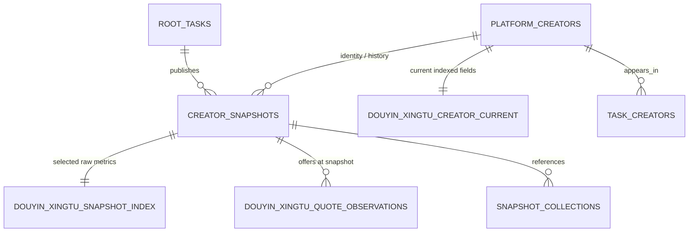

# 达人数据 JSONB 结构化与多平台兼容改造方案

状态：设计稿（DATA-01；未实施）  
审计基准：2026-10-13 的 `xingtu_development/public` 只读查询、迁移 001—009、已验证平台契约与现有持久化代码。

## 1. 结论

推荐采用**平台隔离的轻量混合存储**：继续以 `creator_snapshots.payload` 保存完整、不可变的每次采集事实，以 `platform_creators.projection` 保存现有“最新成功字段”投影；只增加三个**巨量星图专属**的查询表，服务高频列表、筛选、报价与趋势。不建立自然人主档、不自动跨平台合并、不引入通用 EAV 指标中心，也不把所有 JSON 拆列。

用户已确认的业务边界：

- 同一自然人即使同时出现在巨量星图和磁力聚星，一期也视为两个独立的平台账号；不做技术推断或自动合并。
- 报价按平台合作形式分别展示和筛选；没有“通用报价”。
- CPM、CPE、互动率等保持平台原始口径、单位、周期和字段名；不做跨平台换算、评分或排序比较。

## 2. 已核验现状与数据链路

### 2.1 实际数据库

- PostgreSQL 18.3，`xingtu_development/public`，迁移 1—9 已应用。
- 当前审计到 11 位巨量星图平台达人、39 份 `creator_snapshots`（2026-10-07 至 2026-10-12）。同一任务内已有 13 次快照修订，证明追加快照不是理论设计。
- `platform_creators` 以 `UNIQUE(platform, platform_creator_id)` 去重，已能承载多个平台的账号 ID，不会发生平台间 ID 冲突。
- `creator_snapshots` 受触发器禁止更新/删除；`featured_collections`、`featured_cards` 也追加式保存。`task_creators.latest_snapshot_id` 是**任务内**最近快照，不能当作达人全局当前值。

用户提到的列名需要校正：`projection` 位于 `platform_creators`，不是 `creator_snapshots`；后者的 JSONB 列为 `payload`。二者都重要，但语义不同：

| 载体 | 实际内容 | 当前样本 | 用途 |
|---|---|---:|---|
| `platform_creators.projection` | 扁平的 `module.field → FieldObservation`；只在字段 `COLLECTED` 且 `observed_at` 更新时覆盖 | 每达人 72—80 个当前成功字段路径 | 当前值、失败不覆盖旧值 |
| `creator_snapshots.payload` | 8 个模块、字段状态、来源、周期、完整度、失败原因与精选集合引用 | 39 个不可变版本 | 历史、任务结果、证据解释与恢复 |

`basic.industry_labels_raw` 在样本中为 `NO_DATA`，故未进入当前 `projection`；这正是两层语义不能混淆的例子。

### 2.2 真实写入与读取路径

```text
平台 Adapter / FieldObservation
        │
        ▼
Repository.persist_creators()  (同一数据库事务)
  ├─ platform_creators: 按 (platform, platform_creator_id) 取/建身份
  ├─ projection: 只接受较新的 COLLECTED 字段
  ├─ creator_snapshots.payload: 插入不可变整份资料
  ├─ task_creators.latest_snapshot_id: 仅更新本任务结果指针
  └─ featured_* / snapshot_collections: 追加作品观察
        │
        ▼
ProductQueries: 任务内按 latest_snapshot_id 返回 payload
```

事实依据：[repository.py](../backend/src/xingtu/repository.py) 的 `persist_creators()`；[product_queries.py](../backend/src/xingtu/product_queries.py) 的 `list_creators()` / `get_creator()`；前端当前通过递归读取 `payload` 显示昵称和粉丝数。现有 API 因此适合“任务结果回放”，不适合全局、跨任务的结构化达人检索。

### 2.3 当前问题

1. 当前高频字段嵌在 `projection`/`payload`，列表筛选、数值排序与统计要反复解析 JSONB；前端甚至按候选键递归猜测显示字段。
2. `projection` 已很好地保护旧成功值，却没有可直接索引的业务列；`payload` 完整但不可变、按任务保存，不能以“最后抵达”替代最新观测。
3. 合作报价是真实的一对多数组；把它压成一个“最低价”会丢掉合作形式、原价和状态。
4. CPM/CPE 叶子实际为无单位的数字字符串；互动/完播值包含 `value` 与 `overtake`。未经口径确认不能把它们标为元、百分比或跨平台统一数字。

完整字段审计见[达人数据字段字典](达人数据字段字典.md)。

## 3. 三种方案比较

| 方案 | 做法 | 优点 | 缺点 | 结论 |
|---|---|---|---|---|
| A 最小改造 | 仅给 `platform_creators` 加少数列，其他保留 JSONB | 改动最少 | 报价/历史趋势仍依赖 JSON；字段来源与部分成功处理易丢失 | 不足以支撑报价和可靠趋势 |
| B 平台隔离的轻量混合存储 | 保留现有 JSONB；新增星图当前索引、快照索引、报价观察三表 | 高频查询可索引；历史与失败语义完整；第二平台可低成本平行接入 | 需要 Mapper、回填和少量新 API | **推荐** |
| C 完整规范化 | 人物、平台账号、指标、标签、画像、作品、报价等全面拆表 | 理论查询最细 | 迁移/采集耦合大，须维护大量口径与关联，明显超出一期 | 过度设计 |

## 4. 推荐目标模型

### 4.1 ER 图



`platform_creators`、`creator_snapshots`、`task_creators`、精选作品表均继续复用；新增表均以 `douyin_xingtu_` 前缀隔离平台语义。

### 4.2 新增表

#### `douyin_xingtu_creator_current`

每平台账号一行的当前检索视图，不替代 `projection`。所有值从后者或本次成功 `FieldObservation` 派生；`field_sources` 记录字段级 `observed_at`、来源快照和状态，避免一行 `updated_at` 冒充所有字段同一时点。

| 字段 | 类型 | 规则 |
|---|---|---|
| `creator_id` | `uuid PK FK platform_creators` | 仅接受 `platform='douyin_xingtu'` 的应用层校验 |
| `display_name`, `avatar_uri`, `city`, `province`, `mcn_name`, `creator_type_label`, `introduction` | `text NULL` | 仅字段成功且更晚时更新 |
| `followers_count`, `monthly_deep_users_count`, `monthly_connected_users_count`, `monthly_follower_growth_rate_raw` | `numeric NULL` | 不重算、不把缺失写 0 |
| `interaction_rate_value_raw`, `completion_rate_value_raw` | `numeric NULL` | 原始叶子值；比例尺度未命名 |
| `expected_cpm_21_60_raw`, `expected_cpm_60_raw`, `expected_cpe_21_60_raw`, `expected_cpe_60_raw` | `numeric NULL` | 仅解析已验证的纯数字字符串；不赋币种/单位 |
| `industry_labels`, `content_theme_labels` | `jsonb NOT NULL DEFAULT '[]'` | 原始标签数组；不建通用标签主表 |
| `field_sources` | `jsonb NOT NULL` | 每个已物化字段的观测时间、快照 ID、状态与契约版本 |
| `refreshed_at` | `timestamptz NOT NULL` | 本行物化时间，不代表全部字段观测时间 |

索引：`followers_count DESC`、`creator_type_label`、四个 CPM/CPE 原始数值、`GIN(industry_labels jsonb_path_ops)`、`GIN(content_theme_labels jsonb_path_ops)`。`NULL` 表示未成功采到，不能用 `0` 代替。

#### `douyin_xingtu_creator_snapshot_index`

每个 `creator_snapshots.snapshot_id` 正好一行，供趋势和按时间的筛选；与不可变快照同样只插入不更新。

| 字段 | 类型 | 规则 |
|---|---|---|
| `snapshot_id` | `uuid PK FK creator_snapshots` | 幂等回填主键 |
| `creator_id`, `captured_at` | `uuid`、`timestamptz` | 身份与本系统快照写入时间 |
| 上述数值字段 | 与 current 表同型、全部可空 | 同名平台原始指标在该次快照中的成功值 |
| `metric_status`, `metric_sources` | `jsonb NOT NULL` | 保留 `COLLECTED`/缺失/失败及字段观察时间、周期、来源 |

索引：`(creator_id, captured_at DESC)`，以及按实际产品筛选需求追加的原始数值组合索引。该表不储存完整 payload，完整资料仍只在 `creator_snapshots.payload`。

#### `douyin_xingtu_creator_quote_observations`

合作报价是唯一确认需要拆出的业务数组：一个快照有零到多行，既能按合作形式查询，又不丢历史。

| 字段 | 类型 | 规则 |
|---|---|---|
| `snapshot_id`, `offer_position` | `uuid FK`、`smallint`，联合主键 | 保持原数组顺序、幂等 |
| `creator_id`, `observed_at` | `uuid FK`、`timestamptz` | 支持按达人/时间检索 |
| `offer_field_raw` | `text` | 平台合作形式原值（来自数组 `field`），不强行映射统一枚举 |
| `price_amount_raw`, `origin_price_amount_raw` | `numeric NULL` | 平台原始数值；没有币种列或换算 |
| `settlement_type_raw`, `task_category_raw`, `video_type_raw` | `text NULL` | 将平台数值编码按原文保存 |
| `offer_raw` | `jsonb NOT NULL` | 保存完整元素、未知字段与活动信息 |

索引：`(creator_id, offer_field_raw, observed_at DESC)` 和 `(offer_field_raw, price_amount_raw)`。当前报价通过“同一达人/合作形式最新 `COLLECTED` 观察”查询；较新的失败或未采集快照不会清空旧成功报价。

### 4.3 JSONB 策略

- 保留 `creator_snapshots.payload`、`platform_creators.projection`、`featured_* .payload` 原样；它们是可解释性、字段状态、来源、周期、失败原因与未知平台字段的权威记录。
- 只物化明确进入列表/筛选/趋势的字段。`fans` 趋势、画像、创作作品、转化区间、履约分布和精选作品继续 JSONB/既有专表，避免无业务查询时拆成十余张表。
- 新表绝不反向重建原始 JSON；回填和运行时写入都从 `FieldObservation`/快照派生。物化失败时整笔事务回滚，不能出现“当前索引已更新但快照未发布”。

### 4.4 多平台策略

`platform_creators` 是平台账号边界。新增磁力聚星时：

1. 新增其 Adapter、契约、`magnetic_*`（或正式平台代号）专属 current/snapshot-index/报价表及 API DTO；不修改巨量星图列的含义。
2. 其 `platform_creator_id` 继续由 `(platform, platform_creator_id)` 唯一约束保护。
3. 只有产品后续明确引入“人工确认同一自然人”的工作流，才新增可选的 `creator_entities` + 人工链接表；不得用昵称、头像、报价或任意平台 ID 自动匹配。

## 5. 历史、查询与 Agent

### 5.1 快照规则

- 每次发布都插入完整 `creator_snapshots`，无论是否有字段缺口；快照的 `created_at` 是本系统采集/发布时间，字段 `observed_at` 与平台 `period_label` 分别保存，三者不混用。
- 同日多次采集也保留多份快照；不按日期去重。快照内 `draft_revision`、任务 ID、租约/尝试保护既有乱序写入问题。
- 当前层只对 `COLLECTED` 且字段观测更新的值上移；`FAILED`、`NOT_ATTEMPTED`、`NO_DATA`、`NO_PERMISSION` 不覆盖已有成功值，也不伪造零值。

示例：查询某巨量星图达人的粉丝变化只读 `douyin_xingtu_creator_snapshot_index`：

```sql
SELECT captured_at, followers_count, metric_status -> 'followers' AS field_state
FROM douyin_xingtu_creator_snapshot_index
WHERE creator_id = :creator_id
ORDER BY captured_at;
```

### 5.2 新 API 与 Agent 最小读取

保留现有 `/api/tasks/{root_task_id}/creators...`：它必须继续返回任务绑定的不可变结果。另加平台隔离 API，例如：

- `GET /api/creators?platform=douyin_xingtu&industry=...&offer_field=...`：仅查 current 表与当前报价。
- `GET /api/creators/{creator_id}/history?platform=douyin_xingtu&metrics=followers,...`：仅读快照索引；返回字段状态、观测时间与平台原始口径。
- `GET /api/creators/{creator_id}/quotes?platform=douyin_xingtu`：按合作形式返回当前及历史报价。

未来 Agent 使用同一受认证 API/查询服务按字段白名单取数，例如昵称、粉丝、行业标签、报价项、互动/完播原值与趋势；不发送完整 `payload`，更不发送证据、会话或内部来源信息。

## 6. 增量迁移与实施顺序

### 阶段 1：契约映射与迁移

建立 `douyin_xingtu` Mapper，明确 81 个字段中哪些进入 C/H/Q；新增三表、约束、索引与追加式保护。Mapper 遇到未知结构、非纯数字 CPM/CPE 或未登记口径时拒绝物化该字段，但仍正常保存原快照。

验收：迁移可前进；旧 API、旧快照和任务执行不变；`NULL`/状态不误写为 0。

### 阶段 2：发布路径与查询 API

在 `Repository.persist_creators()` 的既有事务、快照插入之后调用 Mapper：写快照索引与报价观察，再依据字段级来源更新 current 表。新增平台隔离查询服务/API，前端仅在产品明确授权的全局达人库页面消费；不改任务详情页的历史快照语义。

验收：同一平台重复采集只有一个身份、多个历史索引；失败字段保留 current 旧值；乱序旧尝试不能覆盖更新观察。

### 阶段 3：历史回填、对账与灰度

对全部现有快照按 `snapshot_id` 分批、可重入回填 H/Q；再由既有 `projection` 回填 C，字段无法反推来源快照时在 `field_sources` 标为 `backfill_projection` 而非伪造关联。对账 81 字段状态、11 个身份、39 个快照与报价数组长度；先以只读 API 比对，再切换新列表查询。

验收：回填重复运行无重复行；快照计数、选定字段原始值/状态/观测时间一致；性能计划使用新索引。

### 阶段 4：回归与上线准备

覆盖新 Mapper 的单位/格式拒绝、报价多项/空项、部分模块、同日多快照、任务乱序完成、历史不可变、跨平台隔离、权限及 Agent 字段白名单。迁移采取只新增表/列/索引，不删除 JSONB、不重写已发布快照。

回滚：停止新 API/Mapper 写入并回退应用版本；新增表保留供审计。只有另行授权的数据治理任务才能删除新表或历史数据。

## 7. 待确认事项

以下事项不阻塞本方案，但阻塞相应字段成为“有单位的业务指标”：CPM/CPE 的币种、缩放与时长口径；互动率/完播率 `value` 的比例尺度；报价 `settlement_type`、`task_category`、`video_type` 枚举解释；连接用户漏斗阶段编码。实施前须以平台 UI/接口证据登记，不能由数值形态推断。
